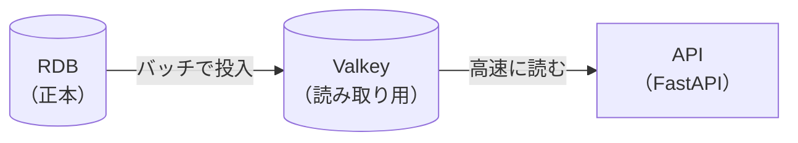

# 00. はじめに

## 要点

- この資料は、Valkey（Amazon ElastiCache for Valkey）を使って、設計・実装・運用を行うチームのためのドキュメントです。
- 00〜19 章と付録で構成しています。全体像だけをつかみたい人は、01 章を読んでください。
- 例は、チームと同じ技術スタック（FastAPI、redis-py、ElastiCache、AWS CDK、CloudWatch）で書いています。
- 調査の時点（2026 年 11 月）の情報です。確かめきれなかった点は、本文で「確かめる」と明記しています。

## この資料の目的

この資料は、Redis / Valkey を使ったことがないメンバーが、Valkey を前提とした**設計・実装・運用を自分で行えるようになる**ことを目的としています。

- Valkey の一般的な機能を網羅するリファレンスではありません。想定する使い方（後述）で使う部分を厚く、使わない部分は薄く書いています。
- チームのシステムの設計書でもありません。設計の判断に必要な知識と選択肢を説明しますが、何を選ぶかは決めていません。

## 想定する使い方

この資料は、次のような使い方を想定しています。

- 正本のデータは RDB にあり、Valkey のデータはバッチで作り直せる
- Valkey は、高速な応答が必要な API のための、読み取り用のデータストアとして使う（キャッシュではない）

## 読み方

### 立場ごとの読み方

| 立場 | 読む範囲 | 時間の目安 |
|---|---|---|
| Valkey の全体像をつかみたい人 | [01 章](01-what-is-valkey.md) | 30 分程度 |
| 設計・実装・レビュー・運用を担当する人 | 全章 | — |

### 構成

| 部 | 章 | 内容 |
|---|---|---|
| 第1部 基礎 | 00〜07 章 | Valkey とは何か、データをどう持つか |
| 第2部 アプリ開発 | 08〜10 章 | FastAPI からどう使うか、データをどう入れて入れ替えるか、どうテストするか |
| 第3部 インフラ・運用 | 11〜18 章 | ElastiCache をどう構成し、どう監視・運用するか |
| 第4部 横断 | 19 章 | アンチパターンと障害パターンの一覧 |
| 付録 | A〜D | 扱わない機能、コマンド早見表、チェックリスト、用語集 |

最初は 01 章から順に読むことをおすすめします。各章は単独でも読めるように書いていますが、前提となる章を冒頭に示しています。
まず [01 章の「RDB の感覚が通用しない点」](01-what-is-valkey.md) を読んでおくと、ほかの章の注意点の理由が分かりやすくなります。

### 辞書として引くとき

| 知りたいこと | 入口 |
|---|---|
| 起きている症状や、レビューで確かめるべき落とし穴 | [19 章](19-antipatterns.md) |
| あるコマンドの用途と注意点 | [付録 B](appendix-b-commands.md) |
| 設計レビュー・リリース前・運用中に確かめること | [付録 C](appendix-c-checklists.md) |
| 用語の意味 | [付録 D](appendix-d-glossary.md) |
| 障害の調べ方 | [17 章](17-troubleshooting.md) |
| クラスターに関わる注意点 | [13 章のチェックリスト](13-replication-and-cluster.md) |

## 前提とする知識

次の知識は、本文では説明しません。

- Python の基礎
- RDB と SQL の基礎（本文では、RDB と比べながら説明します）
- ターミナルの操作
- ネットワークとサーバーの基礎
- TLS などのセキュリティの一般知識
- AWS（VPC、セキュリティグループ、IAM など）と AWS CDK の基本

## 対象のバージョンと技術スタック

| 項目 | 対象 |
|---|---|
| Valkey | **9.1**（ElastiCache で使える最新のバージョン） |
| 本番環境 | Amazon ElastiCache for Valkey（Serverless とノードベースの両方を扱う） |
| ローカル環境 | Docker Compose |
| アプリ | Python / FastAPI（非同期） |
| クライアント | redis-py 8.x（`redis.asyncio`） |
| IaC | AWS CDK（Python、L1 コンストラクト） |
| 監視 | Amazon CloudWatch |

ElastiCache、redis-py、valkey-search などは更新が速いため、情報は**調査の時点（2026 年 11 月）**のものです。料金は、調査の時点の us-east-1 の参考値です。

## 例の題材

例は、全章を通して、**架空の EC サイトの「商品カタログ API」**を使います。

| 読み取りパターン | Valkey での持ち方 |
|---|---|
| ID で商品詳細を取得する | Hash（03 章） |
| カテゴリ別の商品一覧を価格順で並べ、ページングする | Sorted Set（04 章） |
| タグで絞り込む | Set（04 章） |
| 全件の入れ替え | バージョン付きのキーとポインタ（09 章） |

## 表記

### 囲み

| 囲み | 意味 |
|---|---|
| `> 前提: …` | その章を読む前に読んでおくとよい章 |
| `> **RDB で言うと**` | RDB の概念に置き換えた説明 |
| `> **注意: …**` | 設計・実装・運用で気をつける点。「何が起きるか / なぜ起きるか / どう防ぐか・どう気づくか」の形で書く（短いものは1〜2文） |

### 用語

- 一般的な技術用語はカタカナで書きます（エビクション、レプリカ、シャードなど）。
- データ型の名前（String、Hash など）とコマンド名（`SET` など）は、英語のまま書きます。
- 詳しくは [付録 D](appendix-d-glossary.md) を見てください。

### 確かめきれなかった点

ドキュメントだけでは確かめきれなかった点（実際の環境での動作など）は、本文で「確かめる」「検証環境で測る」と明記しています。導入の前に、検証環境で確かめてください。

## まとめ

- この資料は、Valkey を前提とした設計・実装・運用を自分で行えるようになるためのものです。
- 時間のない人は 01 章を、担当者は全章を読みます。辞書として引くときは、19 章と付録を入口にします。
- 対象は Valkey 9.1 と ElastiCache で、情報は 2026 年 11 月の時点のものです。
