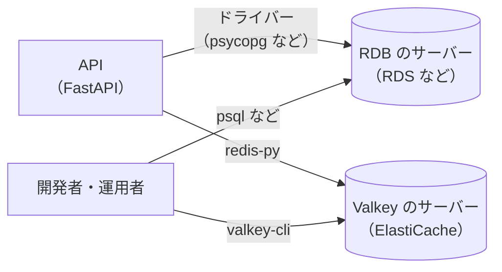
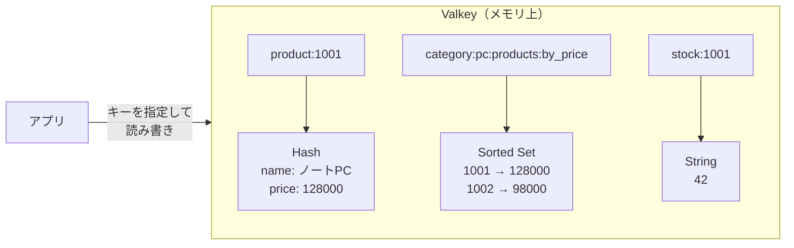
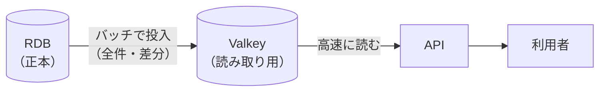
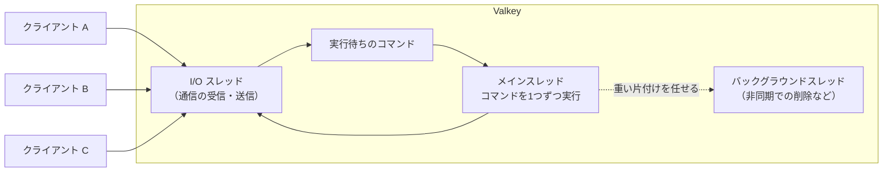
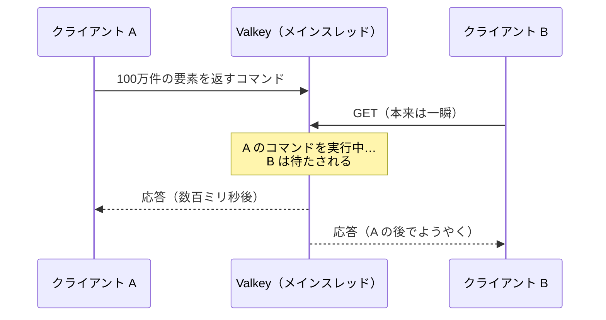

# 01. Valkey とは

## 要点

- データベースは RDB だけではありません。Valkey は RDB とは別の種類の、**キーバリューストア**（key-value store）と呼ばれるデータベースです。
- RDB と同じく、**別のサーバーで動き**、アプリはライブラリ（redis-py）で、人はコマンドラインツール（valkey-cli）で接続します。
- 送るのは SQL ではなく**コマンド**ですが、DB の言葉で頼みたいことを送る点は RDB と同じです。
- 違いの根っこは、データを**キーと値の組**で持ち、**キーを指定しないとデータにたどり着けない**ことです。条件で探すことも JOIN もできず、キー以外で探したいなら、そのための構造（インデックスに相当するもの）をアプリが作ります。そのかわり、データはメモリ上にあり、キーを指定した読み書きはミリ秒未満で終わります。
- RDB のような柔軟な検索や、厳密な耐久性はありません。「**どう読むかが決まっているデータを、とにかく速く返す**」ための道具です。
- 型の制約、JOIN、読み取りの一貫性、コミット後の耐久性など、**RDB では当たり前のことの多くが Valkey にはありません**（「RDB の感覚が通用しない点」の節）。
- 正本を RDB に置き、そこから作り直せるデータを Valkey に載せる構成は、Valkey の強みを活かし、弱みを補える使い方です。
- コマンドは**1本のスレッドで1つずつ順番に**実行されます。そのため、1つの重いコマンドがほかのすべてのリクエストを待たせます。後の章の注意点の多くは、この性質から来ています。

## データベースは RDB だけではない

「データベース」と聞くと、テーブルに行を入れて SQL で問い合わせる RDB を思い浮かべるかもしれません。
しかし、データベースには RDB 以外にもいくつかの種類があります。RDB 以外のデータベースは、まとめて **NoSQL** と呼ばれます。

| 種類 | データの形 | 例 |
|---|---|---|
| RDB | テーブルと行 | PostgreSQL、MySQL |
| キーバリューストア | キーと値の組 | **Valkey**、Redis |
| ドキュメントデータベース | JSON のような文書 | MongoDB |

NoSQL は「SQL を使わないデータベース」くらいの意味の総称で、種類ごとに得意なことが違います。
RDB を置き換えるものではありません。RDB が苦手なことを補うために、RDB と組み合わせて使うのが一般的です。この資料でも、RDB と Valkey を組み合わせて使います。

## RDB と同じところ: 別のサーバーで動き、ネットワーク越しにつなぐ

Valkey の中身は RDB とかなり違いますが、「どこで動いて、どうつなぐか」は RDB とほぼ同じです。



| 観点 | RDB（PostgreSQL の場合） | Valkey |
|---|---|---|
| どこで動くか | アプリとは別のサーバー（AWS では RDS など） | アプリとは別のサーバー（AWS では ElastiCache） |
| アプリからの使い方 | ドライバー（psycopg など）で、ネットワーク越しに接続する | クライアントライブラリ（redis-py）で、ネットワーク越しに接続する（08 章） |
| 人が直接さわる道具 | psql | valkey-cli（02 章） |
| 接続の守り方 | ユーザーとパスワード、TLS | ユーザーとパスワード、TLS（15 章） |
| データの共有 | 複数のアプリのサーバーから、同じデータを使う | 複数のアプリのサーバーから、同じデータを使う |

この章で「**インメモリ**」（in-memory）と言うのは、**Valkey のサーバーが**データを自分のメモリに置く、という意味です。
アプリのプロセスの中の変数（Python の `dict` など）にデータを持つのとは違います。そのため、次のようになります。

- 複数の API のサーバーから、同じデータを読める
- アプリを再起動しても、Valkey のデータは消えない
- 1回の読み書きごとに、ネットワークの往復が1回かかる。数を減らすために、複数のコマンドをまとめて送る仕組みがある（06 章）

ElastiCache での具体的な構成（VPC の中にどう置くか、ノードの数など）は 14 章で説明します。

## RDB と同じところ: 頼みたいことを、DB の言葉で送る

RDB には SQL を送ります。Valkey は SQL を理解しないので、かわりに `GET`（値を読む）や `HSET`（Hash に書く）のような**コマンド**（command）を送ります。
文法は違いますが、「頼みたいことを、その DB が決めた言葉で書いて送る」という点は同じです。

```sql
-- psql（RDB）: SQL を打つ
SELECT name, price FROM products WHERE id = 1001;
```

```console
# valkey-cli（Valkey）: コマンドを打つ
> HGETALL product:1001
1) "name"
2) "ノートPC"
3) "price"
4) "128000"
```

アプリから使うときも同じです。

```python
# RDB（psycopg）
cur.execute("SELECT name, price FROM products WHERE id = %s", (1001,))
row = cur.fetchone()

# Valkey（redis-py）
product = await r.hgetall("product:1001")
# → {"name": "ノートPC", "price": "128000"}
```

redis-py では、コマンドごとにメソッド（`get()`、`hset()`、`hgetall()` など。コマンド名を小文字にしたもの）が用意されていて、それを呼ぶとコマンドが送られます。RDB でも、ORM やクエリビルダーを使えば SQL を書かずにメソッドで問い合わせられるのと同じです。逆に redis-py でも、`execute_command("HGETALL", "product:1001")` のように、コマンドを直接書いて送れます。
（`await` が付いているのは、この資料では非同期版のクライアントを使うためです。08 章）

## RDB と違うところ: データはキーと値の組で持つ

Python の `dict` を思い浮かべてください。

```python
catalog = {
    "product:1001": {"name": "ノートPC", "price": "128000"},
    "stock:1001": "42",
}
catalog["product:1001"]   # キーを指定して、値を取り出す
```

Valkey は、この `dict` が別のサーバーの上にあって、ネットワーク越しに複数のアプリから使えるもの、と考えると近いです。
`dict` と同じく、キーが分かっていれば一瞬で値を取り出せます。一方で、「価格が 10 万円以上の商品」のように、値の中身を見て探すのは得意ではありません。

もう少し正確に言うと、Valkey は**キー**（名前）と**値**（データ）の組を保存するデータベースです。データはディスクではなくメモリ上に置かれます。



特徴は3つあります。

| 特徴 | 内容 |
|---|---|
| メモリ上にある | ディスクへのアクセスがないため、1回の操作がとても速い。同じネットワーク内なら、1ミリ秒未満で応答することが多い |
| キーで引く | 基本の操作は「キーを指定して値を取る」こと。SQL のように条件を書いて探すことはできない |
| 値に「型」がある | 値は単なる文字列だけでなく、Hash（項目と値の組）、Sorted Set（スコア付きの集合）など、いくつかのデータ型を持てる。型ごとに専用の操作がある（03 章・04 章） |

> **RDB で言うと**
>
> 主キーだけで引けるテーブルが、たくさん並んでいるイメージです。JOIN や WHERE 句による絞り込みはありません。そのかわり、主キーで引く速さはずっと上です。

## RDB と違うところ: キーを指定しないと、データにたどり着けない

RDB との違いの根っこは、ここにあります。
Valkey でデータを読むには、**まずキーを指定する**必要があります。キーを指定したあとなら、値の中で範囲を指定して取り出すこと（Sorted Set の点数の範囲など）はできますが、入口は必ずキーです。

「PC カテゴリの商品を、価格の安い順に 20 件、名前と価格つきで」という読み方で比べます。

```sql
-- RDB: 条件を書けば、RDB が探してくれる
SELECT id, name, price FROM products
WHERE category = 'pc' ORDER BY price LIMIT 20;
```

```console
# Valkey: 「PC カテゴリの価格順の一覧」というキーを、あらかじめ自分で作っておく
> ZRANGE category:pc:products:by_price 0 19
1) "1002"
2) "1001"
...
# 取れた ID からキーを組み立てて、商品詳細を1件ずつ読む
> HGETALL product:1002
> HGETALL product:1001
...
```

`category:pc:products:by_price` は、Valkey が用意してくれるものではありません。商品のデータとは別に、アプリが作って入れておいた Sorted Set です。
RDB で言えば、**インデックスを自分で作って、自分で更新している**のと同じです。この資料では、こうした構造を**二次インデックス**（secondary index）と呼びます（04 章・05 章）。

この性質から、次のことが出てきます。

| 結果 | 内容 | 詳しく |
|---|---|---|
| 条件で探せない | WHERE 句のように「値がこうなっているもの」を探す手段がない | 05 章 |
| 結合できない | JOIN がない。関連するデータは、キーを1つずつたどって読む | 05 章 |
| 探し方をアプリが用意する | キー以外の条件で探したいなら、そのための構造（上の Sorted Set）を別のキーに作り、元のデータを変えるたびに一緒に更新する | 04 章・05 章 |
| 読み方を先に決める | 探すための構造がなければ読めない。RDB のように、あとから SQL を書けば読める、とはいかない | 05 章 |
| 調べにくい | 障害の調査でも、キー名が分からないとデータにたどり着けない | 02 章・17 章 |

例外として、valkey-search という機能を使うと、Valkey が自動で更新するインデックスを作り、値の中身を条件にして探せます。ただし、メモリを多く使うなどの制約があり、条件の組み合わせが多いときの選択肢という位置づけです（07 章）。

## なぜ RDB のほかに Valkey を使うのか

RDB だけでも、データの保存も読み出しもできます。それでも Valkey を組み合わせるのは、**読み取りが非常に多く、応答を速く返したい**場面があるからです。

- API へのリクエストのたびに RDB へ SQL を送ると、リクエストが増えるにつれて RDB の負荷が上がり、応答も遅くなる
- 同じ読み方を何度も繰り返すなら、その読み方にちょうど合う形でメモリ上に持っておけば、毎回すぐに返せる

一般には、次のような使い方がよく知られています。

| 使い方 | 内容 |
|---|---|
| キャッシュ | RDB から読んだ結果を一時的に置いておき、2回目からはそこから返す |
| 読み取り用のデータストア | RDB のデータを、読み方に合わせた形で Valkey に入れておき、API は Valkey だけを読む |
| ランキング・カウンター | 点数順の並べ替えや、回数の増減を、その場で速く行う |
| セッション | ログイン中のユーザーの情報を、複数のサーバーで共有する |

この資料が想定しているのは、2つめの「**読み取り用のデータストア**」です（00 章）。正本は RDB に置き、バッチで Valkey に入れます。
この使い方が成り立つ理由は、この章の後半（「RDB を正本にして Valkey で読む」構成が成り立つ理由）で説明します。

## RDB との違いの一覧

| 観点 | RDB | Valkey |
|---|---|---|
| データの置き場所 | ディスク（よく使う部分はメモリにキャッシュされる） | メモリ |
| 1回の読み取りの速さ | 数ミリ秒〜（クエリによる） | 1ミリ秒未満が多い |
| 検索 | SQL で自由に書ける | キーで引くのが基本。それ以外の読み方は、自分でインデックスを作って用意する（05 章） |
| スキーマ | テーブルの定義がある | なし。キーの名前と値の形は、アプリ側の約束で決める |
| トランザクション | ロールバックできる ACID トランザクション | 複数のコマンドをまとめて実行する仕組みはあるが、ロールバックはない（06 章） |
| 耐久性 | コミットしたデータはディスクに残る | 設定しだい。何もしなければ、再起動でデータが消えることがある（12 章） |
| 容量 | ディスクの大きさまで | メモリの大きさまで。容量あたりの費用は高い |

設計にいちばん効く違いは、「**どう読むか**」を先に決めておく必要があることです。これは、前の節で見た「キーを指定しないと、データにたどり着けない」性質から来ています。
RDB はデータを入れたあとで、どんなクエリでも書けます。
Valkey では、読み方に合わせてデータの持ち方（キーの名前とデータ型）を設計します。設計にない読み方をしたくなったら、データの持ち方を足す必要があります。

## RDB の感覚が通用しない点

上の表の違いは、具体的な場面では次のような「感覚のずれ」として表れます。
RDB に慣れていると、無意識にこれらを前提にしてしまいます。設計・実装の前に確認してください。

| # | RDB での感覚 | Valkey の実際 | 詳しく |
|---|---|---|---|
| 1 | 列には型があり、制約（NOT NULL、UNIQUE、外部キー）で守られる | 型の強制も制約もない。Hash の値はすべて文字列として保存され、数値も文字列になる。おかしな値を書き込んでもエラーにならない | 03 章・05 章 |
| 2 | JOIN で関連データを結合でき、外部キーで参照の整合性が守られる | JOIN も参照の整合性もない。商品を消しても、カテゴリの一覧（Sorted Set）には商品 ID が残る。関連データの整合はアプリが守る | 05 章 |
| 3 | 1つのクエリの結果は、ある時点の一貫した状態になる | 複数のキーを読むと、更新の途中の状態が見えることがある（商品の詳細は新しいのに、一覧は古い、など）。**バッチで投入する構成では、特に考慮が必要** | 06 章・09 章 |
| 4 | コミットが成功すれば、データは失われない | 書き込みが成功しても、ディスクやレプリカにはまだ届いていない。フェイルオーバーで直前の書き込みが失われることがある。**正本を Valkey に置かない理由の1つ** | 12 章・13 章 |
| 5 | 中身は `SELECT ... WHERE` で自由に調べられる | 条件を指定して中身を調べる手段がほとんどない。障害時の調査でも、キー名が分からないとデータにたどり着けない | 02 章・17 章 |
| 6 | ディスクが残り少なくなっても、すぐには止まらない | メモリが上限に達すると、設定しだいで書き込みが失敗するか、データが自動で消される | 11 章 |
| 7 | 空のテーブルは残る。「空」と「存在しない」は区別できる | 要素が 0 個になったキーは自動で消える。「空」と「存在しない」は区別できない | 03 章・04 章 |
| 8 | ALTER TABLE で構造を変えられる | 構造を変える仕組みはない。データの形を変えるには、既存のキーを書き直す | 05 章・09 章 |
| 9 | データベースやスキーマで、データの置き場所と影響範囲を分けられる | キー名の `:` は階層ではなく、プレフィックスや DB 番号で負荷やメモリが分離されることもない | 02 章 |
| 10 | 値がないことを NULL で表せる | NULL という値はない。Hash のフィールドは「ある」か「ない」かのどちらかだけ。RDB で NULL になった列は、フィールドを消して表す必要がある（`HSET` だけでは古い値が残る） | 03 章 |

## 向く用途・向かない用途

| 向く用途 | 理由 |
|---|---|
| キーが決まっているデータを高速に返す（商品詳細、ユーザー情報など） | キーで引く操作がもっとも速い |
| 決まった順番の一覧を返す（価格順、人気順など） | Sorted Set で、並べ替え済みの状態を保てる |
| 頻繁に読まれるが、作り直せるデータ | 消えても困らないので、耐久性の弱さが問題になりにくい |
| カウンター・回数の制限 | 1つのコマンドで、値の増減を不可分に行える |

| 向かない用途 | 理由 |
|---|---|
| 正本のデータ（失うと復元できないもの） | 耐久性が RDB より弱い |
| 条件を自由に組み合わせる検索・集計 | SQL のような問い合わせができない。検索機能はあるが制約が多い（07 章） |
| メモリに収まらない大量のデータ | 容量はメモリで決まり、費用も高い |
| 複数のデータをまたいだ厳密な整合性 | ロールバックできるトランザクションがない |

### 「RDB を正本にして Valkey で読む」構成が成り立つ理由

この資料では、次のような構成を例として扱います。



この構成では、Valkey の弱みが問題になりにくくなります。

| Valkey の弱み | この構成で問題になりにくい理由 |
|---|---|
| 耐久性が弱い | データが消えても、RDB からバッチで作り直せる |
| 自由な検索ができない | API の読み方は決まっているので、それに合わせてデータを持てばよい |
| 厳密な整合性がない | 書き込むのはバッチだけなので、書き込みの競合が起きにくい |

ただし、「作り直せる」ことと「消えてもよい」ことは同じではありません。
作り直している間、API は遅くなるか、使えなくなります。どこまで永続化するかは、作り直しにかかる時間と相談して決めます（12 章）。

> **注意: 「作り直せるから、消えても問題ない」と考えてしまう**
>
> - **何が起きるか**: ノードの再起動や置き換えでデータが空になり、作り直しが終わるまで API が正しく応答できなくなる。
> - **なぜ起きるか**: データ量が増えるほど、全件の作り直しには時間がかかる。数十分〜数時間かかることもある。
> - **どう防ぐか**: 作り直しにかかる時間を測っておき、それに合わせてレプリカ・バックアップ・永続化の設定を決める（12 章・14 章）。

## Redis との関係

Valkey は、Redis から分かれて生まれたオープンソースのソフトウェアです。
2024 年に Redis のライセンスが変わったことをきっかけに、Linux Foundation のもとで開発が始まりました。

- コマンドと通信プロトコルは、Redis と互換性があります。Redis 向けのクライアントライブラリ（この資料で使う redis-py など）で、そのまま接続できます。
- 分かれたあとは、それぞれが独自の機能を追加しています。そのため、新しい機能やコマンドは両者で違うことがあります（08 章）。
- インターネット上の Redis の情報は、基本的な部分では Valkey にもあてはまります。ただし、新しいバージョンの機能については、Valkey で使えるかを確認してください。

この資料は、**Valkey 9.1** を対象にしています（ElastiCache で使える最新のバージョンです）。

## アーキテクチャ: コマンドは1本のスレッドで実行される

Valkey の性質を理解するうえで、もっとも大事なのがこの仕組みです。



| 役割 | 担当 | 内容 |
|---|---|---|
| 通信 | I/O スレッド（複数） | リクエストの受信と解析、応答の送信 |
| コマンドの実行 | **メインスレッド（1本）** | すべてのコマンドを1つずつ順番に実行する |
| 時間のかかる片付け | バックグラウンドスレッド | 大きなデータの非同期での削除など（09 章） |

通信の部分は複数のスレッドで並列に処理されます。一方、**データを読み書きするコマンドの実行は、1本のスレッドで1つずつ**行われます。
この仕組みから、次の2つの性質が生まれます。

**よい性質: 1つのコマンドは不可分に実行される**
コマンドの実行中に、ほかのコマンドが割り込むことはありません。
たとえば「在庫を1減らす」コマンドは、ロックを取らなくても、ほかのリクエストと競合しません。

**注意すべき性質: 重いコマンドが、全員を待たせる**
1つのコマンドが 100 ミリ秒かかれば、その間、ほかのすべてのリクエストは待たされます。
RDB では、重いクエリがあっても、ほかのクエリは並行して進みます。Valkey ではそうなりません。



> **RDB で言うと**
>
> データベース全体に1本だけ実行の窓口があり、すべてのクエリがその窓口に1列に並ぶイメージです。1件ずつの処理がとても速いので、普段は気になりません。しかし、窓口で時間がかかる人が1人いると、列全体が止まります。

この性質から、後の章では次のような注意点が出てきます。

| 注意点 | 説明する章 |
|---|---|
| 本番で全キーを列挙するコマンド（`KEYS`）を使わない | 02 章 |
| 要素の多いデータ（ビッグキー）を作らない、一度に全部取らない | 03 章・11 章 |
| 大量のデータを消すときは、非同期で少しずつ消す | 09 章 |
| 時間のかかるスクリプトを書かない | 06 章 |
| CPU の使用率は、メインスレッドの使用率（EngineCPUUtilization）で見る | 16 章 |

また、コマンドを実行するのが1本のスレッドなので、1台のサーバーで処理できる量には上限があります。それを超える場合は、データを複数のサーバーに分けて（シャーディング）処理量を増やします（13 章）。

> **注意: 「インメモリだから、何でも速い」と考えてしまう**
>
> - **何が起きるか**: 要素数の多いデータを一度に取得するコマンドで応答が遅くなり、ほかのリクエストも巻き込んで API 全体が遅くなる。
> - **なぜ起きるか**: 速いのは「1回の操作が小さい」場合だけ。扱う要素の数に比例して時間がかかるコマンドは、メモリ上でも遅くなる。しかもその間、ほかのコマンドを止めてしまう。
> - **どう防ぐか・どう気づくか**: コマンドの計算量（02 章）を確認し、大きなデータは分けて取得する。遅いコマンドは監視で検出する（16 章・17 章）。

## まとめ

- データベースは RDB だけではありません。Valkey は、RDB 以外のデータベース（NoSQL）の1つで、キーと値の組を保存するキーバリューストアです。
- RDB と同じく別のサーバーで動き、アプリは redis-py で、人は valkey-cli で接続します。送るのは SQL ではなくコマンドですが、DB の言葉で頼みたいことを送る点は同じです。
- 違いの根っこは、キーを指定しないとデータにたどり着けないことです。条件で探すことも JOIN もできず、キー以外で探すための構造は、アプリが作って更新します。
- データはメモリ上にあり、キーで引く操作がとても速い一方で、自由な検索や厳密な耐久性はありません。
- 読み方を先に決めて、それに合わせてデータを持つのが基本です。
- 型の制約、JOIN、読み取りの一貫性、コミット後の耐久性など、RDB での当たり前は通用しません。設計の前に、感覚のずれを一覧で確認してください。
- 「RDB を正本にして、作り直せるデータを Valkey で読む」構成は、Valkey の弱みを補える使い方です。ただし、作り直す間の影響は考えておく必要があります。
- Redis と互換性があり、Redis 向けのクライアントやたいていの情報をそのまま使えます。新しい機能は両者で違うことがあります。
- コマンドは1本のスレッドで順番に実行されます。1つのコマンドは不可分に実行されますが、重いコマンドがあると全体が待たされます。
