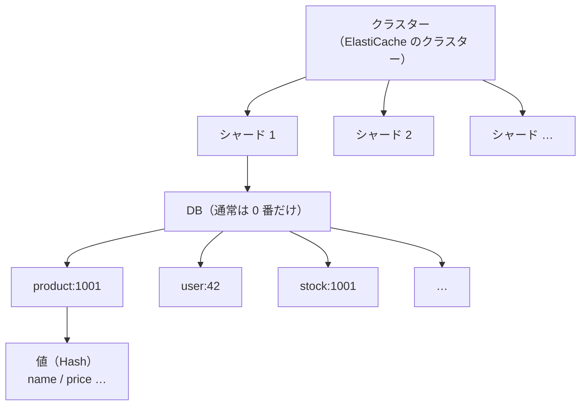
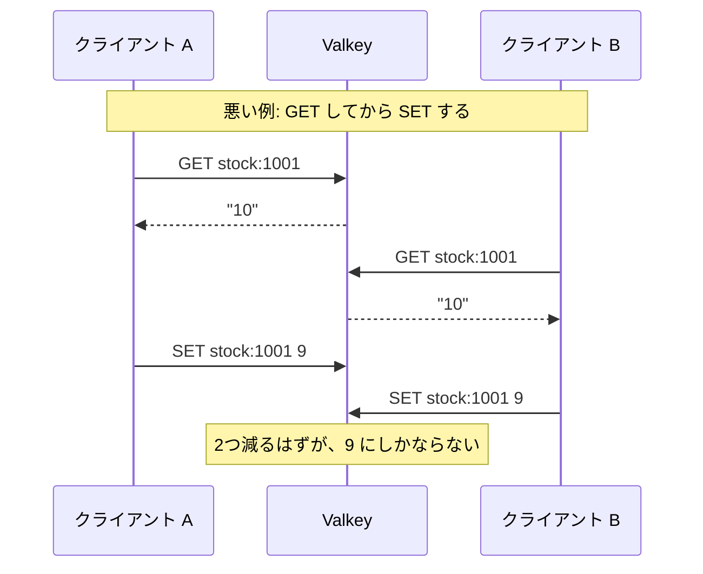
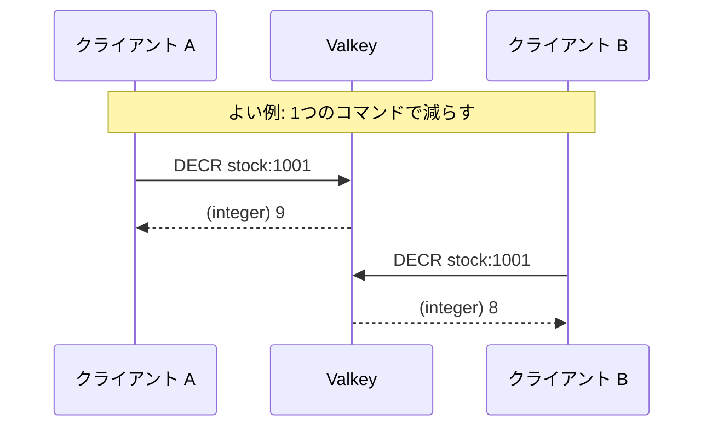

# 02. 基本操作とキー

> 前提: [01. Valkey とは](01-what-is-valkey.md)（特に「アーキテクチャ」の節）

## 要点

- Valkey には、RDB のようなスキーマやテーブルはありません。キーは**階層のない1つの空間に並び**、キー名の `:` は見た目上の区切りにすぎません。プレフィックスごとに分離されることもありません。
- 操作の確認や調査には、付属のコマンドラインツール **valkey-cli** を使います。
- キーの名前は `product:1001` のように、**コロン区切りで「種類:ID」の形**にそろえます。命名規則は最初にチームで決めて、文書にしておきます。
- コマンドには**計算量**があります。要素数 N に比例するコマンド（O(N)）は、N が大きいと全体を止めます。
- 本番で全キーを列挙する `KEYS` は使いません。代わりに、少しずつ取り出す `SCAN` を使います。
- 1つのコマンドは不可分に実行されます。ただし、**複数のコマンドの組み合わせは不可分ではありません。**

## valkey-cli

valkey-cli は、Valkey に接続してコマンドを打つためのツールです。動作の確認や、障害時の調査で使います。

```console
$ valkey-cli -h <ホスト名> -p 6379 --tls -c
```

| オプション | 意味 |
|---|---|
| `-h` / `-p` | 接続先のホスト名とポート |
| `--tls` | TLS で接続する（ElastiCache Serverless では必須。15 章） |
| `-c` | クラスターモードで接続する。キーが別のシャードにあるとき、自動でそちらにつなぎ直す（13 章） |
| `--user` / `--pass` | ユーザー名とパスワードで認証する（15 章） |

接続すると、コマンドを対話的に打てます。この資料のコマンド例は、次の形式で書きます。

```console
> SET stock:1001 42
OK
> GET stock:1001
"42"
> INCR stock:1001
(integer) 43
> TYPE stock:1001
string
```

`>` の行が入力したコマンドで、その下が応答です。

> **注意: 本番環境での valkey-cli の操作**
>
> 本番で valkey-cli を使うのは、調査のための読み取りに限ります。書き込みや削除、重いコマンドは、誤操作がそのまま障害になります。どのコマンドが重いかは、この章の「計算量」の節と 17 章を参照してください。

## データの階層

RDB には「データベース → スキーマ → テーブル → 行 → 列」という階層があります。Valkey の階層は、それよりずっと単純です。



| RDB | Valkey | 補足 |
|---|---|---|
| サーバー / クラスター | クラスター | ElastiCache のクラスター（14 章） |
| パーティション | シャード | キー名から計算した値で、**自動的に**振り分けられる。人が範囲を決めるものではない（13 章） |
| データベース | DB 番号 | 名前空間の区切りにすぎず、分離はされない（この章の「DB 番号」の節） |
| スキーマ / テーブル | **ない** | |
| 行（主キー） | キー | DB の中では、すべてのキーが**階層のない1つの空間に並ぶ** |
| 列 | Hash のフィールドなど | 値のデータ型による（03 章・04 章） |

> **注意: キー名の `:` は階層ではない**
>
> - **何が起きるか**: `product:` の下にキーが多すぎると考えて `product1:` と `product2:` に分けるなど、意味のない設計をしてしまう。
> - **なぜ起きるか**: `product:1001` はフォルダの中のファイルのように見える。しかし実際は、`product1001` と同じ「ただの1つの文字列」として扱われる。`:` は人が読みやすくするための慣習で、技術的な意味はない。
> - **どう考えるか**: 同じプレフィックスのキーがいくつあっても、それ自体は問題にならない。気にすべきなのは「1つのキーの大きさ」（03 章・11 章）と「全体のメモリ量」（11 章）。クラスターモードでは、同じプレフィックスのキーもキー名ごとに全シャードへ散らばるため、プレフィックスで分割する意味もない。

> **注意: プレフィックスでも DB でも、分離はされない**
>
> - **何が起きるか**: `product:` のデータの問題が、`user:` のデータを使う処理まで巻き込む。
> - **なぜ起きるか**: プレフィックスにも DB 番号にも、分離の仕組みはない。メモリも CPU も、コマンドを実行するスレッド（01 章）も共有している。そのため、`product:` の巨大なキーへの重いコマンドは `user:` への `GET` も待たせる。`product:` のデータでメモリがいっぱいになれば、`user:` も書き込めなくなる。
> - **どう防ぐか**: 互いに影響させたくない用途は、クラスター（ElastiCache のリソース）そのものを分ける（14 章）。

## キーと値

キーは、値を取り出すための名前です。

- キーには任意の文字列を使えます。大文字と小文字は区別されます。
- 1つのキーには、1つの値が対応します。値にはデータ型があり、型によって使えるコマンドが違います（03 章・04 章）。
- すでにあるキーに書き込むと、値は上書きされます。違う型のコマンドを使うとエラーになります。

```console
> HSET product:1001 name "ノートPC" price 128000
(integer) 2
> GET product:1001
(error) WRONGTYPE Operation against a key holding the wrong kind of value
```

`product:1001` は Hash 型なので、String 用のコマンド `GET` では読めません。

> **RDB で言うと**
>
> キーは「テーブル名と主キーをつなげた文字列」に近いものです。Valkey にはテーブルがないので、キーの名前で種類を区別します。

## キーの命名規則

Valkey にはスキーマがありません。キーの名前が、そのままデータの構造の説明になります。
命名規則がぶれると、後から「どんなキーがあるのか」が分からなくなり、調査や削除が難しくなります。

### 基本の形

```text
<種類>:<ID>[:<補足>]
```

例の題材（商品カタログ API）での例です。

| キー | 型 | 内容 |
|---|---|---|
| `product:1001` | Hash | 商品 1001 の詳細 |
| `stock:1001` | String | 商品 1001 の在庫数 |
| `category:pc:products:by_price` | Sorted Set | カテゴリ「pc」の商品を価格順に並べた一覧 |
| `tag:sale:products` | Set | タグ「sale」が付いた商品の ID の集合 |

### 決めておくこと

| 項目 | おすすめ | 理由 |
|---|---|---|
| 区切り文字 | `:`（コロン） | 慣習として広く使われている。GUI のツールでも、コロンで階層を表示するものが多い。ただし技術的な意味はない（「データの階層」の節） |
| 種類の名前 | 単数形・小文字・英語（`product`） | 表記の揺れ（`products` / `Product`）を防ぐ |
| 複数語 | `_` でつなぐ（`by_price`） | コロンと区別するため |
| 長さ | 意味が分かる範囲で短く | キーもメモリを使う。キーが数千万個あると、数文字の差でも合計は大きくなる |
| プレフィックス | 用途やシステムごとに付ける（例: `catalog:product:1001`） | 1つの Valkey を複数の用途で共有するときに、キーの範囲を区別できる |

命名規則は、一覧表としてリポジトリに置き、キーを増やすたびに更新します。

> **注意: 命名規則がぶれる**
>
> - **何が起きるか**: `product:1001`、`products:1001`、`Product_1001` が混在して、同じデータが二重に入ったり、削除の対象から漏れたりする。
> - **なぜ起きるか**: スキーマがないので、どんな名前で書き込んでもエラーにならない。
> - **どう防ぐか**: キーの名前を組み立てる処理を1か所（関数やクラス）にまとめ、アプリのコードで文字列を直接書かない。

クラスターモードでは、キーの名前の一部（`{...}` で囲んだ部分）が、どのシャードにデータを置くかを決めます。これを**ハッシュタグ**と呼びます。命名規則を決めるときには、13 章もあわせて参照してください。

### DB 番号

Valkey には、0 から始まる番号の付いた「DB」があり、キーの置き場所を分けられます（`SELECT` コマンドで切り替えます）。
ただし、複数の DB を使えるかどうかは、構成によって違います。

| 構成 | 複数の DB |
|---|---|
| ElastiCache ノードベース（クラスターモード無効） | 使える（既定で 16 個） |
| ElastiCache ノードベース（クラスターモード有効） | Valkey 9.0 以降で使える。DB の数（`cluster-databases`）は**クラスターを作るときにしか設定できない** |
| ElastiCache Serverless | Valkey 9.0 以降で使える（最大 1,024 個）。ただし、DB の間でキーを移す `MOVE`、DB を入れ替える `SWAPDB` は使えない |

複数の DB を使う場合は、次の点に注意が必要です。

| 注意点 | 内容 |
|---|---|
| DB どうしは分離されていない | メモリも CPU も共有する。ある DB の負荷が、ほかの DB にも影響する |
| 全消去の範囲 | Serverless では、`FLUSHDB`（今の DB の全消去）がクラスター全体のキーを消す |
| コネクションプール | `SELECT` で切り替えた接続がプールに戻ると、次にその接続を使う処理も、切り替えたあとの DB を向いたままになる |
| クライアントライブラリ | クラスターモードでは DB 0 しか使えないようにしているライブラリがある（08 章） |

構成を変えても同じように動くのは、キーのプレフィックスで用途を分ける方法です。特別な理由がなければ、**DB は 0 番だけを使い、用途の区別はキーのプレフィックスで行う**のが安全です。

## 有効期限（TTL）

キーには有効期限（TTL）を付けられます。期限が過ぎたキーは、自動で削除されます。

```console
> SET temp:report:20261123 "..." EX 3600
OK
> TTL temp:report:20261123
(integer) 3598
```

この例では、3600 秒後に削除されます。`TTL` コマンドで、残りの秒数を確認できます（期限がないキーは `-1` を返します）。

### 期限切れのキーが消える仕組み

期限が過ぎた瞬間に削除されるわけではありません。次の2つの方法を組み合わせて削除されます。

| 方法 | 内容 |
|---|---|
| アクセス時の削除 | 期限切れのキーにアクセスがあったときに削除し、「存在しない」として応答する |
| 定期的な削除 | バックグラウンドで定期的に一部のキーを調べ、期限切れのものを削除する |

そのため、アクセスされない期限切れのキーは、しばらくメモリに残ることがあります。

> **注意: 値を上書きすると、TTL が消える**
>
> - **何が起きるか**: 期限付きで作ったキーを `SET` で上書きすると、期限がなくなり、いつまでも残り続ける。
> - **なぜ起きるか**: `SET` は、オプションを指定しないと、既存の TTL を消してしまう。
> - **どう防ぐか**: 上書きでも期限を残したいときは、`SET` に `KEEPTTL` を付けるか、上書きのたびに期限を付け直す。

> **注意: 大量のキーが同時に期限切れになる**
>
> - **何が起きるか**: バッチで一斉に作ったキーが同じ時刻に期限切れになり、削除の処理と、元データの再読み込みが一時に集中する。
> - **なぜ起きるか**: 同じ TTL を付けると、期限が切れる時刻もそろってしまう。
> - **どう防ぐか**: TTL に数％程度のばらつきを加えて、期限が切れる時刻を分散させる。

## 計算量

Valkey の公式ドキュメントでは、コマンドごとに**計算量**が書かれています。
01 章で説明したとおり、コマンドは1本のスレッドで順番に実行されます。そのため、計算量の大きいコマンドは、ほかのすべてのリクエストを待たせます。

| 計算量 | 意味 | コマンドの例 |
|---|---|---|
| O(1) | データの量に関係なく、一定の時間で終わる | `GET`、`SET`、`HGET`、`INCR` |
| O(log N) | データが増えても、時間はゆっくりとしか増えない | `ZADD`（Sorted Set への追加） |
| O(N) | 要素数 N に比例して時間がかかる | `KEYS`、`HGETALL`、`SMEMBERS` |
| O(log N + M) | 位置を探す時間に、取得する件数 M の分が加わる | `ZRANGE`（Sorted Set の範囲取得） |

**N が何を指すか**を必ず確認してください。
たとえば `HGETALL` の N は「その Hash のフィールド数」です。フィールドが 10 個なら問題ありませんが、100 万個あると全体を止めます。

> **RDB で言うと**
>
> O(N) のコマンドは、インデックスを使わない全件スキャンに近いものです。RDB では、ほかのクエリと並行して動きます。Valkey では、終わるまでほかのすべてのリクエストが待たされます。

## KEYS と SCAN

キーを探すコマンドは2つあります。

| コマンド | 動き | 本番で使えるか |
|---|---|---|
| `KEYS <パターン>` | すべてのキーを一度に調べて返す。O(N)（N はキーの総数） | **使わない**。キーが多いと、数秒間すべてのリクエストを止める。ElastiCache Serverless ではそもそも使えない |
| `SCAN <カーソル>` | キーを少しずつ返す。何回かに分けて呼び出し、全体をたどる | 使える |

`SCAN` は、前回の応答で返ってきたカーソルを次の呼び出しに渡して、続きを取得します。カーソルが `0` に戻ったら終わりです。

```console
> SCAN 0 MATCH product:* COUNT 100
1) "1792"
2) 1) "product:1001"
   2) "product:1005"
> SCAN 1792 MATCH product:* COUNT 100
1) "0"
2) 1) "product:1002"
```

1 行目の `1792` が、次に渡すカーソルです。2 回目の応答のカーソルが `0` なので、ここで終わりです。

`SCAN` には、知っておくべき性質があります。

| 性質 | 影響 |
|---|---|
| 同じキーが、2回以上返ることがある | 返ってきたキーで処理をするなら、2回処理しても問題がないように作る |
| たどっている間に追加・削除されたキーは、返るかどうか分からない | 正確な一覧のスナップショットではない |
| `MATCH` は、取り出したキーを後から絞り込むだけ | 一致するキーが少なくても、走査する量は変わらない。空の応答が続くことがある |
| `COUNT` は、1回で調べる量の目安 | 正確な件数ではない。大きくすると1回あたりの時間が延びる |
| クラスターモードでは、シャードごとに実行する必要がある | 1つのシャードの `SCAN` は、そのシャードのキーしか返さない。全体をたどるには、すべてのプライマリに対して実行する（08 章） |

アプリの通常の処理で、`SCAN` によってキーを探す設計は避けます。
特定の条件のキーの一覧が必要なら、その一覧を Set などで別に持ちます（05 章）。`SCAN` は、調査や一括削除（09 章）などの運用作業で使うものと考えてください。

> **注意: 本番で KEYS を使う**
>
> 開発環境ではキーが少ないので、`KEYS` は一瞬で終わります。本番ではキーの数が桁違いに多いので、同じコマンドで数秒間止まります。アプリのコードでも運用の手順書でも、`KEYS` を使わないでください。

## 1つのコマンドは不可分、複数のコマンドは不可分ではない

01 章で説明したとおり、1つのコマンドの実行中に、ほかのコマンドが割り込むことはありません。
しかし、**アプリが続けて送った2つのコマンドの間には、ほかのクライアントのコマンドが割り込めます。**

在庫を1つ減らす例で比べます。





| やりたいこと | 方法 |
|---|---|
| 値の増減 | `INCR` / `DECR` / `HINCRBY` など、1つのコマンドで済ませる |
| 「なければ作る」 | `SET` に `NX` を付ける |
| 複数のコマンドを不可分にしたい | トランザクションや Lua スクリプトを使う（06 章） |

> **RDB で言うと**
>
> 1つのコマンドは、1つの SQL 文のように不可分に実行されます。一方で、Valkey のコマンドを2回続けて送るのは、トランザクションを張らずに SQL を2回実行するのと同じです。

## まとめ

- キーは階層のない1つの空間に並びます。`:` は慣習で、プレフィックスやDB番号で負荷やメモリが分離されることはありません。分離したいなら、クラスターを分けます。
- 操作の確認や調査には valkey-cli を使います。本番での操作は、読み取りの調査に限ります。
- キーは `<種類>:<ID>` の形にそろえます。命名規則は文書にして、キーの名前を組み立てる処理は1か所にまとめます。
- TTL は自動で期限切れにする仕組みです。`SET` で上書きすると TTL が消えることと、期限切れが一度に集中することに注意します。
- コマンドの計算量を確認し、N が大きくなる O(N) のコマンドに注意します。
- 本番では `KEYS` を使わず `SCAN` を使います。ただし、アプリの通常の処理で `SCAN` に頼る設計は避けます。
- 1つのコマンドは不可分ですが、複数のコマンドの組み合わせは不可分ではありません。
