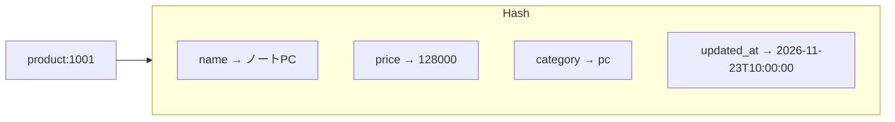
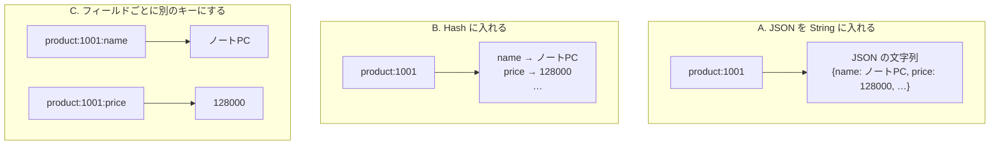

# 03. データ型 (1) String と Hash

> 前提: [02. 基本操作とキー](02-basics-and-keys.md)

## 要点

- **String** は1つの値を持つ型です。シリアライズしたオブジェクト（JSON など）やカウンターに使います。
- **Hash** は「フィールドと値の組」を複数持つ型です。RDB の1行に近く、オブジェクトを項目ごとに読み書きできます。
- オブジェクトの持ち方は「**JSON にして String に入れる**」か「**Hash に入れる**」かが基本の選択です。部分的に読み書きするなら Hash、まるごと読み書きするなら String が向いています。
- 値はすべて**文字列**として保存されます。型の強制はなく、Hash は入れ子にもできません。
- 1つのキーが大きくなりすぎる（**ビッグキー**）と、全体を止める原因になります。Hash は小さく保つと、メモリの使用量も少なくなります。

## String

String は、1つのキーに1つの値を持つ、もっとも基本的な型です。
名前は「文字列」ですが、中身は任意のバイト列です。テキストだけでなく、数値、JSON、バイナリデータも入れられます。

### 主な使い方

| 使い方 | 例 |
|---|---|
| シリアライズしたオブジェクト | 商品の情報を JSON にして `product:1001` に入れる |
| カウンター | 在庫数 `stock:1001`、アクセス数 |
| フラグ・小さな値 | 処理中であることを示す印、最終更新時刻 |

### 主なコマンド

| コマンド | 内容 | 計算量 |
|---|---|---|
| `SET key value` | 値を書き込む（既存の値は上書きされる） | O(1) |
| `GET key` | 値を読む | O(1) |
| `MSET` / `MGET` | 複数のキーをまとめて書く・読む | O(N)（N はキーの数） |
| `INCR` / `DECR` / `INCRBY` | 整数として増減する | O(1) |
| `INCRBYFLOAT` | 小数として増減する | O(1) |

`SET` には、動作を変えるオプションがあります。

| オプション | 内容 |
|---|---|
| `NX` | キーが**存在しないとき**だけ書き込む |
| `XX` | キーが**存在するとき**だけ書き込む |
| `EX 秒` / `PX ミリ秒` | 有効期限を付ける |
| `KEEPTTL` | 既存の有効期限を消さずに残す（02 章） |
| `IFEQ 値` | 現在の値が指定した値と**一致するとき**だけ書き込む（Valkey 8.1 以降） |
| `GET` | 書き込む前の値を返す |

```console
> SET lock:batch:daily "worker-1" NX EX 600
OK
> SET lock:batch:daily "worker-2" NX EX 600
(nil)
```

2 回目は、キーがすでにあるので書き込まれません（`(nil)` が返る）。このように `NX` を使うと、「最初の1人だけが成功する」処理を作れます。

### 数値も文字列として保存される

`INCR` は値を整数として扱いますが、保存されている中身は文字列です。

```console
> SET stock:1001 42
OK
> INCR stock:1001
(integer) 43
> SET stock:1002 "forty"
OK
> INCR stock:1002
(error) ERR value is not an integer or out of range
```

整数として解釈できない値に `INCR` を使うとエラーになります。ただし、**書き込むときにはチェックされません。** `SET stock:1002 "forty"` は成功します。

> **RDB で言うと**
>
> すべての列が `VARCHAR` で、CHECK 制約もないテーブルのようなものです。数値として使えるかどうかは、使うときに初めて分かります。

> **注意: INCRBYFLOAT の誤差**
>
> `INCRBYFLOAT` は浮動小数点数で計算するため、`0.1` を 3 回足しても `0.3` ちょうどにならないことがあります。金額など誤差が許されない値は、最小単位（円、セント）の整数にして `INCRBY` で扱います。

## Hash

Hash は、1つのキーの中に「フィールドと値の組」を複数持つ型です。



> **RDB で言うと**
>
> Hash は、テーブルの1行に近いものです。キーが主キー、フィールドが列にあたります。ただし、スキーマはありません。同じ `product:` のキーでも、Hash ごとに違うフィールドを持てます。

### 主なコマンド

| コマンド | 内容 | 計算量 |
|---|---|---|
| `HSET key f1 v1 [f2 v2 …]` | フィールドを書き込む（既存のフィールドは上書き、ほかのフィールドはそのまま） | O(N)（N は書き込むフィールドの数） |
| `HGET key f` | 1つのフィールドを読む | O(1) |
| `HMGET key f1 f2 …` | 指定したフィールドをまとめて読む | O(N)（N は指定したフィールドの数） |
| `HGETALL key` | すべてのフィールドと値を読む | O(N)（N は Hash のフィールド数） |
| `HDEL key f` | フィールドを削除する | O(N)（N は削除するフィールドの数） |
| `HINCRBY key f n` | フィールドを整数として増減する | O(1) |
| `HLEN key` | フィールドの数を返す | O(1) |
| `HSCAN key cursor` | フィールドを少しずつ読む（02 章の `SCAN` の Hash 版） | 1回あたり O(1)、全体で O(N) |
| `HGETDEL key FIELDS n f …` | フィールドを読んで、同時に削除する（Valkey 9.1 以降） | O(N)（N は指定したフィールドの数） |

```console
> HSET product:1001 name "ノートPC" price 128000 category pc
(integer) 3
> HGET product:1001 price
"128000"
> HMGET product:1001 name price
1) "ノートPC"
2) "128000"
> HINCRBY product:1001 price -1000
(integer) 127000
```

Valkey 9.0 からは、Hash のフィールドごとに有効期限を付けることもできます。この資料の想定する使い方では使う場面が少ないので、存在を知っておく程度で十分です。

### Hash の制約

| 制約 | 内容 |
|---|---|
| 値は文字列だけ | フィールドの値に、Hash やリストを入れることはできない（入れ子にできない） |
| 型の強制はない | `price` に数値以外を書き込んでもエラーにならない |
| 空になると消える | フィールドを全部削除すると、キーそのものが消える（01 章「RDB の感覚が通用しない点」の 7） |

入れ子になったデータ（商品の中に複数のバリエーションがある、など）を Hash で持つには、次のどちらかにします。

- 子のデータを JSON にして、1つのフィールドに入れる（`variants` → `[{"color":"black",...}]`）
- 子のデータを別のキーにする（`product:1001:variant:1`）

## オブジェクトの持ち方を選ぶ

商品のようなオブジェクトを Valkey に持つ方法は、主に3つあります。



| 観点 | A. JSON を String に入れる | B. Hash に入れる | C. フィールドごとに別のキー |
|---|---|---|---|
| 全体を読む | `GET` 1回 | `HGETALL` 1回 | フィールドの数だけ読む |
| 一部だけ読む | できない（全体を読んで取り出す） | `HGET` / `HMGET` でできる | できる |
| 一部だけ更新する | できない（全体を書き直す） | `HSET` でできる | できる |
| 入れ子のデータ | そのまま持てる | 持てない（JSON をフィールドに入れるなど） | 持てない |
| 全体の置き換え | `SET` 1回で不可分に置き換わる | 工夫が必要（後述の注意を参照） | 工夫が必要 |
| メモリ | 中程度 | 小さい Hash なら少ない（後述） | 多い（キーごとにオーバーヘッドがかかる） |
| アプリ側の処理 | シリアライズ・デシリアライズが必要 | 値の型の変換が必要（すべて文字列で返る） | 値の型の変換が必要 |

**選び方の目安**

| 状況 | おすすめ |
|---|---|
| いつもオブジェクト全体を読む。入れ子のデータがある | A. JSON を String に入れる |
| 一部のフィールドだけ読む・更新することが多い。データが平ら（入れ子がない） | B. Hash に入れる |
| フィールドごとに有効期限を変えたい、など特別な理由がある | C は通常は選ばない。Hash のフィールドの有効期限（9.0）で足りることが多い |
| JSON の一部を読み書きしたい | valkey-json（07 章） |

この資料の題材（商品カタログ API）では、商品詳細は「API でまるごと返す」ことも「一覧画面で名前と価格だけ使う」こともあります。後者が多いなら Hash、前者だけなら JSON の String が向いています。この例でどちらを選ぶかは、05 章「商品詳細の持ち方」で、読み取りパターンに当てはめて決めます。

> **注意: Hash の更新で、古いフィールドが残る**
>
> - **何が起きるか**: RDB で値が NULL になった列（たとえば `sale_price`）を、Valkey の Hash に反映できず、古いセール価格が表示され続ける。
> - **なぜ起きるか**: `HSET` は指定したフィールドだけを上書きし、ほかのフィールドには触れない。RDB の行をそのまま `HSET` で書き込むと、NULL になった列のフィールドは消えずに残る。
> - **どう防ぐか**: 全体を置き換えたいときは、①`DEL` してから `HSET` する処理をトランザクション（06 章）でまとめる、②新しいキーに書いてから切り替える（09 章）、③NULL の列は `HDEL` する、のいずれかにする。①は `DEL` と `HSET` の間に読まれると空に見えるので、必ず不可分にする。

## 値のシリアライズ

Valkey に入れる値は、すべてバイト列（文字列）です。アプリのオブジェクトを入れるには、決まった形式に変換（シリアライズ、serialization）します。

| 形式 | 長所 | 短所 |
|---|---|---|
| JSON | 人が読める。valkey-cli で中身を確認しやすい。多くの言語で扱える | サイズが大きめ。数値と文字列の区別などに注意が必要 |
| MessagePack など | サイズが小さく、変換が速い | 人が読めないため、調査がしにくい |

特別な理由がなければ、**調査のしやすさを優先して JSON** にするのがおすすめです。

Hash に入れる場合も、値は文字列として返ってきます。アプリ側で型を戻す処理を1か所にまとめておきます。

```python
from dataclasses import dataclass


@dataclass
class Product:
    id: int
    name: str
    price: int


def to_hash(p: Product) -> dict[str, str]:
    # Valkey には文字列で入る。変換のルールをここに集める
    return {"name": p.name, "price": str(p.price)}


def from_hash(product_id: int, h: dict[str, str]) -> Product:
    # 取り出した値はすべて文字列。型を戻すのもここに集める
    return Product(id=product_id, name=h["name"], price=int(h["price"]))
```

> **注意: シリアライズの形式を後から変える**
>
> - **何が起きるか**: アプリの更新で値の形式（JSON の項目名、日付の書き方など）を変えたところ、新しいアプリが古い形式のデータを読めずにエラーになる。
> - **なぜ起きるか**: Valkey にはスキーマがないので、古い形式のデータもそのまま残っている。新旧のアプリが同時に動く時間（デプロイ中）もある。
> - **どう防ぐか**: 値に形式のバージョン（`"v": 2` など）を入れるか、キー名にバージョンを含める（`product:v2:1001`）。読む側は、古い形式も読めるようにしておく。全件を作り直す構成なら、形式の変更を全件の入れ替え（09 章）に合わせるのも1つの方法。

## 内部のエンコーディングとメモリ

Valkey は、同じ型のデータでも、中身の大きさに応じて内部の持ち方（**エンコーディング**、encoding）を切り替えます。
エンコーディングによって、メモリの使用量が大きく変わります。

### Hash のエンコーディング

| エンコーディング | 使われる条件（既定値） | 特徴 |
|---|---|---|
| listpack | フィールドが 128 個以下、かつ、すべてのフィールド名と値が 64 バイト以下 | データを詰めて並べて持つ。**メモリの使用量が少ない**。1つのフィールドを探すのに先頭から順に見るが、要素が少ないので速い |
| hashtable | 上の条件を1つでも超えたとき | 1フィールドごとに管理用の領域を持つ。メモリの使用量は多いが、要素が多くても速い |

```console
> HSET product:1001 name "ノートPC" price 128000
(integer) 2
> OBJECT ENCODING product:1001
"listpack"
```

これが「**小さい Hash はメモリを節約できる**」と言われる理由です。

- 条件の値（`hash-max-listpack-entries` / `hash-max-listpack-value`）は、ElastiCache のノードベースではパラメータグループで変えられます。Serverless では変えられません。
- 一度 hashtable になった Hash は、フィールドを減らしても listpack には戻りません。
- `OBJECT ENCODING` は、ElastiCache Serverless では使えません（Serverless で使えない調査コマンドは 17 章）。

> **注意: 長い値を1つ入れただけで、Hash のメモリが増える**
>
> - **何が起きるか**: 商品説明（数百バイト）を Hash のフィールドに入れたところ、全商品の Hash が hashtable になり、メモリの使用量が想定より大きく増える。
> - **なぜ起きるか**: フィールド名か値が1つでも 64 バイトを超えると、その Hash 全体が hashtable に切り替わる。日本語は1文字 3 バイト程度なので、20 文字ほどで 64 バイトを超える。
> - **どう防ぐか・どう気づくか**: 長い値（説明文など）は別のキーに分ける。メモリの見積もり（11 章）では、実際のデータを数件入れて `MEMORY USAGE` で測る（ノードベースの場合）。

### キーそのもののオーバーヘッド

値とは別に、キー1つごとに管理用の領域（数十バイト程度）がかかります。
「C. フィールドごとに別のキーにする」持ち方がメモリを多く使うのはこのためです。キーが数千万個になる設計では、この差が無視できなくなります（11 章）。

## ビッグキー

要素が多すぎる、または値が大きすぎるキーを**ビッグキー**（big key）と呼びます。

| 問題 | 理由 |
|---|---|
| 読み書きが全体を止める | `HGETALL` や `DEL` の時間が要素の数に比例し、その間ほかのコマンドが待たされる（01 章） |
| ネットワークを圧迫する | 1回の応答が大きく、通信の帯域を使う |
| クラスターで偏る | 1つのキーは1つのシャードに置かれる。そのシャードだけメモリや負荷が増える（13 章） |
| 移動や同期に時間がかかる | シャードの間の移動や、レプリカとの同期の負担が大きい |

どこからがビッグキーかに決まった基準はありません。目安としてよく使われるのは、String なら数百 KB 以上、Hash などの集合型なら要素が数千個以上です。
ただし、本当の基準は「**そのキーを扱うコマンドが、何ミリ秒かかるか**」です。

ビッグキーを避ける考え方は、次のとおりです。

| 状況 | 対処 |
|---|---|
| 1つの Hash に、全商品を入れようとしている（`products` → フィールドが商品 ID） | 商品ごとにキーを分ける（`product:1001`、`product:1002` …） |
| 1つの商品の Hash に、レビューを全部入れようとしている | レビューは別のキーにし、件数が増える前提で設計する |
| どうしても大きなキーを読む必要がある | `HGETALL` ではなく `HSCAN` で少しずつ読む |
| 大きなキーを消す | `DEL` ではなく `UNLINK` で非同期に消す（09 章） |

ビッグキーの見つけ方は 11 章で説明します。

> **注意: HGETALL を気軽に使う**
>
> - **何が起きるか**: 開発時はフィールドが数個だった Hash が、運用中に数万個に増え、`HGETALL` のたびに応答が遅れる。
> - **なぜ起きるか**: `HGETALL` は O(N) で、N は Hash のフィールド数。データの増え方を想定していないと、気づかないうちにビッグキーになる。
> - **どう防ぐか**: 必要なフィールドが決まっているなら `HMGET` を使う。フィールドが増え続ける設計（ID をフィールドにするなど）は避ける。

## まとめ

- String は1つの値を持つ型です。JSON にしたオブジェクトやカウンターに使います。`SET` のオプション（`NX` など）で条件付きの書き込みができます。
- Hash はフィールドと値の組を持つ型で、RDB の1行に近いものです。ただし、スキーマも型の強制もなく、入れ子にもできません。
- オブジェクト全体を読むなら JSON の String、一部を読み書きするなら Hash が向いています。フィールドごとに別のキーにする持ち方は、通常は選びません。
- Hash を `HSET` で更新すると、指定しなかったフィールドは残ります。全体を置き換えるときは、不可分に置き換える工夫が必要です。
- 値はすべて文字列です。シリアライズの方法と型の変換は1か所にまとめ、形式の変更に備えてバージョンを持たせます。
- 小さい Hash は listpack で持たれ、メモリを節約できます。値が1つでも 64 バイトを超えると、この効果はなくなります。
- ビッグキーは全体を止める原因になります。要素が増え続ける設計を避け、大きなキーは少しずつ読み、非同期で消します。
