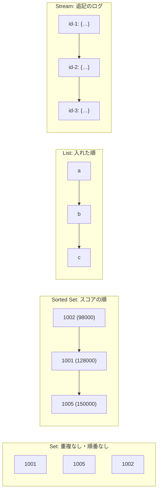
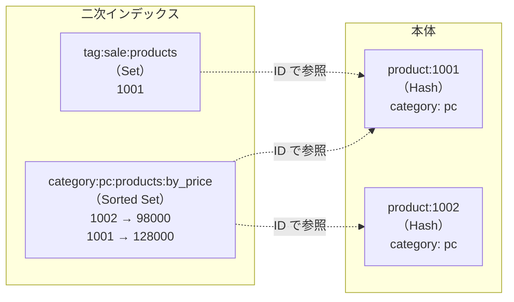

# 04. データ型 (2) Set・Sorted Set・List・Stream

> 前提: [03. データ型 (1) String と Hash](03-string-and-hash.md)

## 要点

- **Set** は重複のない集合です。「タグ sale が付いた商品の ID の集まり」のように、所属関係を表すのに使います。
- **Sorted Set** は、要素ごとにスコア（数値）を持ち、スコアの順に並んだ集合です。「価格順の商品一覧」のように、**並べ替え済みの一覧**を保つのに使います。
- **List** は順番付きのリスト、**Stream** は追記していくログです。この資料の想定する使い方では、使う場面は限られます。
- Valkey には RDB の `CREATE INDEX` のような組み込みのインデックスがないため、「カテゴリ別の一覧」のような**検索用の索引（二次インデックス）を自分で作り、自分で更新します。** ロールバックもないので、本体のデータと索引のずれが、よくある不具合の原因になります。

## 4つの型の比較



| 型 | 中身 | 重複 | 順番 | この資料での主な使い方 |
|---|---|---|---|---|
| Set | 文字列の集合 | なし | なし | タグや所属関係 |
| Sorted Set | 文字列とスコアの組の集合 | なし | スコアの順 | 並べ替え済みの一覧、ページング |
| List | 文字列の並び | あり | 入れた順 | 最新 N 件の保持（限定的） |
| Stream | フィールドと値の組（エントリ）の並び | — | 追記した順 | 差分の同期の手段（限定的） |

> **RDB で言うと**
>
> Set と Sorted Set は、それぞれ「ID だけを持つテーブル」と「ID と並べ替え用の列を持ち、その列にインデックスが張られたテーブル」に近いものです。RDB でインデックス用のテーブルを自作した場合と同じく、本体のデータを更新しても自動では更新されません（「二次インデックスを自分で作る」の節）。

## Set

Set は、重複のない文字列の集合です。同じ要素を2回追加しても、1つしか入りません。

### 主なコマンド

| コマンド | 内容 | 計算量 |
|---|---|---|
| `SADD key m1 [m2 …]` | 要素を追加する | O(N)（N は追加する要素の数） |
| `SREM key m1 [m2 …]` | 要素を削除する | O(N)（N は削除する要素の数） |
| `SISMEMBER key m` | 要素が含まれているかを調べる | O(1) |
| `SCARD key` | 要素の数を返す | O(1) |
| `SMEMBERS key` | すべての要素を返す | O(N)（N は Set の要素数） |
| `SSCAN key cursor` | 要素を少しずつ返す | 1回あたり O(1)、全体で O(N) |
| `SINTER k1 k2 …` | 共通する要素（積集合）を返す | O(N×M)（N は最も小さい Set の要素数、M は Set の数） |
| `SUNION k1 k2 …` | いずれかに含まれる要素（和集合）を返す | O(N)（N は全 Set の要素数の合計） |
| `SDIFF k1 k2 …` | 最初の Set にだけ含まれる要素（差集合）を返す | O(N)（N は全 Set の要素数の合計） |
| `SINTERCARD n k1 k2 … [LIMIT l]` | 積集合の要素の数だけを返す | `SINTER` と同じ。`LIMIT` で打ち切れる |

```console
> SADD tag:sale:products 1001 1002 1005
(integer) 3
> SADD tag:new:products 1002 1003
(integer) 2
> SISMEMBER tag:sale:products 1001
(integer) 1
> SINTER tag:sale:products tag:new:products
1) "1002"
```

「セール中で、かつ新着」の商品を、積集合で求めています。

### 集合演算の注意

集合演算は便利ですが、計算量が要素の数に比例します。

| 注意点 | 内容 |
|---|---|
| 大きな Set どうしの演算は重い | 数十万件の Set どうしの `SUNION` は、その間ほかのコマンドを止める |
| 結果も大きくなりうる | 和集合の結果をそのまま返すと、応答が大きくなる |
| クラスターモードでの制約 | 演算の対象となるキーが、すべて同じシャードにある必要がある（13 章） |

API のリクエストごとに大きな集合演算をする設計は避けます。よく使う組み合わせは、バッチで結果を作って別のキーに保存しておく方法もあります（`SINTERSTORE` など、結果を保存するコマンドがあります）。

## Sorted Set

Sorted Set は、要素ごとに**スコア**（数値）を持ち、スコアの小さい順に並んだ集合です。
要素を追加すると、正しい位置に自動で並べられます。

### 主なコマンド

| コマンド | 内容 | 計算量 |
|---|---|---|
| `ZADD key score m [score m …]` | 要素をスコア付きで追加する（すでにあればスコアを更新する） | O(log N)（1要素あたり） |
| `ZREM key m` | 要素を削除する | O(log N)（1要素あたり） |
| `ZSCORE key m` | 要素のスコアを返す | O(1) |
| `ZCARD key` | 要素の数を返す | O(1) |
| `ZRANK key m` | 要素の順位を返す | O(log N) |
| `ZRANGE key start stop` | 順位で範囲を指定して取得する | O(log N + M)（M は返す要素の数） |
| `ZRANGE key min max BYSCORE [LIMIT offset count]` | スコアで範囲を指定して取得する | O(log N + M)。`offset` が大きいと、その分の読み飛ばしにも時間がかかる |
| `ZCOUNT key min max` | スコアの範囲に含まれる要素の数を返す | O(log N) |

`ZRANGE` に `REV` を付けると、大きい順に取得できます。

### 一覧とページング

題材の「カテゴリ別の商品一覧を価格順で返し、ページングする」は、Sorted Set の基本的な使い方です。

```console
> ZADD category:pc:products:by_price 128000 1001 98000 1002 150000 1005
(integer) 3
> ZRANGE category:pc:products:by_price 0 1
1) "1002"
2) "1001"
> ZRANGE category:pc:products:by_price 2 3
1) "1005"
> ZRANGE category:pc:products:by_price 100000 200000 BYSCORE
1) "1001"
2) "1005"
```

- 1 ページ 2 件なら、1 ページ目は `0 1`、2 ページ目は `2 3` のように順位で指定します。
- 価格帯での絞り込みは `BYSCORE` で行えます。
- Sorted Set には商品 ID だけを入れます。商品の詳細は、取得した ID で `product:<ID>` の Hash を読みます（`HMGET` を ID の数だけ。06 章のパイプラインでまとめて送る）。

| やりたいこと | 方法 |
|---|---|
| 価格順と人気順の両方で並べたい | 並べ方ごとに Sorted Set を作る（`…:by_price`、`…:by_popularity`） |
| 大きい順に並べたい | `ZRANGE … REV` を使う |
| 全体の件数を出したい | `ZCARD`（範囲内の件数は `ZCOUNT`） |

### スコアの性質

| 性質 | 影響 |
|---|---|
| スコアは浮動小数点数（倍精度） | 2の53乗（約 9,000 兆）までの整数なら正確に表せる。それを超える整数や、小数の比較には誤差が出うる |
| スコアが同じ要素は、要素の文字列の辞書順で並ぶ | 数値の順ではない。`"1001"` と `"999"` では `"1001"` が先になる |
| スコアは1つだけ | 「価格が同じなら新しい順」のような複数の条件での並べ替えは、スコアの計算を工夫する（例: 価格 × 大きな数 + 新しさ）か、並べ方ごとに Sorted Set を作る |

> **注意: 同じスコアの要素の並び順**
>
> - **何が起きるか**: 同じ価格の商品の並び順が、ID の数値順にならず、ページをまたいだときの並びが期待と違う。
> - **なぜ起きるか**: 同じスコアの要素は、要素の文字列の辞書順で並ぶ。数値の ID を文字列として比べるので、桁数が違うと数値の順と一致しない。
> - **どう防ぐか**: 並び順を厳密にしたいなら、ID を固定の桁数にゼロ埋めする（`0000001001`）か、スコアに並び順の情報を含める。

## List

List は、文字列を入れた順に並べるリストです。両端からの追加と取り出しが速く、途中の要素へのアクセスは遅い型です。

| コマンド | 内容 | 計算量 |
|---|---|---|
| `LPUSH` / `RPUSH` | 先頭 / 末尾に追加する | O(1)（1要素あたり） |
| `LPOP` / `RPOP` | 先頭 / 末尾から取り出す | O(1)（1要素あたり） |
| `LRANGE key start stop` | 範囲を指定して取得する | O(S + N)（S は開始位置までの距離、N は返す要素の数） |
| `LTRIM key start stop` | 範囲外の要素を削除する | O(N)（N は削除する要素の数） |
| `LINDEX key i` | 指定した位置の要素を返す | O(N)（N は位置までの距離） |

この資料の想定する使い方（RDB から作り直せる読み取り用のデータストア）では、一覧は並べ替えの条件を持つ Sorted Set で作るのが基本です。
List を使うのは、「最近見た商品の最新 10 件」のように、入れた順そのものに意味がある場合に限られます。その場合も、`LPUSH` の後に `LTRIM` で件数を一定に保ちます。

## Stream

Stream は、エントリ（フィールドと値の組）を追記していくログです。エントリには時刻をもとにした ID が付きます。
複数の読み手が続きから読んだり、処理済みの位置を記録したりする仕組み（コンシューマーグループ）があります。

| コマンド | 内容 |
|---|---|
| `XADD key * f v …` | エントリを追記する（`*` で ID を自動で付ける） |
| `XREAD` | 指定した ID の続きから読む |
| `XREADGROUP` / `XACK` | コンシューマーグループで読み、処理済みを記録する |
| `XTRIM key MAXLEN n` | 古いエントリを削除して、件数を一定に保つ |

この資料の想定する使い方では、Stream は「RDB の変更を Valkey に差分で反映する」ときの、変更の通知の手段の1つとして候補になります。使うかどうかの判断は 09 章で扱います。

> **注意: Stream は自動では縮まない**
>
> Stream は、読み終わったエントリも削除しない限り残り続け、メモリを使い続けます。使う場合は、`XADD` の `MAXLEN` オプションや `XTRIM` で、件数の上限を必ず決めておきます。

## 二次インデックスを自分で作る

RDB には `CREATE INDEX` のような組み込みのインデックスの機能があり、データを更新するたびに DBMS が自動でインデックスも更新します。そのため、インデックスを自作することはまれです。
Valkey には、この組み込みの機能がありません。**「カテゴリ別の一覧」のような索引は、自分でキーを作り、自分で更新します。** これを**二次インデックス**（secondary index）と呼びます。

自作のインデックスが自動で更新されないのは、RDB でインデックス用のテーブルを自作した場合と同じです。ただし Valkey には、ずれを防ぐうえで RDB より不利な点があります。

| | RDB で自作した場合 | Valkey で自作した場合 |
|---|---|---|
| 本体とインデックスをまとめて更新する | 同じトランザクションで更新できる | まとめて実行はできる（06 章） |
| 途中で失敗したとき | ロールバックされ、両方とも元に戻る | **ロールバックはない**。片方だけ更新された状態が残りうる |

例外として、検索モジュールの valkey-search を使うと、Hash や JSON のデータに対して自動で更新されるインデックスを持てます（07 章）。



| 操作 | 本体 | 二次インデックス |
|---|---|---|
| 商品を追加する | `product:1003` を作る | カテゴリ・タグの Set / Sorted Set に ID を追加する |
| 価格を変える | `product:1001` の `price` を更新する | 価格順の Sorted Set のスコアも更新する |
| カテゴリを変える | `product:1001` の `category` を更新する | **古いカテゴリの一覧から削除し**、新しいカテゴリの一覧に追加する |
| 商品を削除する | `product:1001` を削除する | **すべての一覧・タグから ID を削除する** |

本体とインデックスを更新する処理は、不可分にまとめるか（06 章）、全件を作り直して入れ替える（09 章）ことで、ずれを防ぎます。
この資料の想定する構成（RDB からバッチで投入する）では、インデックスもバッチで作り直すのが単純で確実です。

> **注意: 本体と二次インデックスがずれる**
>
> - **何が起きるか**: 一覧に、削除したはずの商品や、カテゴリを移した商品が出てくる。一覧から ID を取って詳細を読むと、詳細が存在しない。
> - **なぜ起きるか**: インデックスは自動で更新されない。本体だけを更新したり、更新の途中で処理が失敗したりすると、ずれが残る。古い値（変更前のカテゴリなど）が分からないと、古いインデックスから消すこともできない。
> - **どう防ぐか・どう気づくか**: 本体とインデックスの更新を1つの処理にまとめ、不可分に実行する。または全件の作り直しで定期的にずれをなくす。読む側は、詳細が存在しない ID を飛ばすように作り、その件数を記録しておくと、ずれに気づける。

## 内部のエンコーディング

Set と Sorted Set も、03 章の Hash と同じように、小さいうちはメモリを節約する持ち方になります。

| 型 | 小さいときの持ち方 | 切り替わる条件（既定値） | 大きいときの持ち方 |
|---|---|---|---|
| Set（要素がすべて整数） | intset | 要素が 512 個を超える | hashtable |
| Set（文字列を含む） | listpack | 要素が 128 個を超える、または 64 バイトを超える要素がある | hashtable |
| Sorted Set | listpack | 要素が 128 個を超える、または 64 バイトを超える要素がある | skiplist |
| List | listpack | 要素の数・合計サイズが一定を超える | quicklist（listpack をつなげたもの） |

カテゴリ別の一覧のように要素が数千〜数万になる Sorted Set は、大きいときの持ち方になります。11 章のメモリの見積もりでは、実際のデータで測ってください。

## まとめ

- Set は重複のない集合で、タグや所属関係に使います。集合演算は便利ですが、要素の数に比例して重くなります。
- Sorted Set はスコアの順に並んだ集合で、並べ替え済みの一覧とページングに使います。並べ方ごとに1つ作り、要素には ID だけを入れます。同じスコアの要素は文字列の辞書順に並びます。
- List と Stream は、この資料の想定する使い方では限定的です。Stream を使う場合は、件数の上限を必ず決めます。
- 組み込みのインデックスがないので、二次インデックスは自分で作り、自分で更新します（valkey-search を使う場合を除く）。ロールバックがないため、本体とのずれを防ぐには、不可分な更新か、全件の作り直しを使います。
- 要素が全部なくなった Set / Sorted Set / List は、キーごと消えます（01 章「RDB の感覚が通用しない点」の 7）。
