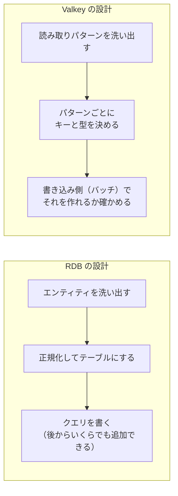
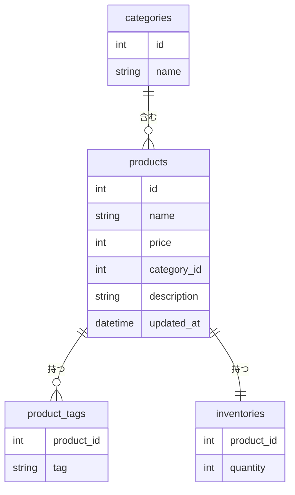
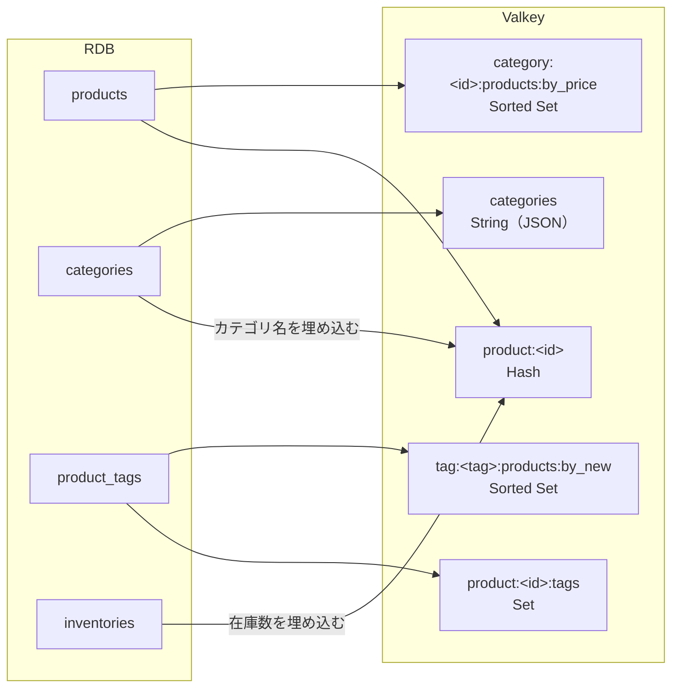

# 05. データモデリングとキー設計

> 前提: [03. データ型 (1)](03-string-and-hash.md)、[04. データ型 (2)](04-set-zset-list-stream.md)

## 要点

- Valkey の設計は、**API がどう読むか（アクセスパターン）から始めます。** RDB のように、エンティティを正規化してからクエリを考える順番ではありません。
- 1つの読み取りパターンに、1〜数回のコマンドで応答できる持ち方を選びます。JOIN がないので、**必要な情報をあらかじめまとめておく（非正規化）**か、ID で参照して別に読みます。
- 検索用の索引（二次インデックス）は、条件の種類ごとに Set や Sorted Set で作ります。条件の組み合わせを全部作ろうとすると、キーの数が爆発します。
- キーの一覧（**キー設計書**）を作り、型・中身・書き手・読み手・サイズを記録します。スキーマがない Valkey では、これがスキーマの代わりになります。
- ElastiCache Serverless は常にクラスターモードです。**最初からクラスターを前提に**、複数のキーをまとめて扱う操作の制約とホットキーを考えておきます。

## RDB との設計の進め方の違い



RDB では、データの持ち方を決めた後で、どんなクエリでも書けます。
Valkey では、読み方に合わせて持ち方を決めます。**設計にない読み方は、後からはできません。** 新しい読み方が必要になったら、データの持ち方を追加し、既存のデータからそれを作る必要があります。

> **RDB で言うと**
>
> 「よく使うクエリの結果を、あらかじめテーブルとして作っておく」設計（マテリアライズドビューや集計テーブル）に近い考え方です。Valkey では、ほとんどすべてのデータをこの考え方で持ちます。

## 設計の手順

| 手順 | やること | 成果物 |
|---|---|---|
| 1 | API の読み取りパターンを洗い出す。頻度、応答に必要な項目、並び順、絞り込みの条件、件数を書く | 読み取りパターンの一覧 |
| 2 | パターンごとに、1〜数回のコマンドで応答できるキーと型を決める | キー設計書（下書き） |
| 3 | 書き込み側（RDB からのバッチ）で、そのデータを作れるか、更新できるかを確かめる | キー設計書に「書き手」を記入 |
| 4 | キーの数とサイズを見積もる | キー設計書に「件数・サイズ」を記入 |
| 5 | クラスターモードでの制約（複数キーの操作、ホットキー）を確認する | キー設計書に「ハッシュタグ」「注意点」を記入 |

## 例: 商品カタログ API

### 正本の RDB



### 手順1: 読み取りパターンを洗い出す

| # | API | 応答に必要な項目 | 並び順・条件 | 頻度 |
|---|---|---|---|---|
| R1 | 商品詳細 `GET /products/{id}` | 商品のすべての項目、カテゴリ名、タグ、在庫数 | — | 高 |
| R2 | カテゴリ別一覧 `GET /categories/{id}/products` | 商品名、価格（1ページ 20 件） | 価格順・新着順、ページング | 高 |
| R3 | タグ別一覧 `GET /products?tag=sale` | 商品名、価格（1ページ 20 件） | 新着順、ページング | 中 |
| R4 | カテゴリの一覧 `GET /categories` | カテゴリ ID、名前 | 名前順 | 中 |

### 手順2: キーと型を決める

| キー | 型 | 中身 | 応答するパターン |
|---|---|---|---|
| `product:<id>` | Hash | 商品の項目＋カテゴリ名（非正規化）＋在庫数 | R1、R2・R3 の詳細部分 |
| `product:<id>:tags` | Set | タグの集合 | R1 |
| `category:<id>:products:by_price` | Sorted Set | 商品 ID（スコア = 価格） | R2（価格順） |
| `category:<id>:products:by_new` | Sorted Set | 商品 ID（スコア = 更新日時の UNIX 時刻） | R2（新着順） |
| `tag:<tag>:products:by_new` | Sorted Set | 商品 ID（スコア = 更新日時の UNIX 時刻） | R3 |
| `categories` | String | カテゴリの一覧を JSON にしたもの | R4 |



R2（カテゴリ別一覧の 1 ページ）は、次の2段階で応答します。

1. `ZRANGE category:10:products:by_price 0 19` で、1 ページ分の商品 ID を取る
2. 取得した 20 件の ID について、`HMGET product:<id> name price` をパイプライン（06 章）でまとめて送る

この設計で決めたことと、その理由は次のとおりです。

| 決めたこと | 理由 |
|---|---|
| 商品詳細に、カテゴリ名と在庫数を埋め込む | R1 を1回の読み取りで返すため（後述の「非正規化」） |
| タグは商品の Hash に入れず、別の Set にする | タグの数が商品によって違い、Hash のフィールドには入れにくいため |
| 並び順ごとに Sorted Set を作る | Sorted Set のスコアは1つだけなので（04 章） |
| カテゴリの一覧は1つの String にする | 件数が少なく、いつも全体を読むため（03 章の「オブジェクトの持ち方」） |

## 非正規化と参照

Valkey には JOIN がありません（01 章「RDB の感覚が通用しない点」の 2）。
関連するデータを一緒に返したいときは、次の2つから選びます。

| 方法 | 内容 | 例 |
|---|---|---|
| 埋め込む（非正規化、denormalization） | 関連するデータの値を、あらかじめコピーして持っておく | 商品の Hash に `category_name` を入れる |
| 参照する | ID だけを持ち、必要なときに別のキーを読む | 商品の Hash には `category_id` だけを入れ、`category:<id>` を別に読む |

| 観点 | 埋め込む | 参照する |
|---|---|---|
| 読み取りの回数 | 1回 | 2回以上（パイプラインでまとめられる） |
| 関連データが変わったとき | **コピーしたすべての箇所を更新する必要がある** | 1か所の更新で済む |
| メモリ | コピーの分だけ増える | 増えない |
| 向いている場面 | 関連データがあまり変わらない。読み取りが多い | 関連データがよく変わる。コピーする箇所が多すぎる |

この資料の想定する構成（RDB からバッチで全件を作り直す）では、**埋め込むほうが扱いやすい**ことが多くなります。全件を作り直すたびに、コピーした値も最新になるからです。
差分で更新する場合は、関連データが変わったときに、コピーしたすべての箇所を見つけて更新する仕組みが必要です（09 章）。

> **注意: 埋め込んだ値の更新漏れ**
>
> - **何が起きるか**: カテゴリ名を変えたのに、一部の商品の詳細に古いカテゴリ名が表示され続ける。
> - **なぜ起きるか**: 埋め込んだ値は、元のデータを変えても自動では変わらない。差分の更新で、カテゴリの変更を商品側に反映する処理が漏れている。
> - **どう防ぐか**: 埋め込む値は、キー設計書に「どこからコピーしたか」を書いておく。差分で更新するなら、元データの変更でどのキーを更新するかの対応表を作る。全件の作り直しを定期的に行い、ずれをなくす。

### 参照の整合性はアプリが守る

RDB の外部キーのように、「存在しない ID を参照させない」仕組みはありません。
一覧の Sorted Set に入っている ID の商品が、実際には存在しないこともありえます（04 章「本体と二次インデックスがずれる」）。

読む側は、参照先がないことを前提に作ります。

```python
import logging

from redis.asyncio import Redis

logger = logging.getLogger(__name__)


async def get_products(r: Redis, ids: list[str]) -> list[dict[str, str]]:
    async with r.pipeline(transaction=False) as pipe:
        for product_id in ids:
            pipe.hgetall(f"product:{product_id}")
        results: list[dict[str, str]] = await pipe.execute()
    # 参照先が消えている ID は空の dict が返る。飛ばして、件数を記録する
    found = [h for h in results if h]
    if len(found) < len(ids):
        logger.warning("missing products: %d", len(ids) - len(found))
    return found
```

## 二次インデックスの設計

04 章で説明したとおり、Valkey の索引は自分で作ります。どんな条件にどんな索引を作るかの基本は、次のとおりです。

| 読み取りの条件 | 索引 | 例 |
|---|---|---|
| ある値と一致するものを全部 | Set | `tag:sale:products` |
| ある値と一致するものを、並べて・ページングして | Sorted Set（スコア = 並べ替えの値） | `tag:sale:products:by_new` |
| 数値の範囲（価格帯など） | Sorted Set（スコア = その数値）＋ `BYSCORE` | `category:10:products:by_price` |
| 前方一致（名前の先頭の文字など） | Sorted Set（スコアをすべて 0 にし、辞書順を使う） | 検索候補の表示など |

### 条件の組み合わせ

「カテゴリ = pc、かつタグ = sale、価格順」のように、条件を組み合わせたいことがあります。方法は3つです。

| 方法 | 内容 | 長所 | 短所 |
|---|---|---|---|
| 組み合わせごとに索引を作る | `category:10:tag:sale:products:by_price` | 読むのが速い（1回の `ZRANGE`） | 組み合わせの数だけキーが増える。条件が3つ、4つと増えると爆発する |
| 読むときに集合演算で組み合わせる | `ZINTER` などで、カテゴリの索引とタグの索引を掛け合わせる | キーが増えない | 要素の数に比例して重い。リクエストのたびに実行すると、全体を止める（04 章） |
| valkey-search を使う | 属性検索のインデックスを作り、条件を組み合わせて問い合わせる | 柔軟。インデックスが自動で更新される | 制約が多い。メモリを使う（07 章） |

目安は次のとおりです。

- 組み合わせが少なく、決まっている → 組み合わせごとに索引を作る
- 組み合わせは多いが、対象の件数が小さい（数百件程度） → 読むときに集合演算
- 組み合わせが多く、件数も大きい → valkey-search を検討する。それでも難しければ、その読み方は RDB や検索エンジンに任せる

> **注意: 読み取りパターンが後から増えて、手戻りになる**
>
> - **何が起きるか**: 「タグでも絞り込みたい」「在庫ありだけを表示したい」という要望が後から出て、索引の追加・バッチの改修・全件の作り直しが必要になる。
> - **なぜ起きるか**: Valkey では、設計にない読み方はできない（RDB のように WHERE 句を足せば済む、ということがない）。
> - **どう防ぐか**: 設計の段階で、画面と API の仕様から読み取りパターンを洗い出し、関係者と合意しておく。将来出てきそうな条件は、索引を作る費用と一緒に一覧にしておく。索引を追加するときの手順（バッチの改修と作り直し）を、あらかじめ決めておく。

## キー設計書

Valkey にはスキーマがないので、どんなキーがあり、何が入っているかは、どこにも記録されません（01 章「RDB の感覚が通用しない点」の 1・5）。
**キー設計書**を作り、スキーマの代わりとしてリポジトリで管理します。

| 項目 | 内容 | 例（`product:<id>`） |
|---|---|---|
| キーのパターン | キー名の形 | `product:<id>` |
| 型 | データ型 | Hash |
| 中身 | フィールドと値の形式。埋め込んだ値はコピー元も書く | `name`: 文字列、`price`: 整数（円）、`category_name`: 文字列（categories.name からコピー）… |
| 書き手 | どの処理が書くか | 全件ロードのバッチ、差分の同期 |
| 読み手 | どの API・処理が読むか | R1、R2、R3 |
| TTL | 有効期限の有無 | なし |
| 件数・サイズ | キーの数と1つあたりの大きさの見積もり | 100 万件、1件 約 500 バイト |
| ハッシュタグ | 使うかどうかと理由 | 使わない |
| 備考 | 注意点 | 説明文は 64 バイトを超えるので別のキー（03 章） |

型と値の形式は、書き込む側のコードでも検証します。Valkey は、おかしな値を書き込んでもエラーにしないからです。
Python なら、キー設計書の「中身」を Pydantic などのモデルとして定義し、書き込む前と読み込んだ後に通すと、ずれに気づけます。

## 構造の変更

RDB の `ALTER TABLE` のような、構造を変える仕組みはありません（01 章「RDB の感覚が通用しない点」の 8）。
変更の種類によって、対応が変わります。

| 変更 | 例 | 対応 |
|---|---|---|
| 項目の追加 | 商品の Hash に `brand` を追加する | 読む側を「`brand` がなくても動く」ように先に直し、その後で書く側を変える |
| 項目の削除 | `old_price` をやめる | 読む側が使わないように先に直し、その後で書く側を止める。残ったフィールドは全件の作り直しで消える |
| 意味や形式の変更 | 価格を税抜きから税込みに変える。型を Hash から JSON の String に変える | 新しいキー（`product:v2:<id>` など）に新しい形で作り直し、読む側を切り替える（09 章）。または値にバージョンを持たせる（03 章） |
| 索引の追加 | タグ別一覧を新しく作る | バッチを直して、全件の作り直しで作る |

新旧のアプリが同時に動く時間（デプロイ中）にも、どちらのアプリでもデータを正しく読めるように、変更の順番を決めます。

## キーの数とサイズの見積もり

メモリの量は、そのまま費用と構成（ノードタイプ、シャードの数）に関わります（11 章・14 章）。設計の段階で見積もっておきます。

| 手順 | やること |
|---|---|
| 1 | キー設計書のキーのパターンごとに、キーの数を見積もる（例: 商品数、カテゴリ数 × 並び順の数） |
| 2 | 実際のデータを数百件ほど入れて、1キーあたりの大きさを測る（ノードベースなら `MEMORY USAGE`、Serverless ならメトリクスのデータ量） |
| 3 | 「キーの数 × 1キーあたりの大きさ」をパターンごとに足し合わせる |
| 4 | データの増加と、運用上の余裕（11 章）を上乗せする |

> **注意: 見積もりは、必ず実際のデータで測る**
>
> 値の大きさから計算するだけでは、内部の管理用の領域や、エンコーディングの違い（03 章・04 章）が含まれません。同じデータでも、Hash の値が 64 バイトを超えるかどうかで、使うメモリは何倍も変わることがあります。

## クラスターを前提にしたキー設計

ElastiCache Serverless は常にクラスターモードで動きます（14 章）。ノードベースでも、データ量が増えればクラスターモードを使います。
キーを設計するときは、最初からクラスターを前提にします。詳しい仕組みは 13 章で説明し、ここでは設計に関わる点だけを挙げます。

### キーはキー名によってシャードに振り分けられる

クラスターモードでは、キー名から計算した値（ハッシュスロット）によって、どのシャードにキーを置くかが決まります。
そのため、**複数のキーをまとめて扱うコマンドは、すべてのキーが同じハッシュスロットにないとエラーになります**（`CROSSSLOT` エラー）。

| 影響を受ける操作 | 例 |
|---|---|
| 複数のキーを読み書きするコマンド | `MGET`、`MSET`、`SINTER`、`ZINTER`、`SINTERSTORE` |
| トランザクションと Lua スクリプト | 中で扱うキーは、すべて同じハッシュスロットにある必要がある（06 章） |
| キー名の変更 | `RENAME` の変更前と変更後のキー |

### ハッシュタグ

キー名の一部を `{` と `}` で囲むと、その部分だけでハッシュスロットが計算されます。これを**ハッシュタグ**（hash tag）と呼びます。
同じハッシュタグを持つキーは、必ず同じハッシュスロット（同じシャード）に置かれます。

```text
category:{10}:products:by_price   ┐
category:{10}:products:by_new     ┘ どちらも "10" で計算 → 同じシャード
```

| 使う場面 | 使わない場面 |
|---|---|
| 複数のキーを1つのコマンド・トランザクションで扱う必要がある | 1つずつ読み書きするだけのキー（ほとんどのキー） |

> **注意: ハッシュタグの付けすぎ**
>
> - **何が起きるか**: 特定のシャードだけにデータとアクセスが集中し、そのシャードのメモリや CPU が先に限界に達する。
> - **なぜ起きるか**: 同じハッシュタグのキーは、すべて1つのシャードに置かれる。たとえば全商品のキーに `{product}` を付けると、商品のデータが全部1つのシャードに集まり、クラスターにした意味がなくなる。
> - **どう防ぐか**: ハッシュタグは、まとめて扱う必要があるキーの小さな集まり（1つのカテゴリの索引など）にだけ付ける。ハッシュタグの中身には、値の種類が多いもの（ID など）を使う。

### ホットキー

特定の1つのキーに、アクセスが極端に集中することがあります。これを**ホットキー**（hot key）と呼びます。
1つのキーは1つのシャードにしか置かれないので、シャードを増やしても、そのキーへのアクセスは分散されません。

| 例 | 対処 |
|---|---|
| トップページに表示する人気商品の一覧 | アプリのメモリにも短時間だけ保持する。レプリカからも読む（13 章） |
| セール対象の特定の商品の詳細 | 同じ内容を複数のキー（`…:copy1`、`…:copy2`）に持ち、読む側でばらけさせる |
| すべてのリクエストが読むキー（09 章の入れ替えのポインタなど） | アプリのメモリに数秒だけ持ち、毎回は読まない（09 章） |

ホットキーは、設計の段階では気づきにくい問題です。アクセスが集中しそうなキーをキー設計書の備考に書いておき、監視（16 章）で確認します。

## まとめ

- Valkey の設計は、読み取りパターンから始めます。設計にない読み方は、後からはできません。
- 読み取りパターンごとに、1〜数回のコマンドで応答できるキーと型を決めます。
- JOIN がないので、関連データは埋め込むか参照します。全件を作り直す構成では、埋め込むほうが扱いやすいことが多くなります。参照の整合性は、アプリが守ります。
- 索引は条件の種類ごとに作ります。条件の組み合わせは、組み合わせごとの索引、読むときの集合演算、valkey-search から選びます。
- キー設計書を作り、スキーマの代わりにします。型と値の形式は、書き込む側のコードでも検証します。
- 構造の変更は、新旧のアプリが同時に動いても壊れない順番で行います。形式を変えるときは、新しいキーに作り直して切り替えます。
- キーの数とサイズは、実際のデータで測って見積もります。
- 最初からクラスターを前提にします。複数のキーをまとめて扱うならハッシュタグを付けますが、付けすぎるとシャードが偏ります。ホットキーにも注意します。
