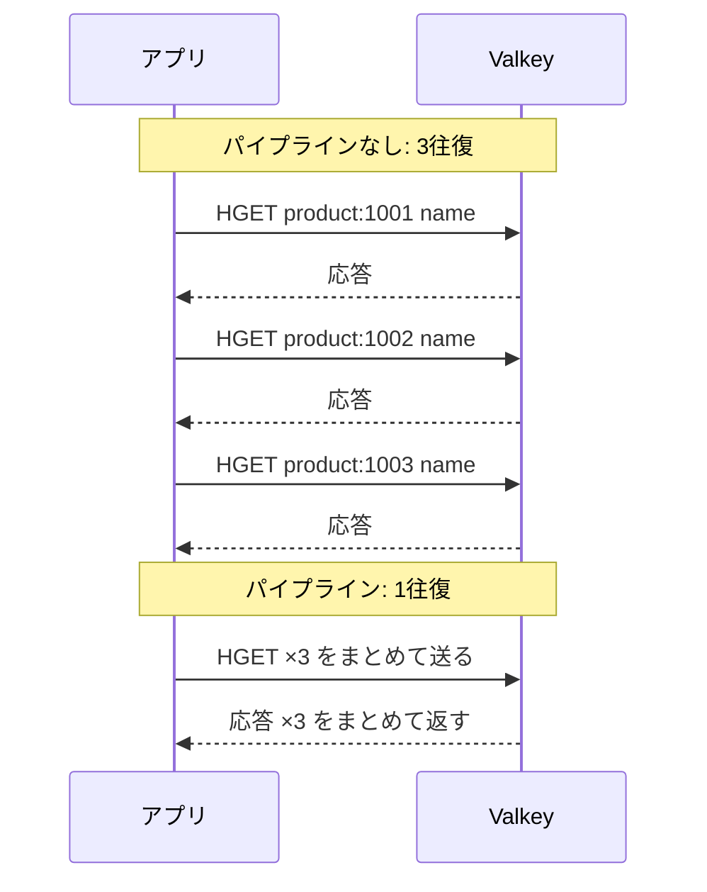
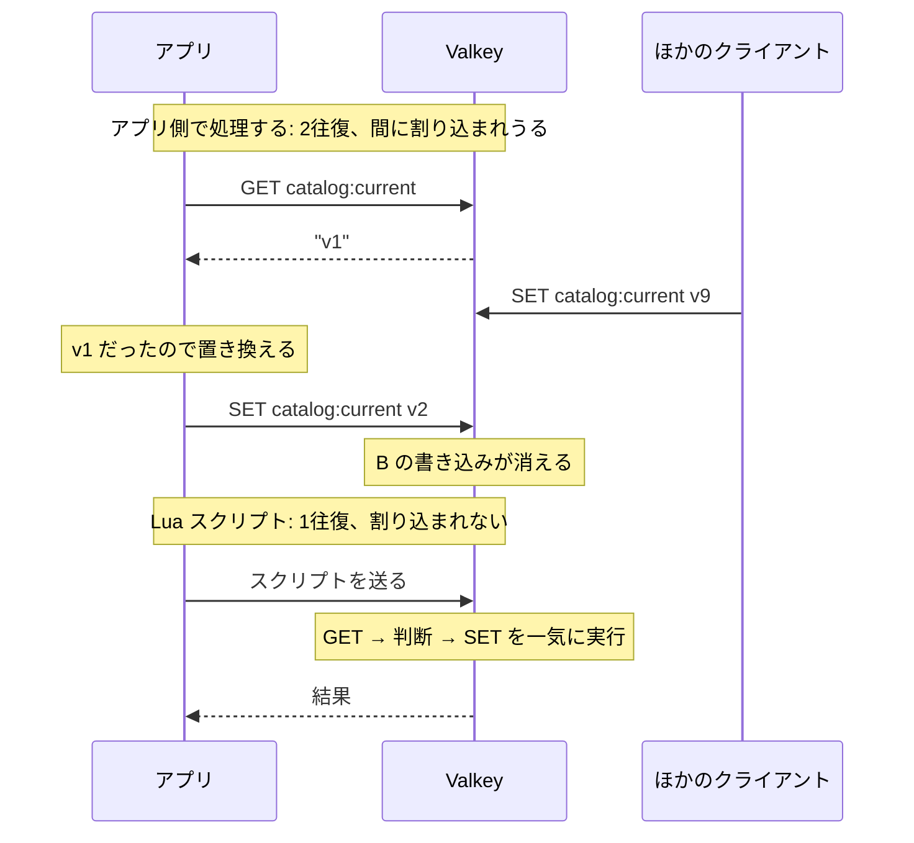

# 06. 複数コマンドの扱い

> 前提: [02. 基本操作とキー](02-basics-and-keys.md)（特に「1つのコマンドは不可分、複数のコマンドは不可分ではない」の節）

## 要点

- 複数のコマンドを扱う仕組みは3つあります。**パイプライン**（まとめて送る）、**トランザクション**（transaction。まとめて不可分に実行する）、**Lua スクリプト**（サーバー側で処理を不可分に実行する）です。
- このほかに、`MGET` / `MSET` のように**1つのコマンドで複数の String のキーを扱う**方法もあります。ただしクラスターモードでは、キーがすべて同じハッシュスロットにある必要があります。ばらばらのキーには、redis-py の `mget_nonatomic()` かパイプラインを使います。
- パイプラインは**速くするための仕組み**で、不可分ではありません。トランザクションと Lua スクリプトは**不可分にするための仕組み**です。この2つを混同しないことが大切です。
- トランザクションには**ロールバックがありません。** 途中のコマンドが失敗しても、ほかのコマンドは実行されます。
- クラスターモードでは、トランザクションと Lua スクリプトで扱うキーは、**すべて同じハッシュスロットにある必要があります。** 本体と索引のように、別々のシャードにあるキーを不可分に更新することはできません。

## 3つの仕組みの比較

| | パイプライン | トランザクション（MULTI / EXEC） | Lua スクリプト | （参考）複数のキーを扱うコマンド（`MGET` / `MSET`） |
|---|---|---|---|---|
| 目的 | 往復の回数を減らして速くする | 複数のコマンドを不可分に実行する | 条件分岐を含む処理を不可分に実行する | 往復の回数を減らして速くする |
| 不可分か | **いいえ**（間にほかのコマンドが入りうる） | はい | はい | はい（1つのコマンドなので） |
| 途中のコマンドが失敗したとき | ほかのコマンドは実行される。取り消されない | ほかのコマンドは実行される。**取り消されない**（ロールバックはない） | そこで止まるが、それまでの書き込みは**取り消されない** | 途中で失敗することがない（全部書くか、何も書かないか） |
| 前のコマンドの結果を使った分岐 | できない | できない | できる | できない |
| クラスターモードでのキーの制約 | なし（クライアントがシャードごとに分けて送る） | すべて同じハッシュスロット | すべて同じハッシュスロット | すべて同じハッシュスロット |



## パイプライン

パイプライン（pipeline）は、複数のコマンドを、応答を待たずに続けて送る仕組みです。応答はまとめて受け取ります。

### なぜ速くなるのか

Valkey の1回のコマンドの処理は、マイクロ秒の単位で終わります。それに対して、アプリと Valkey の間の通信の往復（RTT）には、同じ AZ の中でも数百マイクロ秒、AZ をまたぐと 1 ミリ秒前後かかります。
つまり、小さなコマンドを1つずつ送ると、**時間のほとんどは通信の待ち時間**になります。

| 方法 | 100 個のコマンドにかかる時間の目安（RTT が 0.5 ミリ秒の場合） |
|---|---|
| 1つずつ送る | 0.5 ミリ秒 × 100 往復 = 約 50 ミリ秒 |
| パイプラインで送る | 約 0.5 ミリ秒 × 1 往復 ＋ 処理時間 = 1 ミリ秒前後 |

05 章のカテゴリ別一覧（20 件の商品の詳細を読む）や、09 章の全件ロード（大量の書き込み）では、パイプラインが必須になります。

### redis-py での使い方

```python
async with r.pipeline(transaction=False) as pipe:
    for product_id in ids:
        pipe.hmget(f"product:{product_id}", ["name", "price"])
    results: list[list[str | None]] = await pipe.execute()
```

> **注意: redis-py のパイプラインの既定の動きが、クライアントによって逆になる**
>
> - **何が起きるか**: ローカル（クラスターモード無効で `Redis` のクライアント）ではトランザクションとして不可分に動いていた処理が、本番（クラスター）では不可分でなくなる。または逆に、パイプラインのつもりの処理がローカルではトランザクションとして送られる。
> - **なぜ起きるか**: redis-py の `pipeline()` は、引数を指定しないとき、単一ノード用のクライアント（`Redis`）では `transaction=True`（MULTI / EXEC で囲む）、クラスター用のクライアント（`RedisCluster`）ではトランザクションなし、になる。
> - **どう防ぐか**: `pipeline(transaction=False)` か `pipeline(transaction=True)` を、必ず明示して書く。クラスター用のクライアントで `transaction=True` にした場合、キーが別々のハッシュスロットにあるとエラーになる（08 章）。

### 1回に送る量

パイプラインで送ったコマンドの応答は、すべて終わるまで Valkey のメモリにためられます。1回に送る量が多すぎると、Valkey のメモリを圧迫し、ほかのコマンドの応答も遅らせます。

| 量 | 目安 |
|---|---|
| 1回のパイプラインで送るコマンドの数 | 数百〜数千程度。それより多いときは、分けて送る |
| 応答の大きさ | 1回あたり数 MB 程度まで。大きな値を読むときは、数を減らす |

最適な量はデータの大きさと環境で変わるので、09 章の全件ロードでは実際に測って決めます。

> **注意: パイプラインは不可分ではない**
>
> パイプラインで送ったコマンドの間に、ほかのクライアントのコマンドが入ることがあります。「まとめて送ったから、まとめて反映される」わけではありません。読む側から、途中の状態が見えることがあります。不可分にしたいときは、トランザクションか Lua スクリプトを使います。

## 複数のキーを扱うコマンド（MGET / MSET）

`MGET` は複数のキーの値を1つのコマンドで読み、`MSET` は複数のキーに1つのコマンドで書きます。
パイプラインと同じく往復が1回で済み、しかも1つのコマンドなので不可分です。
**複数の String のキー**（JSON にしたオブジェクト、カウンターなど）をまとめて読み書きするときに使います。

`MSET` は、一部のキーだけ書けて残りは失敗する、ということがありません。理由は2つあります。

- **失敗しうることは、書き始める前に全部確かめる。** 引数の形、キーのハッシュスロット（`CROSSSLOT`）、ACL の権限、メモリの上限を先に確かめ、どれかに引っかかれば、1件も書かずにエラーを返します。
- **書き始めたあとは、1件ずつの書き込みが失敗しない。** `SET` と同じく既存のキーをどんな型でも上書きするので、型の違いでエラーになりません。制約もなく、ディスクへの書き込みも待たず、1本のスレッドで実行するのでロックの競合も起きません（01 章）。

RDB で複数行の更新が途中で失敗するのは、制約違反やデッドロック、ディスクの容量不足などが、更新の途中で起きうるからです。`MSET` には、途中で起きうる失敗がありません。
トランザクションや Lua スクリプトでは、途中のコマンドが失敗しても、それまでの書き込みは残ります（後述）。この点が違います。

```console
> MGET stock:1001 stock:1002 stock:1003
1) "42"
2) "7"
3) (nil)
```

### クラスターモードでの制約

クラスターモードでは、指定したキーが**すべて同じハッシュスロットにないと `CROSSSLOT` エラー**になります（後述の「クラスターモードでの制約」）。
`product:1001`、`product:1002` のような、ばらばらの ID のキーは、普通は別々のスロットにあります。そのため、ElastiCache Serverless（常にクラスターモード）では、こうしたキーを `MGET` 1回で読むことはできません。

ばらばらのキーをまとめて読み書きするときは、次のどちらかを使います。

| 方法 | 内容 |
|---|---|
| `mget_nonatomic()` / `mset_nonatomic()` | redis-py のクラスター用クライアント（`RedisCluster`）のメソッド。キーをスロットごとに分けて、スロットごとの `MGET` / `MSET` をパイプラインでまとめて送る。スロットが複数にまたがると、**不可分ではなくなる** |
| パイプライン | キーごとの `GET` / `SET` を、パイプラインでまとめて送る（上の「redis-py での使い方」）。クライアントがシャードごとに分けて送る（08 章） |

```python
# r はクラスター用のクライアント（redis.asyncio.RedisCluster）
values: list[str | None] = await r.mget_nonatomic(["product:1001", "product:1002"])
```

クラスターモードを使わない構成（ノードベースでクラスターモードが無効）なら、この制約はなく、`MGET` / `MSET` をそのまま使えます。

### この資料の例での使い方

この資料の例では、商品詳細を Hash で持っています（05 章「商品詳細の持ち方」）。`MGET` / `MSET` は String 用のコマンドなので、Hash には使えません。
そのため、一覧の 20 件は、`HMGET` をパイプラインで送って読みます。商品詳細を JSON の String で持つ設計であれば、`mget_nonatomic()` で読めます。

> **注意: `HMGET` と `MGET` を取り違える**
>
> 名前は似ていますが、扱うものが違います。`HMGET` は「**1つの**キーの、複数のフィールド」を読み、`MGET` は「**複数の**キー」を読みます。
> 05 章の一覧（R2）では、20 件の商品それぞれに `HMGET product:<id> name price` を送り、それをパイプラインでまとめています。`HMGET` 1回で 20 件の商品を読めるわけではありません。

## トランザクション（MULTI / EXEC）

`MULTI` から `EXEC` までに送ったコマンドは、`EXEC` のときにまとめて、**間にほかのコマンドを挟まずに**実行されます。

```console
> MULTI
OK
> DEL product:1001
QUEUED
> HSET product:1001 name "ノートPC" price 128000
QUEUED
> EXEC
1) (integer) 1
2) (integer) 2
```

`MULTI` の後のコマンドは、すぐには実行されず `QUEUED`（予約済み）と返ります。`EXEC` で一度に実行され、結果がまとめて返ります。
03 章の「Hash の更新で、古いフィールドが残る」は、この方法で `DEL` と `HSET` を不可分にすると防げます。

### 何が保証され、何が保証されないか

| 保証されること | 保証されないこと |
|---|---|
| `EXEC` の間、ほかのクライアントのコマンドが割り込まない | **途中のコマンドが失敗しても、ほかのコマンドは実行される（ロールバックはない）** |
| ほかのクライアントからは、全部が反映される前の状態は見えない | `MULTI` の後で読んだ値を使って、続くコマンドを変えること（予約の時点では結果が分からない） |
| 中で複数のキーを読めば、同じ時点の状態が読める | 書き込みがディスクやレプリカに届いていること（12 章・13 章） |

コマンドの失敗には2種類あり、扱いが違います。

| 失敗の種類 | 例 | 結果 |
|---|---|---|
| 予約の時点で分かる失敗 | コマンド名の誤り、引数の数の誤り | `EXEC` で全体が取り消される（どのコマンドも実行されない） |
| 実行して初めて分かる失敗 | 型が違うキーへの操作（`WRONGTYPE`） | **そのコマンドだけが失敗し、ほかは実行される** |

> **RDB で言うと**
>
> 「途中でエラーになっても COMMIT される、ロールバックのないトランザクション」です。分離の点では、全部が一度に実行されるので、RDB の最も厳しい分離レベルに近い動きをします。

> **注意: トランザクションの途中の失敗で、中途半端な状態が残る**
>
> - **何が起きるか**: `DEL` の後の `HSET` が失敗し、商品のデータが消えたままになる。
> - **なぜ起きるか**: 実行して初めて分かる失敗では、ほかのコマンドは取り消されない。
> - **どう防ぐか・どう気づくか**: `EXEC` の結果を1つずつ確認し、エラーがあれば記録して、再実行できるようにする。全件を作り直す構成なら、次の作り直しで正しい状態に戻る。

### WATCH: 楽観的な排他制御

`WATCH` を使うと、「読んでから書くまでの間に、ほかの誰かが値を変えていたら、書き込みを取りやめる」ことができます。

```console
> WATCH stock:1001
OK
> GET stock:1001
"10"
> MULTI
OK
> SET stock:1001 9
QUEUED
> EXEC
(nil)
```

`WATCH` してから `EXEC` までの間に、ほかのクライアントが `stock:1001` を変更したため、`EXEC` は `(nil)` を返し、何も実行されませんでした。アプリは、最初からやり直します。

値の増減のように1つのコマンドで済むものは、`WATCH` を使わず `INCR` などで済ませるほうが単純です（02 章）。
値が一致するときだけ書き込む・削除するなら、`SET … IFEQ`（03 章）や `DELIFEQ`（Valkey 9.0 以降）も使えます。

## Lua スクリプト

Lua スクリプトは、**処理をアプリではなく、Valkey のサーバー側で実行する**仕組みです。
「読んで、判断して、書く」という一連の処理をスクリプトとして Valkey に送ると、Valkey がそれをメインスレッドの上で一気に実行します。
トランザクションと違い、**前のコマンドの結果を見て、次の処理を変えられます。**

「現在の値が `v1` のときだけ、`v2` に置き換える」処理で、アプリ側で行う場合と比べます。



処理がサーバー側で動くことから、次の性質が出てきます。

| 性質 | 内容 |
|---|---|
| 割り込まれない | 読んでから書くまでの間に、ほかのクライアントのコマンドが入らない |
| 往復が1回 | スクリプトの中で何回コマンドを呼んでも、アプリとの往復は1回で済む |
| 重いと全体を止める | Valkey のメインスレッドで動くので、スクリプトが長いと、その間ほかのすべてのコマンドが待たされる（後述の注意） |
| ロジックが2か所に分かれる | 処理の一部が、アプリのコードではなく Valkey の上で動く。スクリプトの管理と、テスト（本物の Valkey が必要。10 章）を考える必要がある |

> **RDB で言うと**
>
> ストアドプロシージャに近い位置づけです。ただし、Valkey のスクリプトは1本のスレッドで実行されるので、実行中はほかのすべての処理が止まります。

スクリプトの例です。

```lua
-- 現在の値が期待した値のときだけ、新しい値に置き換える
-- KEYS[1]: キー / ARGV[1]: 期待する値 / ARGV[2]: 新しい値
local current = redis.call("GET", KEYS[1])
if current == ARGV[1] then
  redis.call("SET", KEYS[1], ARGV[2])
  return 1
end
return 0
```

スクリプトの中から Valkey のコマンドを呼ぶには `redis.call` を使います。Valkey では `server.call` とも書けますが、この資料では Redis と共通の `redis.call` を使います。

### redis-py での使い方

```python
SWAP_IF_EQUAL = """
local current = redis.call("GET", KEYS[1])
if current == ARGV[1] then
  redis.call("SET", KEYS[1], ARGV[2])
  return 1
end
return 0
"""

swap_if_equal = r.register_script(SWAP_IF_EQUAL)
changed: int = await swap_if_equal(keys=["catalog:current"], args=["v1", "v2"])
```

`register_script` を使うと、スクリプトの本体ではなく、スクリプトの識別子（SHA1 のハッシュ値）で呼び出します（`EVALSHA`）。
フェイルオーバーなどで Valkey 側にスクリプトが登録されていないとき（`NOSCRIPT` エラー）は、redis-py が本体を送り直します。

### スクリプトを書くときの決まり

| 決まり | 理由 |
|---|---|
| 扱うキーは、すべて `KEYS` で渡す（スクリプトの中でキー名を組み立てない） | クラスターモードでは、渡されたキーをもとに実行するシャードを決めるため。`KEYS` に含まれないキーへのアクセスは、正しく動かない |
| `KEYS` のキーは、すべて同じハッシュスロットにする | クラスターモードの制約 |
| 短い時間で終わる処理にする | 実行中は、ほかのすべてのコマンドが待たされる（01 章） |
| スクリプトはアプリのリポジトリで管理し、アプリから送る（`register_script`） | ロジックが Valkey 側に分かれても、変更の管理・レビュー・デプロイをアプリと一緒に行えるようにするため |

> **注意: 長い Lua スクリプトが全体を止める**
>
> - **何が起きるか**: 大量のキーを処理するスクリプトを実行している間、すべての API のリクエストが待たされる。スクリプトが一定時間（既定では 5 秒）を超えると、ほかのクライアントには `BUSY` エラーが返り始める。
> - **なぜ起きるか**: スクリプトは不可分に実行されるため、終わるまでほかのコマンドは実行されない。時間を超えても、スクリプトは止まらない。書き込みをしたスクリプトは、途中で止めることもできない。
> - **どう防ぐか**: スクリプトで扱う要素の数に上限を設ける。大量のデータの処理は、スクリプトではなく、アプリから少しずつ（パイプラインで分けて）行う。

### Functions

Valkey には、スクリプトをサーバーに登録して名前で呼び出す **Functions**（`FUNCTION LOAD` / `FCALL`）という仕組みもあります。
ただし、**ElastiCache Serverless では使えません。** この資料の想定する使い方では、Lua スクリプト（`EVAL` / `EVALSHA`）で足ります。

## クラスターモードでの制約

| 仕組み | 制約 | 違反したとき |
|---|---|---|
| パイプライン | なし（クライアントがシャードごとに分けて送る） | — |
| トランザクション | 中のキーは、すべて同じハッシュスロット | `CROSSSLOT` エラー |
| Lua スクリプト | `KEYS` のキーは、すべて同じハッシュスロット | `CROSSSLOT` エラー |
| 複数のキーを扱うコマンド（`MGET`、`MSET` など） | 指定したキーは、すべて同じハッシュスロット | `CROSSSLOT` エラー |

制約がある理由は、Valkey の「不可分」が、1本のスレッドが割り込みなしに一気に実行することで成り立っているからです（01 章）。
シャードはそれぞれ別のサーバーで、別のスレッドでコマンドを実行します。キーが別々のシャードにあると、1本のスレッドでは両方に手が届きません。シャードをまたいで足並みをそろえる仕組み（RDB の分散トランザクションのようなもの）もありません。
パイプラインに制約がないのは、不可分ではなく、独立したコマンドを並べて送るだけだからです。

条件が「同じシャード」ではなく「**同じハッシュスロット**」なのは、シャードを増減するとき、キーがスロット単位で別のシャードへ移るからです（13 章）。たまたま同じシャードにあったキーでも、スロットが違えば、いずれ別々のシャードになります。

> **注意: シャードが1つでも `CROSSSLOT` エラーになる**
>
> - **何が起きるか**: クラスターモード無効のローカルでは動いていたトランザクションや `MGET` が、本番で `CROSSSLOT` エラーになる。
> - **なぜ起きるか**: クラスターモードでは、シャードが1つしかなくても、スロットが違えばエラーになる。ElastiCache Serverless も、仮想的な1シャードとして見えるが、この制約は残る（13 章）。
> - **どう防ぐか**: ローカルとテストの Valkey も、1ノードのクラスターモードで動かす（10 章）。複数のキーを不可分に扱う箇所は、キー設計書でハッシュタグを確認する（05 章）。

この制約から、**キーが別々のシャードにある更新は、不可分にできません。**
たとえば、商品の Hash（`product:1001`）とカテゴリの索引（`category:10:products:by_price`）は、キー名が違うので、通常は別のシャードに置かれます。両方をトランザクションでまとめて更新することはできません。

ハッシュタグ（05 章）で同じシャードに集めることもできますが、商品と索引の組み合わせは多対多なので、すべてを1つのハッシュタグにまとめるしかなくなります。それではクラスターにした意味がなくなります。

この資料の想定する構成では、本体と索引を不可分に保つには、**新しいデータ一式を作ってから、読む先を切り替える**方法を使います（09 章）。

## 読み取りの一貫性

01 章「RDB の感覚が通用しない点」の 3 のとおり、複数のキーを読むと、更新の途中の状態が見えることがあります。

| 読み方 | 一貫性 |
|---|---|
| 1つのコマンドで1つのキーを読む | その時点の値が読める |
| パイプラインで複数のキーを読む | **途中の状態が見えることがある**（各コマンドの間に書き込みが入りうる） |
| トランザクションで複数のキーを読む | 同じ時点の状態が読める（ただし同じハッシュスロットのキーに限る） |

API の読み取りの多くは、パイプラインで複数のキーを読みます。クラスターモードでは、トランザクションで読める範囲も限られます。
そのため、**読む側で一貫性を保つのではなく、書く側で「途中の状態を見せない」ようにする**のが基本です。具体的な方法は 09 章で説明します。

## まとめ

- パイプラインは速くするための仕組みで、不可分ではありません。redis-py では、クライアントによって既定の動きが違うので、`transaction` を必ず明示します。1回に送る量は数百〜数千程度にします。
- `MGET` / `MSET` は1つのコマンドで複数の String のキーを扱えますが、クラスターモードではキーが同じハッシュスロットにある必要があります。ばらばらのキーには、`mget_nonatomic()`（不可分ではない）かパイプラインを使います。`HMGET`（1つのキーの複数のフィールド）と取り違えないようにします。
- トランザクションは不可分に実行されますが、ロールバックはありません。途中で失敗したコマンドがあっても、ほかのコマンドは実行されます。
- Lua スクリプトは、処理をアプリではなく Valkey のサーバー側で実行する仕組みです。条件分岐を含む処理を、割り込まれずに1往復で実行できます。メインスレッドで動くので短い時間で終わるようにし、扱うキーは `KEYS` で渡し、スクリプトはアプリのリポジトリで管理します。
- Functions は ElastiCache Serverless では使えません。Lua スクリプトで足ります。
- クラスターモードでは、トランザクションと Lua スクリプトのキーは同じハッシュスロットにある必要があり、別々のシャードにあるキーの更新は不可分にできません。
- 途中の状態を見せないためには、書く側で新しいデータを作ってから切り替える方法を使います（09 章）。
