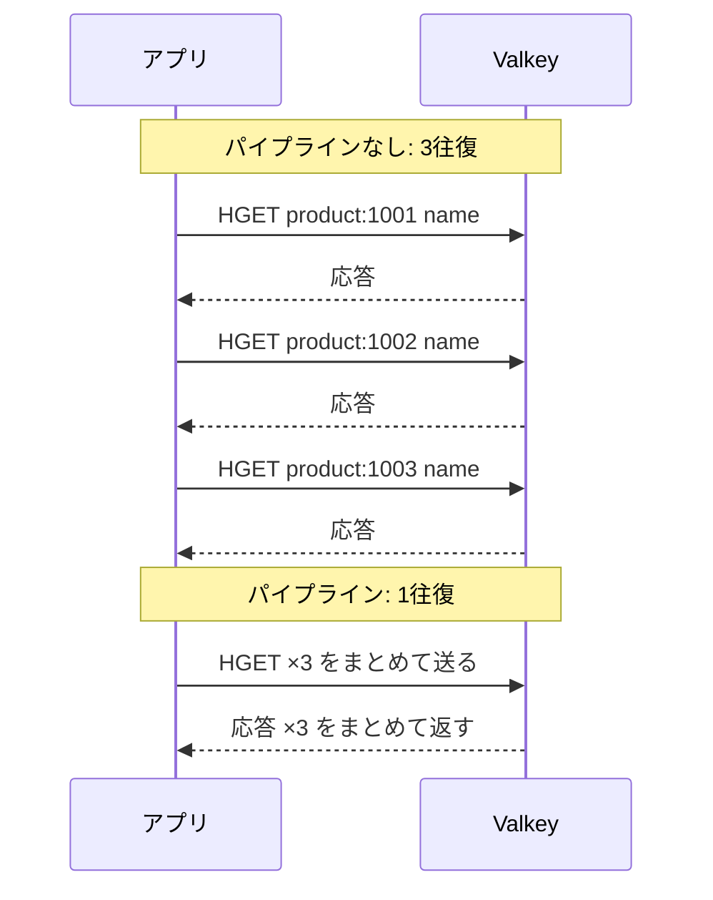

# 06. 複数コマンドの扱い

> 前提: [02. 基本操作とキー](02-basics-and-keys.md)（特に「1つのコマンドは不可分、複数のコマンドは不可分ではない」の節）

## 要点

- 複数のコマンドを扱う仕組みは3つあります。**パイプライン**（まとめて送る）、**トランザクション**（まとめて不可分に実行する）、**Lua スクリプト**（サーバー側で処理を不可分に実行する）です。
- パイプラインは**速くするための仕組み**で、不可分ではありません。トランザクションと Lua スクリプトは**不可分にするための仕組み**です。この2つを混同しないことが大切です。
- トランザクションには**ロールバックがありません。** 途中のコマンドが失敗しても、ほかのコマンドは実行されます。
- クラスターモードでは、トランザクションと Lua スクリプトで扱うキーは、**すべて同じハッシュスロットにある必要があります。** 本体と索引のように、別々のシャードにあるキーを不可分に更新することはできません。

## 3つの仕組みの比較

| | パイプライン | トランザクション（MULTI / EXEC） | Lua スクリプト |
|---|---|---|---|
| 目的 | 往復の回数を減らして速くする | 複数のコマンドを不可分に実行する | 条件分岐を含む処理を不可分に実行する |
| 不可分か | **いいえ**（間にほかのコマンドが入りうる） | はい | はい |
| ロールバック | — | **ない** | **ない** |
| 前のコマンドの結果を使った分岐 | できない | できない | できる |
| クラスターモードでのキーの制約 | なし（クライアントがシャードごとに分けて送る） | すべて同じハッシュスロット | すべて同じハッシュスロット |



## パイプライン

パイプラインは、複数のコマンドを、応答を待たずに続けて送る仕組みです。応答はまとめて受け取ります。

### なぜ速くなるのか

Valkey の1回のコマンドの処理は、マイクロ秒の単位で終わります。それに対して、アプリと Valkey の間の通信の往復（RTT）には、同じ AZ の中でも数百マイクロ秒、AZ をまたぐと 1 ミリ秒前後かかります。
つまり、小さなコマンドを1つずつ送ると、**時間のほとんどは通信の待ち時間**になります。

| 方法 | 100 個のコマンドにかかる時間の目安（RTT が 0.5 ミリ秒の場合） |
|---|---|
| 1つずつ送る | 0.5 ミリ秒 × 100 往復 = 約 50 ミリ秒 |
| パイプラインで送る | 約 0.5 ミリ秒 × 1 往復 ＋ 処理時間 = 1 ミリ秒前後 |

05 章のカテゴリ別一覧（20 件の商品の詳細を読む）や、09 章の全件ロード（大量の書き込み）では、パイプラインが必須になります。

### redis-py での使い方

```python
async with r.pipeline(transaction=False) as pipe:
    for product_id in ids:
        pipe.hmget(f"product:{product_id}", ["name", "price"])
    results: list[list[str | None]] = await pipe.execute()
```

> **注意: redis-py のパイプラインは、既定ではトランザクションになる**
>
> - **何が起きるか**: パイプラインのつもりで使ったら、トランザクション（MULTI / EXEC）として送られる。クラスターモードでは、キーが別々のハッシュスロットにあるため `CROSSSLOT` エラーになる。
> - **なぜ起きるか**: redis-py の `pipeline()` は、引数を指定しないと `transaction=True` になり、全体を MULTI と EXEC で囲んで送る。
> - **どう防ぐか**: 速くするためだけに使うなら、必ず `pipeline(transaction=False)` と書く。クラスター用のクライアントでの扱いは 08 章で説明する。

### 1回に送る量

パイプラインで送ったコマンドの応答は、すべて終わるまで Valkey のメモリにためられます。1回に送る量が多すぎると、Valkey のメモリを圧迫し、ほかのコマンドの応答も遅らせます。

| 量 | 目安 |
|---|---|
| 1回のパイプラインで送るコマンドの数 | 数百〜数千程度。それより多いときは、分けて送る |
| 応答の大きさ | 1回あたり数 MB 程度まで。大きな値を読むときは、数を減らす |

最適な量はデータの大きさと環境で変わるので、09 章の全件ロードでは実際に測って決めます。

> **注意: パイプラインは不可分ではない**
>
> パイプラインで送ったコマンドの間に、ほかのクライアントのコマンドが入ることがあります。「まとめて送ったから、まとめて反映される」わけではありません。読む側から、途中の状態が見えることがあります。不可分にしたいときは、トランザクションか Lua スクリプトを使います。

## トランザクション（MULTI / EXEC）

`MULTI` から `EXEC` までに送ったコマンドは、`EXEC` のときにまとめて、**間にほかのコマンドを挟まずに**実行されます。

```console
> MULTI
OK
> DEL product:1001
QUEUED
> HSET product:1001 name "ノートPC" price 128000
QUEUED
> EXEC
1) (integer) 1
2) (integer) 2
```

`MULTI` の後のコマンドは、すぐには実行されず `QUEUED`（予約済み）と返ります。`EXEC` で一度に実行され、結果がまとめて返ります。
03 章の「Hash の更新で、古いフィールドが残る」は、この方法で `DEL` と `HSET` を不可分にすると防げます。

### 何が保証され、何が保証されないか

| 保証されること | 保証されないこと |
|---|---|
| `EXEC` の間、ほかのクライアントのコマンドが割り込まない | **途中のコマンドが失敗しても、ほかのコマンドは実行される（ロールバックはない）** |
| ほかのクライアントからは、全部が反映される前の状態は見えない | `MULTI` の後で読んだ値を使って、続くコマンドを変えること（予約の時点では結果が分からない） |
| 中で複数のキーを読めば、同じ時点の状態が読める | 書き込みがディスクやレプリカに届いていること（12 章・13 章） |

コマンドの失敗には2種類あり、扱いが違います。

| 失敗の種類 | 例 | 結果 |
|---|---|---|
| 予約の時点で分かる失敗 | コマンド名の誤り、引数の数の誤り | `EXEC` で全体が取り消される（どのコマンドも実行されない） |
| 実行して初めて分かる失敗 | 型が違うキーへの操作（`WRONGTYPE`） | **そのコマンドだけが失敗し、ほかは実行される** |

> **RDB で言うと**
>
> 「途中でエラーになっても COMMIT される、ロールバックのないトランザクション」です。分離の点では、全部が一度に実行されるので、RDB の最も厳しい分離レベルに近い動きをします。

> **注意: トランザクションの途中の失敗で、中途半端な状態が残る**
>
> - **何が起きるか**: `DEL` の後の `HSET` が失敗し、商品のデータが消えたままになる。
> - **なぜ起きるか**: 実行して初めて分かる失敗では、ほかのコマンドは取り消されない。
> - **どう防ぐか・どう気づくか**: `EXEC` の結果を1つずつ確認し、エラーがあれば記録して、再実行できるようにする。全件を作り直す構成なら、次の作り直しで正しい状態に戻る。

### WATCH: 楽観的な排他制御

`WATCH` を使うと、「読んでから書くまでの間に、ほかの誰かが値を変えていたら、書き込みを取りやめる」ことができます。

```console
> WATCH stock:1001
OK
> GET stock:1001
"10"
> MULTI
OK
> SET stock:1001 9
QUEUED
> EXEC
(nil)
```

`WATCH` してから `EXEC` までの間に、ほかのクライアントが `stock:1001` を変更したため、`EXEC` は `(nil)` を返し、何も実行されませんでした。アプリは、最初からやり直します。

値の増減のように1つのコマンドで済むものは、`WATCH` を使わず `INCR` などで済ませるほうが単純です（02 章）。
値が一致するときだけ書き込む・削除するなら、`SET … IFEQ`（03 章）や `DELIFEQ`（Valkey 9.0 以降）も使えます。

## Lua スクリプト

Lua スクリプトを使うと、条件分岐を含む処理を、サーバー側で不可分に実行できます。
トランザクションと違い、**前のコマンドの結果を見て、次の処理を変えられます。**

```lua
-- 現在の値が期待した値のときだけ、新しい値に置き換える
-- KEYS[1]: キー / ARGV[1]: 期待する値 / ARGV[2]: 新しい値
local current = redis.call("GET", KEYS[1])
if current == ARGV[1] then
  redis.call("SET", KEYS[1], ARGV[2])
  return 1
end
return 0
```

スクリプトの中から Valkey のコマンドを呼ぶには `redis.call` を使います。Valkey では `server.call` とも書けますが、この資料では Redis と共通の `redis.call` を使います。

### redis-py での使い方

```python
SWAP_IF_EQUAL = """
local current = redis.call("GET", KEYS[1])
if current == ARGV[1] then
  redis.call("SET", KEYS[1], ARGV[2])
  return 1
end
return 0
"""

swap_if_equal = r.register_script(SWAP_IF_EQUAL)
changed: int = await swap_if_equal(keys=["catalog:current"], args=["v1", "v2"])
```

`register_script` を使うと、スクリプトの本体ではなく、スクリプトの識別子（SHA1 のハッシュ値）で呼び出します（`EVALSHA`）。
フェイルオーバーなどで Valkey 側にスクリプトが登録されていないとき（`NOSCRIPT` エラー）は、redis-py が本体を送り直します。

### スクリプトを書くときの決まり

| 決まり | 理由 |
|---|---|
| 扱うキーは、すべて `KEYS` で渡す（スクリプトの中でキー名を組み立てない） | クラスターモードでは、渡されたキーをもとに実行するシャードを決めるため。`KEYS` に含まれないキーへのアクセスは、正しく動かない |
| `KEYS` のキーは、すべて同じハッシュスロットにする | クラスターモードの制約 |
| 短い時間で終わる処理にする | 実行中は、ほかのすべてのコマンドが待たされる（01 章） |

> **注意: 長い Lua スクリプトが全体を止める**
>
> - **何が起きるか**: 大量のキーを処理するスクリプトを実行している間、すべての API のリクエストが待たされる。スクリプトが一定時間（既定では 5 秒）を超えると、ほかのクライアントには `BUSY` エラーが返り始める。
> - **なぜ起きるか**: スクリプトは不可分に実行されるため、終わるまでほかのコマンドは実行されない。時間を超えても、スクリプトは止まらない。書き込みをしたスクリプトは、途中で止めることもできない。
> - **どう防ぐか**: スクリプトで扱う要素の数に上限を設ける。大量のデータの処理は、スクリプトではなく、アプリから少しずつ（パイプラインで分けて）行う。

### Functions

Valkey には、スクリプトをサーバーに登録して名前で呼び出す **Functions**（`FUNCTION LOAD` / `FCALL`）という仕組みもあります。
ただし、**ElastiCache Serverless では使えません。** この資料の想定する使い方では、Lua スクリプト（`EVAL` / `EVALSHA`）で足ります。

## クラスターモードでの制約

| 仕組み | 制約 | 違反したとき |
|---|---|---|
| パイプライン | なし（クライアントがシャードごとに分けて送る） | — |
| トランザクション | 中のキーは、すべて同じハッシュスロット | `CROSSSLOT` エラー |
| Lua スクリプト | `KEYS` のキーは、すべて同じハッシュスロット | `CROSSSLOT` エラー |

この制約から、**キーが別々のシャードにある更新は、不可分にできません。**
たとえば、商品の Hash（`product:1001`）とカテゴリの索引（`category:10:products:by_price`）は、キー名が違うので、通常は別のシャードに置かれます。両方をトランザクションでまとめて更新することはできません。

ハッシュタグ（05 章）で同じシャードに集めることもできますが、商品と索引の組み合わせは多対多なので、すべてを1つのハッシュタグにまとめるしかなくなります。それではクラスターにした意味がなくなります。

この資料の想定する構成では、本体と索引を不可分に保つには、**新しいデータ一式を作ってから、読む先を切り替える**方法を使います（09 章）。

## 読み取りの一貫性

01 章「RDB の感覚が通用しない点」の 3 のとおり、複数のキーを読むと、更新の途中の状態が見えることがあります。

| 読み方 | 一貫性 |
|---|---|
| 1つのコマンドで1つのキーを読む | その時点の値が読める |
| パイプラインで複数のキーを読む | **途中の状態が見えることがある**（各コマンドの間に書き込みが入りうる） |
| トランザクションで複数のキーを読む | 同じ時点の状態が読める（ただし同じハッシュスロットのキーに限る） |

API の読み取りの多くは、パイプラインで複数のキーを読みます。クラスターモードでは、トランザクションで読める範囲も限られます。
そのため、**読む側で一貫性を保つのではなく、書く側で「途中の状態を見せない」ようにする**のが基本です。具体的な方法は 09 章で説明します。

## まとめ

- パイプラインは速くするための仕組みで、不可分ではありません。redis-py では `transaction=False` を必ず指定します。1回に送る量は数百〜数千程度にします。
- トランザクションは不可分に実行されますが、ロールバックはありません。途中で失敗したコマンドがあっても、ほかのコマンドは実行されます。
- Lua スクリプトは、条件分岐を含む処理を不可分に実行できます。扱うキーは `KEYS` で渡し、短い時間で終わるようにします。
- Functions は ElastiCache Serverless では使えません。Lua スクリプトで足ります。
- クラスターモードでは、トランザクションと Lua スクリプトのキーは同じハッシュスロットにある必要があり、別々のシャードにあるキーの更新は不可分にできません。
- 途中の状態を見せないためには、書く側で新しいデータを作ってから切り替える方法を使います（09 章）。
