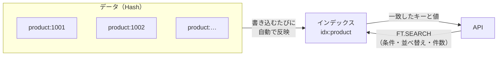

# 07. JSON と検索

> 前提: [03. データ型 (1)](03-string-and-hash.md)、[05. データモデリングとキー設計](05-data-modeling.md)（特に「二次インデックスの設計」の節）

## 要点

- **valkey-json** は、JSON の文書をそのまま保存し、**一部分だけを読み書きできる**機能です。JSON を String に入れる方法と、Hash に入れる方法の中間にあたります。
- **valkey-search** は、Hash や JSON のデータに検索用のインデックスを作る機能です。**条件の組み合わせ・範囲・並べ替えを1回の問い合わせで行えて、インデックスは自動で更新されます。**
- 自前の二次インデックス（04 章・05 章）で足りるなら、そちらのほうが単純で速いことが多いです。valkey-search は、条件の組み合わせが多いときの選択肢です。
- ElastiCache で検索を使えるのは **Valkey 9.0 以降**です。インデックスはメモリを使い、問い合わせは全シャードに広がります。
- redis-py から使うときは、**`protocol=2` を指定します。** 既定の RESP3 のままだと、検索の結果を正しく受け取れないおそれがあります。

## valkey-json

### どんなものか

valkey-json を使うと、JSON の文書を1つのキーに保存し、**パス**（`$.price` など）を指定して、一部分だけを読んだり更新したりできます。

```console
> JSON.SET product:1001 $ '{"name":"ノートPC","price":128000,"variants":[{"color":"black"},{"color":"silver"}]}'
OK
> JSON.GET product:1001 $.price
"[128000]"
> JSON.NUMINCRBY product:1001 $.price -1000
"[127000]"
> JSON.ARRAPPEND product:1001 $.variants '{"color":"white"}'
1) (integer) 3
```

ElastiCache では、Valkey 7.2 以降で、Serverless とノードベースのどちらでも使えます。

### String・Hash との比較

03 章の「オブジェクトの持ち方を選ぶ」に、valkey-json を加えると次のようになります。

| 観点 | JSON を String に入れる | Hash に入れる | valkey-json |
|---|---|---|---|
| 一部だけ読む・更新する | できない | できる | できる |
| 入れ子のデータ | 持てる | 持てない | 持てる |
| 数値の型 | 保持されない（ただの文字列） | 保持されない（文字列） | **保持される**（整数・小数・真偽値など） |
| 検索のインデックス（valkey-search） | 作れない | 作れる | 作れる |
| 扱いやすさ | 単純。どのクライアントでも使える | 単純 | 専用のコマンドとパスの書き方を覚える必要がある |

**選び方の目安**

| 状況 | おすすめ |
|---|---|
| いつも全体を読み書きする | JSON を String に入れる |
| データが平らで、一部を読み書きする | Hash |
| 入れ子のデータの一部を読み書きする。または入れ子のデータを検索の対象にしたい | valkey-json |

この資料の想定する構成（バッチで作り直し、API は読むだけ）では、一部だけを更新する場面が少ないため、valkey-json が必要になる場面は限られます。

### 主なコマンド

| コマンド | 内容 |
|---|---|
| `JSON.SET key path value` | パスの位置に値を書き込む（`$` は文書全体） |
| `JSON.GET key [path …]` | パスの位置の値を読む |
| `JSON.MGET key [key …] path` | 複数のキーから、同じパスの値を読む |
| `JSON.DEL key [path]` | パスの位置の値を削除する |
| `JSON.NUMINCRBY key path n` | 数値を増減する |
| `JSON.ARRAPPEND key path value …` | 配列に要素を追加する |
| `JSON.OBJKEYS key [path]` | オブジェクトのキーの一覧を返す |
| `JSON.TYPE key [path]` | 値の型を返す |

### パスの書き方

| 書き方 | 意味 |
|---|---|
| `$` | 文書全体 |
| `$.price` | トップレベルの `price` |
| `$.variants[0].color` | 配列 `variants` の最初の要素の `color` |
| `$.variants[-1]` | 配列の最後の要素 |
| `$..color` | 深さに関係なく、すべての `color` |
| `$.variants[?(@.color=="black")]` | 条件に合う要素 |

`$` で始まるパスは、一致したものを配列で返します（`"[128000]"` のように `[]` で囲まれて返るのはこのため）。

### 制約

| 制約 | 内容 |
|---|---|
| 文書の大きさ | 最大 64 MB（メモリ上の大きさで数える） |
| 入れ子の深さ | 最大 128 段 |
| メモリ | JSON の文字列そのものより大きくなることがある。`JSON.DEBUG MEMORY` で確認できる |

> **注意: 大きな JSON 文書はビッグキーになる**
>
> 「1つの商品にレビューを全部入れる」ような使い方をすると、文書がどんどん大きくなり、03 章のビッグキーと同じ問題が起きます。一部だけを読み書きできても、文書の大きさの問題はなくなりません。増え続けるデータは、別のキーに分けます。

## valkey-search

### どんなものか

valkey-search は、指定したプレフィックスのキー（Hash または JSON）に、検索用のインデックスを作る機能です。
インデックスを作ると、次のような問い合わせが1回でできます。

- カテゴリが pc で、かつ価格が 10,000〜150,000 円の商品を、価格順に 20 件
- 商品名に「ノート」を含む商品



> **RDB で言うと**
>
> RDB の `CREATE INDEX` と `SELECT … WHERE … ORDER BY … LIMIT` に近いものです。ただし、問い合わせの書き方は SQL ではなく専用の構文です。JOIN はできず、1つのインデックスの中だけを検索します。

### フィールドの種類

インデックスを作るときに、検索の対象にするフィールドと、その種類を指定します。

| 種類 | 用途 | 問い合わせの例 |
|---|---|---|
| TAG | カテゴリ・タグなど、完全に一致するかで絞り込む値 | `@category:{pc}`、`@tags:{sale \| new}` |
| NUMERIC | 価格・日時など、範囲で絞り込む・並べ替える数値 | `@price:[10000 150000]` |
| TEXT | 商品名・説明文など、含まれる単語で探す文章 | `@name:ノート*` |

ベクトル検索（VECTOR）もありますが、この資料では扱いません（付録 A）。

> **注意: 日本語の文章の検索（TEXT）は、期待どおりに動かない可能性が高い**
>
> - **何が起きるか**: 商品名「軽量ノートPC」が、「ノート」で検索しても見つからない。
> - **なぜ起きるか**: TEXT は、文章を空白や記号で単語に区切ってインデックスを作る。日本語は単語の間に空白がないので、「軽量ノートPC」全体が1つの単語として扱われるおそれがある。日本語の単語を区切る仕組み（形態素解析）があるとは、調査の時点では確認できていない。
> - **どう防ぐか**: 日本語の文章の検索が必要なら、使う前に実際のデータで確かめる。期待どおりに動かなければ、検索エンジン（OpenSearch など）に任せることを検討する。カテゴリやタグのような決まった値は、TEXT ではなく TAG にする。

### インデックスを作る

```console
> FT.CREATE idx:product ON HASH PREFIX 1 product: SCHEMA category TAG tags TAG SEPARATOR , price NUMERIC updated_at NUMERIC name TEXT
OK
```

| 部分 | 意味 |
|---|---|
| `idx:product` | インデックスの名前 |
| `ON HASH` | Hash のキーを対象にする（JSON なら `ON JSON`） |
| `PREFIX 1 product:` | `product:` で始まるキーを対象にする（`1` はプレフィックスの数） |
| `SCHEMA …` | 対象のフィールドと種類 |
| `tags TAG SEPARATOR ,` | `tags` フィールドの値を `,` で区切り、複数のタグとして扱う |

JSON を対象にする場合は、フィールドを JSON のパスで指定し、`AS` で名前を付けます（例: `$.price AS price NUMERIC`）。

### 問い合わせる

```console
> FT.SEARCH idx:product "@category:{pc} @price:[10000 150000]" SORTBY price ASC LIMIT 0 20 RETURN 2 name price
1) (integer) 42
2) "product:1002"
3) 1) "name"
   2) "ノートPC 軽量モデル"
   3) "price"
   4) "98000"
4) "product:1001"
…
```

最初の `42` は条件に一致した件数で、その後に、キーと値の組が続きます。

| 構文 | 意味 |
|---|---|
| `@f:{a}` / `@f:{a \| b}` | TAG が a に一致 / a または b に一致 |
| `@f:[10 100]` | NUMERIC が 10 以上 100 以下。`(10` で「10 より大きい」、`-inf` / `+inf` で上限・下限なし |
| 空白でつなぐ | かつ（AND） |
| `\|` でつなぐ | または（OR） |
| 先頭に `-` | 否定（NOT） |
| `SORTBY f ASC\|DESC` | 並べ替え |
| `LIMIT offset num` | 何件目から何件返すか（**省略すると 10 件**） |
| `RETURN n f …` | 返すフィールドを限定する（省略すると全フィールド） |
| `NOCONTENT` | キー名だけを返す |

集計（カテゴリごとの件数など）には `FT.AGGREGATE` を使います。

```console
> FT.AGGREGATE idx:product * GROUPBY 1 @category REDUCE COUNT 0 AS count
```

> **注意: LIMIT を付け忘れると 10 件しか返らない**
>
> `FT.SEARCH` は、`LIMIT` を省略すると最初の 10 件だけを返します。一致した件数（応答の最初の数）が多いのに結果が少ないときは、`LIMIT` を確認します。

### インデックスの更新の仕組み

| 場面 | 動き |
|---|---|
| 対象のキーを書き込む・削除する | バックグラウンドのスレッドでインデックスに反映される。書き込んだクライアントへの応答は、インデックスへの反映が終わってから返る |
| 複数のキーの更新 | 反映の順番は、書き込んだ順と一致するとは限らない（トランザクションや Lua スクリプトの中の更新は、まとめて反映される） |
| インデックスを作ったとき | すでにあるキーを、バックグラウンドで読み込む（バックフィル、backfill）。**読み込みが終わるまでの問い合わせには、読み込み済みのキーしか含まれない** |
| レプリカ | レプリカは自分のインデックスを持ち、レプリケーションで更新される。プライマリより遅れることがある |

バックフィルの進み具合は `FT.INFO` で確認できます。

```console
> FT.INFO idx:product
…
 "state"
 "backfill_in_progress"
 "backfill_complete_percent"
 "0.42"
…
```

`state` が `ready` になれば、読み込みは終わっています。

> **注意: インデックスを作り直した直後、検索結果が欠ける**
>
> - **何が起きるか**: デプロイでインデックスを作り直した直後、検索結果の件数が少なくなる。
> - **なぜ起きるか**: バックフィルが終わるまでは、読み込み済みのキーしか検索の対象にならない。データが多いほど時間がかかる。
> - **どう防ぐか**: インデックスの作成は API の切り替えより前に行い、`FT.INFO` の `state` が `ready` になってから、そのインデックスを使う API を公開する。

### クラスターモードでの動き

| 項目 | 動き |
|---|---|
| インデックスの定義 | どのシャードで `FT.CREATE` しても、すべてのシャードに配られる |
| インデックスの中身 | 各シャードが、自分の持つキーの分だけを持つ |
| 問い合わせ | **すべてのシャードに問い合わせて、結果をまとめて返す** |

問い合わせがすべてのシャードに広がるため、次のような性質があります。

- シャードを増やしても、問い合わせの処理能力はあまり増えません（書き込みの処理能力は増えます）。問い合わせを増やしたいときは、CPU の大きいノードやレプリカを使います。
- 応答の時間は、最も遅いシャードに引きずられます。

### 自前のインデックスとの使い分け

| 観点 | 自前の二次インデックス（04 章・05 章） | valkey-search |
|---|---|---|
| 1つの条件での一覧 | 速い（`ZRANGE` 1回） | 使えるが、自前のほうが軽い |
| 条件の組み合わせ | 組み合わせごとに索引を作る必要がある | 1回の問い合わせでできる |
| 文章を含む単語で探す | 難しい | できる（TEXT。ただし日本語は要確認） |
| インデックスの更新 | 自分で書く。ずれる危険がある | 自動 |
| メモリ | 必要な索引の分だけ | インデックスの分、余分に使う |
| 問い合わせの負荷 | 1つのシャードで済む | すべてのシャードに広がる |
| 運用の難しさ | 単純 | バックフィル、制約、クライアントとの相性に注意が必要 |

この資料の題材では、カテゴリ別・タグ別の一覧は自前の Sorted Set で作り、条件を自由に組み合わせる検索画面が必要になったら valkey-search を検討する、という順番が自然です。

## ElastiCache での制約

| 項目 | 内容 |
|---|---|
| 使えるバージョン | Valkey 9.0 以降（TAG・NUMERIC・TEXT の検索）。8.2 はベクトル検索だけ |
| 使えない構成 | データ階層化（SSD を使うノードタイプ）。小さいノード（t3・t4g）は、より多くの予約メモリが必要 |
| インデックスの数 | 最大 1,000 |
| 1つのインデックスのフィールドの数 | 最大 1,000 |
| 1つのインデックスのプレフィックスの数 | Serverless は 8、ノードベースは 16 |
| TAG の値の長さ | Serverless は 256、ノードベースは 10,000 |
| 問い合わせの時間の上限（`TIMEOUT`） | 最大 60 秒 |
| トランザクションと Lua スクリプト | `FT.CREATE` / `FT.DROPINDEX` は、その中で使えない。クラスターモードでは `FT.SEARCH` / `FT.AGGREGATE` も、トランザクションの中で使えない |
| 権限（ACL） | 検索のコマンドは `@search` という分類にまとめられている（15 章） |

検索の機能は、Valkey と valkey-search のバージョンによって使えるオプションが違います。公開されている最新のドキュメントのオプションが、ElastiCache の使っているバージョンにあるとは限りません。新しいオプションを使う前に、ElastiCache の環境で確認してください。

> **注意: インデックスのメモリを見積もりに入れ忘れる**
>
> インデックスは、データとは別にメモリを使います。どれだけ使うかは、フィールドの数と種類、データの件数によって変わります。11 章のメモリの見積もりでは、実際のデータでインデックスを作り、作る前と後のメモリの使用量の差を測ります。

## redis-py から使う

redis-py には、JSON 用の `r.json()` と、検索用の `r.ft()` が用意されています。

```python
from redis.asyncio import Redis
from redis.commands.search.query import Query

# 検索・JSON を使うときは、protocol=2 を明示する（理由は下の注意を参照）
r = Redis(host="localhost", port=6379, protocol=2, decode_responses=True)

query = (
    Query("@category:{pc} @price:[10000 150000]")
    .sort_by("price", asc=True)
    .paging(0, 20)  # LIMIT 0 20
    .return_fields("name", "price")
)
result = await r.ft("idx:product").search(query)
total: int = result.total
names: list[str] = [doc.name for doc in result.docs]
```

> **注意: redis-py の既定の通信方式（RESP3）では、検索の結果を正しく受け取れないおそれがある**
>
> - **何が起きるか**: 検索の結果が空になる、または値がおかしくなる。エラーにならずに起きることがある。
> - **なぜ起きるか**: redis-py は 8.0 から、通信方式として RESP3 を既定で使い、検索や JSON の応答も RESP3 の形を前提に解釈する。一方、valkey-search の応答は、調査の時点では RESP3 の形式に対応していない（対応の作業は進行中）。
> - **どう防ぐか**: 検索や JSON を使うクライアントは、`protocol=2` を指定して作る。本番に出す前に、実際の ElastiCache の環境で、検索の結果が正しく返ることを確認する。

redis-py の検索の機能は、Redis の検索モジュール（RediSearch）に合わせて作られています。valkey-search は互換性を目指していますが、違いもあります。

| 違い | 影響 |
|---|---|
| 使えないコマンドがある（`FT.CONFIG`、`FT.PROFILE`、`FT.SPELLCHECK` など） | redis-py にメソッドがあっても、呼ぶとエラーになる |
| `FT.INFO` の応答の形が違う | redis-py の `info()` が、エラーにならずに間違った値を返すことがある。`FT.INFO` の値は、valkey-cli で確認するほうが確実 |
| 並べ替えを指定しない問い合わせの結果の順番が保証されない | `LIMIT` でページングするときは、必ず `SORTBY` を指定する |

## まとめ

- valkey-json は、入れ子の JSON の一部を読み書きできる機能です。全体を読み書きするだけなら String、平らなデータなら Hash で足ります。
- valkey-search は、Hash や JSON にインデックスを作り、条件の組み合わせ・範囲・並べ替え・文章の検索を1回の問い合わせで行えます。インデックスは自動で更新されます。日本語の文章の検索は、実際のデータで確かめてから使います。
- インデックスを作った直後は、バックフィルが終わるまで結果が欠けます。`FT.INFO` で確認してから使います。
- クラスターモードでは、問い合わせはすべてのシャードに広がります。
- 1つの条件での一覧は自前の索引、条件の組み合わせが多いときは valkey-search、と使い分けます。
- ElastiCache では Valkey 9.0 以降で使えます。インデックスのメモリと、構成ごとの制約を確認します。
- redis-py から使うときは `protocol=2` を指定し、本番の前に実際の環境で結果を確認します。
