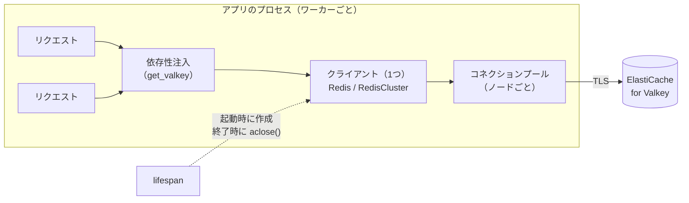

# 08. FastAPI からの利用

> 前提: [06. 複数コマンドの扱い](06-multi-command.md)

## 要点

- クライアントには redis-py の非同期版（`redis.asyncio`）を使います。**クライアントはアプリの起動時に1つ作って使い回し**、終了時に閉じます（FastAPI の lifespan）。
- 接続先の構成によって、使うクラスが違います。**ElastiCache Serverless とクラスターモード有効のノードベースは `RedisCluster`**、クラスターモード無効のノードベースとローカルの単一ノードは `Redis` です。
- **タイムアウトとリトライは必ず設定します。** 既定のままだと、Valkey が応答しないときに、1つのリクエストが1分前後待たされることがあります。
- Valkey が使えないときに API をどう振る舞わせるか（エラーを返すか、RDB から読むか）を、あらかじめ決めておきます。
- Valkey 独自のコマンドには専用のメソッドがないので、`execute_command` で呼びます。逆に、redis-py にあっても Valkey にはないコマンドがあります。

## 全体像



| 要素 | 役割 |
|---|---|
| lifespan | アプリの起動時にクライアントを作り、終了時に閉じる |
| クライアント | アプリ全体で1つ。複数のリクエスト（非同期のタスク）から同時に使ってよい |
| コネクションプール（connection pool） | クライアントの中にあり、接続を使い回す。コマンドごとに空いている接続を借りて返す |
| 依存性注入 | エンドポイントの関数にクライアントを渡す |

## 構成ごとのクライアントの選び方

| 接続先 | クラス | 接続先のアドレス |
|---|---|---|
| ElastiCache Serverless | `RedisCluster` | キャッシュのエンドポイント |
| ElastiCache ノードベース（クラスターモード有効） | `RedisCluster` | 設定エンドポイント |
| ElastiCache ノードベース（クラスターモード無効） | `Redis` | プライマリエンドポイント（読み取り専用ならリーダーエンドポイントも使える） |
| ローカルの単一ノード（Docker Compose） | `Redis` | `localhost` など |

クラスターでは、どのシャードに送るかをクライアントが決める必要があるため、`RedisCluster` を使います（理由は 13 章「クライアントが振り分けを担う」）。
`Redis` と `RedisCluster` は、コマンドのメソッドはほぼ同じですが、次の点が違います。

| 項目 | `Redis` | `RedisCluster` |
|---|---|---|
| キーの振り分け | しない（1つのノードに送る） | キーのハッシュスロットから、送り先のシャードを決める |
| リダイレクト（MOVED / ASK）とトポロジーの変化 | — | 自動でたどり、シャードの構成を更新して送り直す |
| DB 番号 | 指定できる | **0 以外を指定すると例外**（`Argument 'db' must be 0 or None in cluster mode`） |
| `pipeline()` の既定 | トランザクションあり | トランザクションなし（06 章） |
| パイプラインの送り方 | まとめて1つのノードへ | ノードごとに分けて、並行して送る |
| 複数のキーを扱うコマンド（`MGET` など） | そのまま使える | キーが別々のハッシュスロットにあるとエラーになりうる |

ローカルは `Redis`、本番は `RedisCluster` という組み合わせになることが多いので、**この違いがローカルでは見えない**ことに注意します（10 章）。

## クライアントを作る

設定値は環境変数などから読み、接続先の構成に合わせてクラスを切り替えます。

```python
from redis.asyncio import Redis
from redis.asyncio.cluster import RedisCluster
from redis.asyncio.retry import Retry
from redis.backoff import ExponentialWithJitterBackoff

ValkeyClient = Redis | RedisCluster


def create_valkey_client(settings: Settings) -> ValkeyClient:
    options = {
        # タイムアウト: 既定は 5 秒。API の応答時間の目標に合わせて短くする
        "socket_timeout": 0.5,
        "socket_connect_timeout": 1.0,
        # リトライ: 既定は 10 回。回数と待ち時間の上限を決めておく
        "retry": Retry(ExponentialWithJitterBackoff(base=0.01, cap=0.1), retries=2),
        "decode_responses": True,  # 値を str で受け取る
        "protocol": 2,  # 07 章の理由により明示する
        "ssl": settings.valkey_tls,  # ElastiCache Serverless では必須（True）
        "username": settings.valkey_username,
        "password": settings.valkey_password,
    }
    if settings.valkey_cluster_mode:
        return RedisCluster(host=settings.valkey_host, port=settings.valkey_port, **options)
    return Redis(host=settings.valkey_host, port=settings.valkey_port, **options)
```

上のタイムアウトとリトライの値は例です。決め方は「タイムアウトとリトライ」の節で説明します。

### 主な設定項目

| 項目 | 既定値 | 内容 |
|---|---|---|
| `socket_timeout` | 5 秒 | コマンドの応答を待つ時間の上限 |
| `socket_connect_timeout` | 5 秒 | 接続を確立するまでの時間の上限 |
| `retry` | 最大 10 回、待ち時間は指数的に増やし、上限 1 秒 | 接続エラーとタイムアウトのときに、送り直す回数と間隔 |
| `max_connections` | 100（`RedisCluster` ではノードごと） | プールの接続の数の上限 |
| `decode_responses` | `False` | `True` にすると、応答を `bytes` ではなく `str` で受け取る |
| `protocol` | 指定なし（RESP3 を使う） | 通信の方式。`2` で RESP2 |
| `ssl` | `False` | TLS で接続する |
| `health_check_interval` | 0（行わない） | 一定時間使われなかった接続を、使う前に確認する間隔（秒） |

> **注意: decode_responses とバイナリのデータ**
>
> `decode_responses=True` にすると、すべての応答を文字列として解釈します。圧縮したデータや MessagePack（03 章）など、文字列ではない値を入れる場合は、`False` のクライアントを別に用意します。

## FastAPI に組み込む

### lifespan でクライアントを作る・閉じる

```python
from collections.abc import AsyncIterator
from contextlib import asynccontextmanager
from typing import Annotated

from fastapi import Depends, FastAPI, Request


@asynccontextmanager
async def lifespan(app: FastAPI) -> AsyncIterator[None]:
    client = create_valkey_client(get_settings())
    app.state.valkey = client
    try:
        yield
    finally:
        await client.aclose()  # 接続とプールを閉じる


app = FastAPI(lifespan=lifespan)


def get_valkey(request: Request) -> ValkeyClient:
    return request.app.state.valkey


ValkeyDep = Annotated[ValkeyClient, Depends(get_valkey)]
```

### エンドポイントで使う

```python
from fastapi import HTTPException
from redis.exceptions import ConnectionError, TimeoutError


@app.get("/products/{product_id}")
async def get_product(product_id: int, r: ValkeyDep) -> ProductOut:
    try:
        h: dict[str, str] = await r.hgetall(keys.product(product_id))
    except (ConnectionError, TimeoutError):
        # Valkey が使えないときの振る舞い（後述の節を参照）
        raise HTTPException(status_code=503)
    if not h:
        raise HTTPException(status_code=404)
    return ProductOut.from_hash(product_id, h)
```

- `keys.product(...)` は、キーの名前を組み立てる関数です。キーの名前は1か所で組み立てます（02 章）。
- 値の型の変換（`from_hash`）も1か所にまとめます（03 章）。

> **注意: リクエストごとにクライアントを作る**
>
> - **何が起きるか**: 負荷が上がると、Valkey への接続の数が急増し、接続の確立（TLS の処理を含む）に時間がかかって応答が遅くなる。閉じ忘れた接続が残り続けることもある。
> - **なぜ起きるか**: クライアントを作るたびに、新しいコネクションプールと接続が作られる。TLS の接続の確立は、コマンドの処理よりはるかに重い。
> - **どう防ぐか**: クライアントは lifespan で1つだけ作り、依存性注入で渡す。

> **注意: ワーカーのプロセスを分ける前にクライアントを作る**
>
> - **何が起きるか**: 複数のワーカーのプロセスで動かしたとき、接続がおかしくなり、応答の取り違えや接続エラーが起きる。
> - **なぜ起きるか**: redis-py のクライアントは、プロセスの複製（fork）に対して安全ではない。モジュールを読み込んだ時点（プロセスを分ける前）にクライアントを作ると、複数のプロセスが同じ接続を共有してしまう。
> - **どう防ぐか**: クライアントは、モジュールの読み込み時ではなく lifespan の中で作る。lifespan はワーカーごとに実行される。

> **注意: 非同期のエンドポイントで、同期版のクライアントを使う**
>
> `async def` のエンドポイントで、同期版の `redis.Redis` を使うと、Valkey の応答を待つ間、そのワーカーのほかのリクエストの処理がすべて止まります。`async def` の中では、必ず `redis.asyncio` のクライアントを使います。

## タイムアウトとリトライ

### 既定値のままだと、長く待たされる

既定値では、1回のコマンドの応答を最大 5 秒待ち、失敗すると最大 10 回送り直します。
Valkey が応答しなくなったとき、1つのリクエストが待たされる時間は、おおよそ次のようになります。

```text
待ち時間 ≒ タイムアウト × (1 + リトライの回数) + リトライの間の待ち時間の合計
既定値:   5 秒 × 11 回 + 数秒 ≒ 1 分前後
```

その間、リクエストは処理中のまま残り、ワーカーの同時処理数や、手前のロードバランサーのタイムアウトを使い切ります。Valkey の障害が、API 全体の障害に広がります。

### 値の決め方

| 項目 | 決め方 |
|---|---|
| `socket_timeout` | Valkey の通常の応答時間（ミリ秒未満〜数ミリ秒）に十分な余裕を持たせ、API の応答時間の目標より十分に短くする。例: 0.2〜1 秒 |
| `socket_connect_timeout` | 接続の確立（TLS を含む）に十分な時間。例: 1〜2 秒 |
| リトライの回数 | フェイルオーバー中の短い切断を乗り切れる程度。例: 2〜3 回 |
| リトライの間の待ち時間 | 指数的に増やし、ばらつき（ジッター）を入れる。全クライアントが同時に送り直して負荷が集中するのを防ぐ |
| 全体 | 「タイムアウト × (1 + リトライの回数) + 待ち時間」が、API の応答時間の上限に収まるようにする |

`RedisCluster` は、リトライのたびに、シャードの構成を取り直してから送り直します。フェイルオーバーで新しいプライマリに切り替わったときも、数回のリトライの間に自動で追従します（13 章）。

> **注意: 書き込みのリトライで、二重に実行される**
>
> タイムアウトしたコマンドは、Valkey 側では実行済みのことがあります。`INCR` のように、2回実行すると結果が変わるコマンドをリトライすると、二重に実行されることがあります。バッチ（09 章）では、何度実行しても同じ結果になる書き込み（`SET`、`HSET` など）を基本にします。

## コネクションプールと接続の数

コマンドを送るたびに、プールから空いている接続を借り、応答を受け取ったら返します。同時に実行中のコマンドの数だけ、接続が使われます。

| 項目 | 内容 |
|---|---|
| プールの上限に達したとき | 既定のプール（`ConnectionPool`）は、待たずにエラー（`MaxConnectionsError`）にする。`BlockingConnectionPool` を使うと、空くまで一定時間待つ |
| Valkey 側の接続の数 | アプリ全体で、「ポッドの数 × ワーカーの数 × 1ワーカーが同時に使う接続の数」になる。`RedisCluster` はノードごとに接続を持つ |
| 監視 | ElastiCache の `CurrConnections` と `NewConnections`（16 章） |

> **注意: 接続の数が、気づかないうちに増える**
>
> - **何が起きるか**: スケールアウトでポッドを増やしたら、Valkey の接続の数が上限に近づき、新しい接続が失敗する。接続の確立が増えて、Valkey の CPU の使用率も上がる。
> - **なぜ起きるか**: 接続の数は、ポッドの数とワーカーの数の掛け算で増える。`NewConnections` が多い場合は、接続を使い回せていない（リクエストごとにクライアントを作っている、など）。
> - **どう防ぐか・どう気づくか**: 想定する最大のポッドの数で、接続の数を見積もる。`CurrConnections` と `NewConnections` を監視する。

## Valkey が使えないときの振る舞い

Valkey の障害やフェイルオーバーの間、コマンドは失敗します（`ConnectionError`、`TimeoutError` など）。このときに API をどう振る舞わせるかは、あらかじめ決めておく必要があります。

| 方針 | 内容 | 長所 | 短所 |
|---|---|---|---|
| エラーを返す | 503 などを返す | 単純。RDB に影響しない | Valkey の障害の間、API が使えない |
| RDB から読む | Valkey の代わりに、正本の RDB に問い合わせる | API が使い続けられる | **RDB に、ふだんの何倍もの負荷が一度にかかる。** RDB まで止まるおそれがある |
| 古いデータを返す | アプリのメモリに短時間だけ持っている値を返す | API が使い続けられる | 対象が限られる。データが古い |

この資料の想定する構成では、Valkey は「RDB では間に合わない速さで応答するため」に置かれています。Valkey が止まったときに、同じ量のリクエストを RDB で受けられるとは限りません。
RDB から読む方針にする場合は、RDB に流す量を制限する仕組み（同時実行数の上限など）とセットにします。

> **注意: ヘルスチェックに Valkey の状態を含める**
>
> - **何が起きるか**: Valkey のフェイルオーバーで数秒間つながらなくなっただけで、すべてのポッドがヘルスチェックに失敗して再起動され、API 全体が止まる。
> - **なぜ起きるか**: ポッドを生かすかどうかの判定（liveness）に、Valkey への `PING` を含めている。Valkey の一時的な問題で、アプリまで止まってしまう。
> - **どう防ぐか**: liveness は、アプリ自身が動いているかだけを見る。Valkey の状態は、メトリクスやアラーム（16 章）で監視する。

### 「キーがない」ことの扱い

`HGETALL` の結果が空のとき、その商品が本当に存在しないのか、データの入れ替えの途中で一時的に見えないだけなのかは、Valkey の応答だけでは区別できません（01 章「RDB の感覚が通用しない点」の 7）。
404 を返してよいかは、データの入れ替えの方式（09 章）で「途中の状態を見せない」ようにできているかによります。

## Valkey 独自のコマンドと、Redis だけのコマンド

redis-py は Redis のために作られたクライアントです。そのため、Valkey と Redis で違うコマンドの扱いに注意が必要です。

| 種類 | 例 | 扱い |
|---|---|---|
| Valkey にあり、redis-py に専用のメソッドがない | `DELIFEQ`（9.0）、`MSETEX`・`CLUSTERSCAN`（9.1） | `execute_command` で呼ぶ |
| redis-py に専用のメソッドがあり、Valkey にない | Redis の新しいバージョンで追加されたコマンド（例: `HIMPORT`） | 呼ぶとエラーになる。補完の候補に出ても使わない |
| どちらにもあるが、オプションが違う | 新しいバージョンで追加されたオプション | Valkey のドキュメントで確認してから使う |

```python
# Valkey 独自のコマンドは execute_command で呼ぶ
deleted: int = await r.execute_command("DELIFEQ", "lock:batch:daily", "worker-1")
```

> **注意: クラスターモードで、独自のコマンドが正しいノードに届くか**
>
> `RedisCluster` は、コマンドからキーを取り出して送り先を決めます。redis-py が知らないコマンドの場合、キーを正しく取り出せるかどうかは、調査の時点では確認できていません。Valkey 独自のコマンドを使う場合は、本番と同じクラスターモードの環境で動作を確認してください。

## クラスターモードで気をつける操作

| 操作 | 注意点 | 対処 |
|---|---|---|
| 複数のキーを読む（`MGET` など） | キーが別々のハッシュスロットにあるとエラーになりうる | `mget_nonatomic()` / `mset_nonatomic()` を使う（スロットごとに分けて送る。不可分ではない）。または、パイプライン（`transaction=False`）で、キーごとのコマンドを送る。`RedisCluster` はノードごとに分けて並行に送る（06 章） |
| トランザクション（`pipeline(transaction=True)`） | キーがすべて同じハッシュスロットにないとエラー | ハッシュタグ（05 章）で集める。または不可分にしない設計にする（09 章） |
| Lua スクリプト | `KEYS` がすべて同じハッシュスロットにないとエラー | 同上 |
| `SCAN` | 1つのノードのキーしか返さない | 全体をたどるときは、すべてのプライマリに対して実行する（09 章の一括削除など） |
| DB 番号 | Valkey 9.0 以降はクラスターモードでも複数の DB を使えるが、`RedisCluster` は 0 以外を指定すると例外になる | キーのプレフィックスで分ける（02 章） |

## まとめ

- クライアントは redis-py の非同期版を使い、lifespan で1つ作って使い回し、終了時に `aclose()` で閉じます。ワーカーのプロセスを分ける前には作りません。
- Serverless とクラスターモード有効は `RedisCluster`、それ以外は `Redis` を使います。両者の違い（パイプラインの既定、DB 番号、複数キーの操作）は、ローカルでは見えません。
- タイムアウトとリトライは、既定値のままにせず、API の応答時間の上限に収まるように決めます。書き込みのリトライでは、二重の実行に注意します。
- 接続の数は、ポッドの数 × ワーカーの数で増えます。見積もって、監視します。
- Valkey が使えないときの振る舞いを決めておきます。RDB から読む場合は、RDB への負荷の集中に備えます。ヘルスチェックに Valkey の状態を含めません。
- Valkey 独自のコマンドは `execute_command` で呼びます。redis-py にあっても Valkey にないコマンドは使いません。
