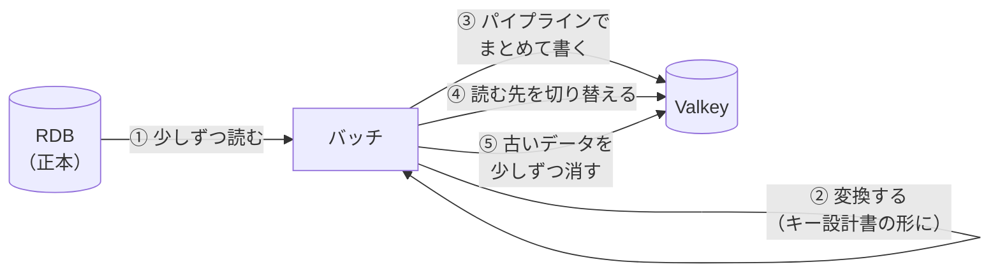
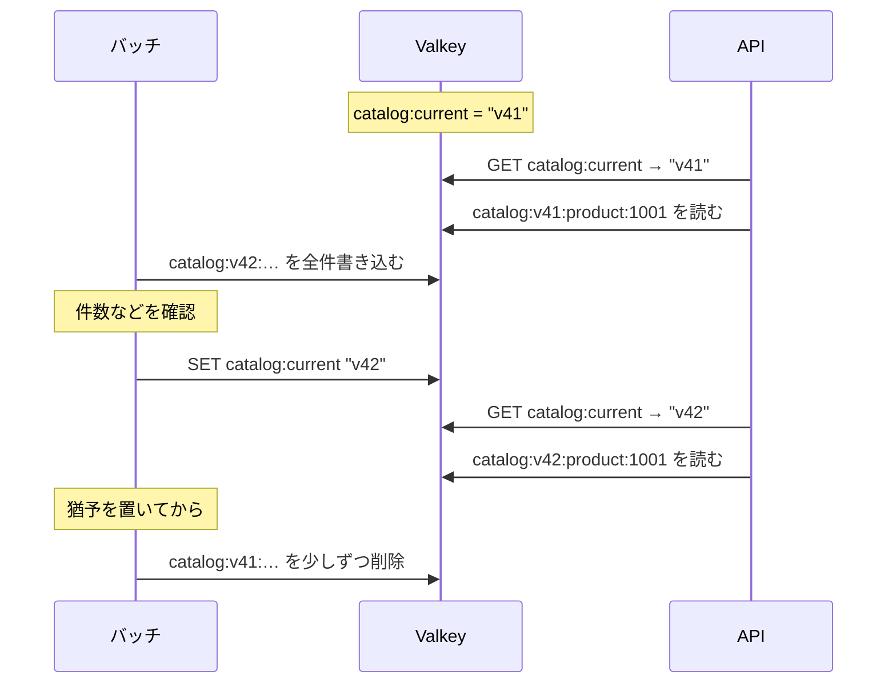

# 09. データの投入・入れ替え・削除

> 前提: [05. データモデリングとキー設計](05-data-modeling.md)、[06. 複数コマンドの扱い](06-multi-command.md)、[08. FastAPI からの利用](08-fastapi.md)

## 要点

- RDB からの全件ロードは、**パイプラインで数百〜数千件ずつまとめて**送ります。1件ずつ送ると、通信の往復だけで何十倍も時間がかかります。
- 全件を入れ替えるときは、**新しいデータ一式を別のキーに作ってから、読む先を一度に切り替える**方法（バージョン付きのキーとポインタ）が基本です。上書きしていく方法では、途中の状態が API から見えます。
- 差分の同期は、整合性の保ち方が難しくなります。差分の同期を使う場合も、**定期的な全件の作り直し**と組み合わせて、ずれを解消します。
- 削除は、`DEL` ではなく **`UNLINK`**（バックグラウンドで解放する）を使い、大量のキーは**少しずつ**消します。削除してもメモリがすぐに減るとは限りません。
- 大量のデータを扱うときは、メモリの余裕、本番のトラフィックへの影響、ネットワークの帯域を、あらかじめ見積もります。

## 全体の流れ



## 全件ロード

### パイプラインでまとめて送る

06 章で説明したとおり、1件ずつ書き込むと、時間のほとんどが通信の往復の待ち時間になります。

| 方法 | 100 万件の書き込みにかかる時間の目安（RTT が 0.5 ミリ秒の場合） |
|---|---|
| 1件ずつ送る | 0.5 ミリ秒 × 100 万往復 ≒ 8 分以上 |
| 1,000 件ずつパイプラインで送る | 0.5 ミリ秒 × 1,000 往復 ＋ 処理時間 ≒ 数秒〜十数秒 |

```python
from collections.abc import AsyncIterable

BATCH_SIZE = 1000  # 実際に測って決める


async def load_products(r: ValkeyClient, rows: AsyncIterable[ProductRow], version: str) -> int:
    count = 0
    async with r.pipeline(transaction=False) as pipe:
        async for row in rows:
            key = keys.product(row.id, version=version)
            pipe.hset(key, mapping=to_hash(row))
            pipe.zadd(keys.category_by_price(row.category_id, version=version), {str(row.id): row.price})
            count += 1
            if count % BATCH_SIZE == 0:
                await pipe.execute()  # ここで送信し、パイプラインは空になる
        await pipe.execute()  # 残りを送る
    return count
```

- RDB からは、全件を一度にメモリに読み込まず、カーソルなどで少しずつ読みます。
- `execute()` の結果（各コマンドの結果）を確認し、エラーがあれば記録します。
- `version` は、後述の「バージョン付きのキー」で使う値です。

### スループットを上げる・抑える

| やりたいこと | 方法 | 注意点 |
|---|---|---|
| もっと速くしたい | 複数のパイプラインを並行して送る（`asyncio` のタスクを複数にする） | 並行の数を上げすぎると、Valkey の CPU を使い切り、本番の API が遅くなる |
| 本番への影響を抑えたい | 並行の数を減らす。バッチの間に短い待ち時間を入れる | 全体の時間は延びる |
| ちょうどよい量を見つけたい | 本番に近い環境で、バッチの大きさと並行の数を変えて測る | Valkey の CPU（`EngineCPUUtilization`）と、API の応答時間を見ながら決める |

> **注意: 全件ロードが、本番の API を遅くする**
>
> - **何が起きるか**: 全件ロードの間、API の応答時間が悪化する。
> - **なぜ起きるか**: コマンドを実行するスレッドは1本で、バッチの書き込みと API の読み取りが同じスレッドを取り合う（01 章）。ネットワークの帯域も共有している。
> - **どう防ぐか・どう気づくか**: アクセスの少ない時間帯に実行する。スループットに上限を設ける。ロード中の `EngineCPUUtilization` と API の応答時間を監視する（16 章）。

## 全件の入れ替えの方式

全件を作り直すとき、古いデータから新しいデータへどう切り替えるかで、API から見える状態が変わります。

| 方式 | 内容 | 途中の状態が見えるか | 消えたデータの扱い | メモリ |
|---|---|---|---|---|
| A. 上書き | 本番のキーに、そのまま書き込んでいく | **見える**（商品は新しく、一覧は古い、など） | 残る。別に消す必要がある | 1世代分 |
| B. バージョン付きのキーとポインタ | 新しい世代のキーに書き込み、最後にポインタを切り替える | 見えない | 古い世代ごと消える | **2世代分** |
| C. RENAME | 一時的なキーに作り、`RENAME` で本番のキーに置き換える | キーごとには見えない。キーどうしの間では見える | 残る | 1つのキーの2倍 |

### A. 上書き

最も単純ですが、次の問題があります。

- 書き込みの途中では、新しいキーと古いキーが混ざって見えます（01 章「RDB の感覚が通用しない点」の 3）。
- RDB で削除された商品のキーは、上書きでは消えません。一覧などの索引にも残ります（04 章）。
- Hash を `HSET` で上書きすると、古いフィールドが残ります（03 章）。

途中の状態が見えても問題がなく、削除がほとんど起きないデータに限って使います。

### B. バージョン付きのキーとポインタ（基本の方式）

キー名に世代（バージョン）を含め、「今どの世代を読むか」を1つのキー（ポインタ）に持ちます。



| 手順 | 内容 |
|---|---|
| 1 | 新しい世代の名前を決める（例: `v42`、または日時） |
| 2 | 全件を、新しい世代のキー（`catalog:v42:product:1001` など）に書き込む |
| 3 | 件数や、いくつかのサンプルの値を確認する |
| 4 | ポインタを切り替える（`SET catalog:current v42`）。1つのコマンドなので、一瞬で切り替わる |
| 5 | 古い世代を読んでいる処理が終わるまで、猶予を置く |
| 6 | 古い世代のキーを、少しずつ削除する（後述） |

読む側は、リクエストの最初にポインタを読み、そのリクエストの間は同じ世代を読みます。

```python
async def current_version(r: ValkeyClient) -> str:
    version: str | None = await r.get("catalog:current")
    if version is None:
        raise CatalogNotReady()
    return version


@app.get("/products/{product_id}")
async def get_product(product_id: int, r: ValkeyDep) -> ProductOut:
    version = await current_version(r)  # 1リクエストの中では、同じ世代を読む
    h: dict[str, str] = await r.hgetall(keys.product(product_id, version=version))
    ...
```

この方式の長所と注意点は次のとおりです。

| 長所 | 注意点 |
|---|---|
| 途中の状態が見えない。切り替えは一瞬 | ロードの間、**2世代分のメモリ**が必要（11 章） |
| 削除された商品は、古い世代と一緒に消える | 読むたびにポインタを読む分、往復が1回増える（アプリのメモリに数秒だけ持つ方法もある） |
| 失敗したら、作りかけの世代を消してやり直せばよい（ポインタは古いまま） | 古い世代の削除を忘れると、メモリを使い続ける |
| ポインタは1つのキーなので、クラスターモードでも使える | 差分の同期と組み合わせるときは、どの世代に書くかを決める必要がある |

> **注意: 古い世代を、すぐに消してしまう**
>
> - **何が起きるか**: ポインタを切り替えた直後に古い世代を消したため、切り替えの直前にポインタを読んだリクエストが、消えたキーを読んで 404 になる。
> - **なぜ起きるか**: リクエストの最初に読んだポインタ（古い世代）で、その後のキーを読んでいる。アプリがポインタをメモリに持っている場合は、その期間も古い世代が読まれる。
> - **どう防ぐか**: 古い世代の削除は、リクエストの処理時間とポインタを持つ期間より十分に長い猶予（数分など）を置いてから行う。

### C. RENAME

`RENAME` は、キーの名前を変えるコマンドです。変更先のキーがすでにあれば、そのキーを置き換えます。1つのコマンドなので、置き換えは不可分です。

```console
> ZADD tmp:category:10:products:by_price 98000 1002 128000 1001
(integer) 2
> RENAME tmp:category:10:products:by_price category:10:products:by_price
OK
```

1つのキーを丸ごと作り直す場合（大きな一覧の Sorted Set など）に便利です。ただし、次の点に注意します。

| 注意点 | 内容 |
|---|---|
| 置き換えられるのは、1つのキーだけ | 複数のキーの間では、途中の状態が見える |
| クラスターモード | 変更前と変更後のキーが、同じハッシュスロットにある必要がある。ハッシュタグを付ける（例: `tmp:{category:10}:…` と `{category:10}:…`） |
| 置き換えられた古い値の解放 | 古い値が大きいと、その解放に時間がかかり、全体を止めることがある。設定によってはバックグラウンドで解放されるが、事前に `UNLINK` で消しておくほうが確実 |

### DB の切り替え（SWAPDB）を使わない理由

単一ノードの Valkey では、別の DB に新しいデータを作り、`SWAPDB` で DB ごと入れ替える方法もあります。
しかし、ElastiCache Serverless では `SWAPDB` を使えず、クラスターモードでも DB の扱いに制約があります（02 章）。構成を変えても使える B の方式をおすすめします。

## 差分の同期

全件の作り直しに時間がかかる場合や、RDB の変更をもっと早く反映したい場合は、差分の同期を考えます。

| 方式 | 内容 | 長所 | 短所 |
|---|---|---|---|
| 定期的な差分のバッチ | 前回からの変更（`updated_at` が新しい行など）だけを、定期的に反映する | 単純 | **削除を検出しにくい**（論理削除の列などが必要）。反映が定期的な間隔だけ遅れる |
| アプリからの二重書き込み | RDB を更新するアプリが、Valkey にも書き込む | 反映が速い | RDB への書き込みは成功し Valkey への書き込みが失敗すると、ずれが残る。RDB を更新するすべての経路に組み込む必要がある |
| CDC（変更データの取得） | RDB の変更ログを読み取り、変更を Valkey に反映する（AWS DMS、Debezium など） | 反映が速い。RDB を更新するアプリを変えなくてよい。変更前の値も取れる | 仕組みが増える。運用の手間がかかる |

差分を反映するときは、次の点に注意します。

| 注意点 | 内容 |
|---|---|
| 索引の更新 | カテゴリが変わったら、古いカテゴリの一覧から消す必要がある。変更前の値が必要（04 章） |
| 埋め込んだ値の更新 | カテゴリ名が変わったら、そのカテゴリの全商品の Hash を更新する必要がある（05 章） |
| 順番 | 同じ商品への変更が前後すると、古い値で上書きされる。変更の時刻やバージョンを持たせ、古い変更は捨てる |
| どの世代に書くか | B の方式と組み合わせる場合、全件ロード中の変更を新旧どちらの世代に書くかを決める |

> **注意: 差分の同期だけで運用し、ずれが積み重なる**
>
> - **何が起きるか**: 時間がたつにつれて、Valkey のデータと RDB のデータが少しずつずれていく。
> - **なぜ起きるか**: 書き込みの失敗、反映の順番の入れ替わり、削除の検出漏れ、索引の更新漏れなど、ずれの原因は多い。Valkey には、RDB と突き合わせて確認する仕組みがない。
> - **どう防ぐか・どう気づくか**: 差分の同期と、定期的な全件の作り直しを組み合わせる。サンプルのキーを RDB と突き合わせて確認する処理を定期的に動かし、ずれの件数を監視する。

## 冪等性と再実行

バッチは、途中で失敗することを前提に作ります。

| 考え方 | 内容 |
|---|---|
| 何度実行しても同じ結果になる書き込みを使う | `SET`、`HSET`、`ZADD`、`SADD` は、同じ値で2回実行しても結果が同じ。`INCR` のように結果が変わるコマンドは、バッチの書き込みでは使わない |
| 世代ごと作り直す | B の方式なら、失敗した世代を消して最初からやり直せる。途中から再開する仕組みを作るより単純 |
| 同時に実行させない | 同じバッチが二重に動くと、世代やポインタが入り乱れる。ロックを取ってから実行する |

ロックは、`SET` の `NX` と有効期限で作れます（03 章）。解除するときは、自分が取ったロックだけを消します。

```python
import uuid

token = str(uuid.uuid4())
acquired = await r.set("lock:catalog:rebuild", token, nx=True, ex=3600)
if not acquired:
    raise AlreadyRunning()
try:
    await rebuild_catalog(r)
finally:
    # 自分が取ったロックのときだけ消す（期限切れの後にほかのバッチが取ったロックを消さない）
    await r.execute_command("DELIFEQ", "lock:catalog:rebuild", token)
```

> **注意: ロックの有効期限が、バッチより先に切れる**
>
> 有効期限（上の例では 1 時間）より長くバッチがかかると、ロックが切れて、別のバッチが同時に動き出します。有効期限は、バッチの最大の実行時間より十分に長くします。バッチの実行時間がデータ量とともに延びていないかも監視します。

## データの削除

### DEL と UNLINK

| コマンド | 動き | 大きなキーを消すとき |
|---|---|---|
| `DEL` | キーを消し、メモリをその場で解放する | 解放が終わるまで、全体を止める（要素数に比例する） |
| `UNLINK` | キーを見えなくし、メモリの解放はバックグラウンドのスレッドで行う | すぐに戻る。全体を止めない |

キーが見えなくなるタイミングはどちらも同じ（すぐ）なので、**特別な理由がなければ `UNLINK` を使います。**

### パターンに一致するキーをまとめて消す

古い世代のキー（`catalog:v41:*`）のように、パターンに一致するキーを消すには、`SCAN` と `UNLINK` を組み合わせます。

```python
import asyncio


async def delete_by_pattern(node: Redis, pattern: str, batch: int = 500) -> int:
    # node: 1つのノードにつながるクライアント。
    # クラスターモードでは、すべてのプライマリについてこの処理を行う
    # （RedisCluster からノードごとに SCAN する方法は、使うバージョンで確認する）
    deleted = 0
    chunk: list[str] = []
    async for key in node.scan_iter(match=pattern, count=batch):
        chunk.append(key)
        if len(chunk) >= batch:
            deleted += await node.unlink(*chunk)
            chunk.clear()
            await asyncio.sleep(0.01)  # 本番への影響を抑えるため、少し間を空ける
    if chunk:
        deleted += await node.unlink(*chunk)
    return deleted
```

| 注意点 | 内容 |
|---|---|
| クラスターモード | `SCAN` は1つのノードのキーしか返さない。すべてのプライマリに対して実行する（08 章）。また、`UNLINK` に複数のキーを渡すと、別々のハッシュスロットのキーが混ざってエラーになりうる。その場合は1キーずつ（パイプラインで）消す |
| `KEYS` は使わない | 02 章のとおり、全体を止める |
| 少しずつ消す | 一度に大量に消すと、バックグラウンドの解放が追いつかず、メモリや CPU に影響する |

世代のキーを消す方法として、古い世代のキーに有効期限を付けて、自動で消えるのを待つ方法もあります。ただし、同じ時刻に大量のキーが期限切れになると、削除が一時に集中します（02 章）。

### すべてのキーを消す（FLUSHDB / FLUSHALL）

| コマンド | 内容 |
|---|---|
| `FLUSHDB ASYNC` | 今の DB のキーをすべて、バックグラウンドで消す |
| `FLUSHALL ASYNC` | すべての DB のキーを、バックグラウンドで消す |

`ASYNC` を付けないと、すべてのキーの解放が終わるまで全体を止めます。
ElastiCache Serverless では、`FLUSHDB` / `FLUSHALL` はクラスター全体のキーを消します。ノードベースのクラスターモードでは、すべてのプライマリに送る必要があります。
**本番で使うことは基本的にありません。** 誤って実行すると、すべてのデータが消えます。権限（ACL）で実行できないようにしておきます（15 章）。

### 削除してもメモリがすぐに減らない

キーを消しても、ElastiCache のメモリの使用量（`BytesUsedForCache` など）がすぐには減らないことがあります。

| 理由 | 内容 |
|---|---|
| バックグラウンドでの解放 | `UNLINK` で消したキーは、解放が終わるまでメモリを使っている |
| 断片化 | 解放されたメモリが細切れになり、OS に返されないまま残る（11 章） |
| 期限切れのキー | 期限が切れても、削除されるまで残る（02 章） |

> **注意: 削除したのにメモリが減らないので、さらに消してしまう**
>
> メモリが減らない理由が断片化の場合、キーをさらに消しても、メモリの使用量は思うように減りません。メモリの断片化の割合（11 章）を確認してから対処を決めます。

## 大量データを扱うときの注意

| 場面 | 注意点 | 対処 |
|---|---|---|
| ロード | メモリが足りなくなる。B の方式では2世代分が必要 | ロードの前に、空きメモリが新しい世代の分より十分にあるかを確認する。足りなければ中止する |
| ロード | 本番の API が遅くなる | スループットに上限を設ける。アクセスの少ない時間帯に行う |
| 削除 | 大きなキーの削除や大量の削除が全体を止める | `UNLINK` を使い、少しずつ消す |
| 読み取り | 大きな結果を一度に返すと、全体を止め、ネットワークも圧迫する | `SCAN` 系のコマンド（`HSCAN` など）や範囲の指定（`ZRANGE … 0 99`）で分けて読む |
| データ量の増加 | スナップショット、レプリカの同期、バックアップからの復元にかかる時間が延びる | データ量の増加を監視し、作り直しと復旧にかかる時間を定期的に測る（11〜13 章） |
| ネットワーク | ロードの通信量が、ノードのネットワークの帯域の上限に達する | ノードベースでは、帯域の上限を超えたことを示すメトリクス（`NetworkBandwidthInAllowanceExceeded` など）を監視する（16 章） |

> **注意: ロード中にメモリが足りなくなる**
>
> - **何が起きるか**: 新しい世代を書き込んでいる途中でメモリが上限に達し、書き込みが失敗する。設定によっては、古い世代のデータが自動で消され（エビクション）、API が読んでいるデータが欠ける。
> - **なぜ起きるか**: B の方式では、ロードの間、新旧の2世代分のデータが同時に存在する。データ量が増えて、いつの間にか余裕がなくなっている。
> - **どう防ぐか・どう気づくか**: ロードを始める前に、空きメモリを確認し、足りなければ中止する。エビクションの設定（11 章）を、データが黙って消えない設定にしておく。メモリの使用率を監視する（16 章）。

## まとめ

- 全件ロードは、パイプラインで数百〜数千件ずつまとめて送ります。バッチの大きさと並行の数は、本番に近い環境で測って決め、本番への影響を抑えます。
- 全件の入れ替えは、バージョン付きのキーに新しい世代を作り、ポインタを切り替える方法が基本です。途中の状態が見えず、削除された商品も古い世代と一緒に消えます。ただし、2世代分のメモリが必要です。
- 差分の同期では、索引と埋め込んだ値の更新、反映の順番、削除の検出に注意します。定期的な全件の作り直しと組み合わせて、ずれを解消します。
- バッチは、何度実行しても同じ結果になる書き込みで作り、ロックで二重の実行を防ぎます。
- 削除は `UNLINK` で、少しずつ行います。パターンで消すときは `SCAN` を使い、クラスターではすべてのプライマリに対して実行します。削除してもメモリがすぐに減るとは限りません。
- 大量のデータを扱うときは、メモリの余裕、本番への影響、ネットワークの帯域を見積もり、データ量の増加とともに定期的に見直します。
