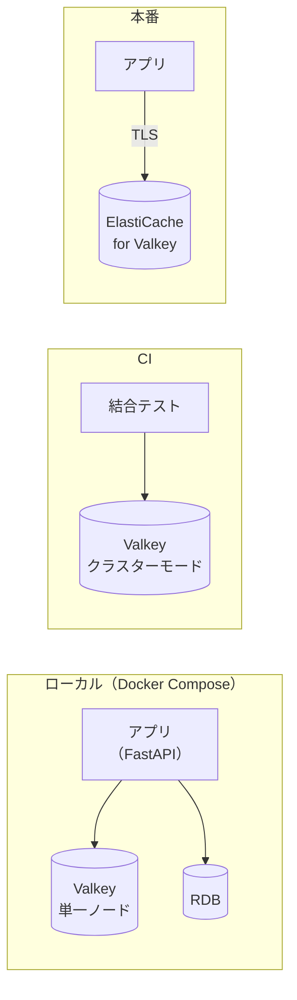

# 10. ローカル環境とテスト

> 前提: [08. FastAPI からの利用](08-fastapi.md)

## 要点

- ローカルでは、Docker Compose で Valkey のコンテナを1つ動かすのが基本です。ただし、**本番（ElastiCache）とは、クラスターモード・TLS・使えるコマンドなどが違います。**
- ローカルが単一ノードだと、クラスターモードでしか起きない問題（`CROSSSLOT` エラーなど）に、本番で初めて気づくことになります。**少なくとも CI では、本番と同じクラスターモードで結合テストを動かします。**
- テストでは、Valkey の動きに依存する部分は**実際のコンテナ**で確かめます。モック（fakeredis など）は、Valkey の動きに依存しない部分のテストに限ります。
- テストのたびにデータを消す処理が、間違って本番や共有の環境に向かないよう、接続先を確認する仕組みを入れます。

## ローカル環境の構成



| 環境 | Valkey の構成 | 目的 |
|---|---|---|
| ローカル | 単一ノードのコンテナ | 日々の開発。起動が速く、単純 |
| CI | **クラスターモードのコンテナ**（複数のノード） | 本番と同じ制約での結合テスト |
| 検証環境 | ElastiCache（本番と同じ構成） | TLS・認証・ElastiCache 固有の制約を含めた確認 |

Valkey の公式のコンテナイメージは、Docker Hub で公開されています。**本番の ElastiCache と同じバージョン（9.1）のイメージ**を使います。

## 本番との違い

| 項目 | ローカル（単一ノードのコンテナ） | 本番（ElastiCache） | 違いで起きること |
|---|---|---|---|
| クラスターモード | 無効 | Serverless は常に有効 | `CROSSSLOT` エラーが本番だけで起きる。パイプラインの既定の動きが逆になる（06 章・08 章） |
| クライアントのクラス | `Redis` | `RedisCluster` | DB 番号や複数キーの操作の扱いが違う（08 章） |
| TLS | なし | Serverless は必須 | 証明書の検証の失敗や、接続の確立にかかる時間が本番だけで起きる |
| 認証 | なし | あり | 権限（ACL）の不足によるエラーが本番だけで起きる（15 章） |
| 使えるコマンド | すべて | `CONFIG`、`KEYS` などが使えない（Serverless はさらに多い） | ローカルで動いた調査用のスクリプトが、本番では動かない（17 章） |
| メモリの上限とエビクション | 設定しなければ上限なし | 上限あり。エビクションの設定がある | メモリが満杯になったときの動きを、ローカルでは確かめられない（11 章） |
| 通信の遅延 | ほぼない | AZ 内で数百マイクロ秒、AZ をまたぐとそれ以上 | パイプラインを使わない処理の遅さに、本番で初めて気づく（06 章） |
| モジュール | イメージによる | JSON・検索が使える（検索は 9.0 以降） | ローカルのイメージにモジュールが含まれていないと、試せない |

違いを小さくするために、次のことを行います。

| やること | 内容 |
|---|---|
| クライアントを作る処理を1つにする | 08 章の `create_valkey_client` のように、設定値だけでクラスとオプションを切り替える。ローカル専用の作り方をしない |
| メモリの上限とエビクションの設定を本番に合わせる | ローカルのコンテナにも、本番と同じエビクションの設定（11 章）を指定する |
| CI ではクラスターモードで動かす | 結合テストを、複数のノードのクラスターに対して実行する |
| 使えないコマンドを使わない | 本番で使えないコマンド（`KEYS` など）を、アプリやバッチのコードで使っていないかを、レビューや静的なチェックで確認する |

> **注意: ローカルが単一ノードなので、本番で初めて CROSSSLOT エラーが出る**
>
> - **何が起きるか**: ローカルとテストでは動いていたトランザクションや `MGET` が、本番で `CROSSSLOT` エラーになる。
> - **なぜ起きるか**: 単一ノードでは、すべてのキーが同じ場所にあるので、キーが別々のハッシュスロットにあっても問題にならない。クラスターモードでしか、この制約は表に出ない。
> - **どう防ぐか**: CI の結合テストを、クラスターモードの Valkey に対して実行する。複数のキーを扱う処理は、05 章のハッシュタグの方針どおりになっているかをレビューで確認する。

## テストの方針

### 何で確かめるか

| テストの対象 | 例 | 確かめ方 |
|---|---|---|
| Valkey に依存しない処理 | キー名の組み立て、値の変換（03 章の `to_hash` / `from_hash`）、API のレスポンスの組み立て | 普通の単体テスト。Valkey は不要 |
| Valkey を使う処理の流れ | エンドポイントが、正しいキーを読み、結果を返すか | モック、または実際のコンテナ |
| Valkey の動きに依存する処理 | パイプライン、トランザクション、Lua スクリプト、有効期限、`SCAN`、入れ替え（09 章）、クラスターでの制約 | **実際のコンテナ** |
| 障害時の振る舞い | Valkey が応答しないときのタイムアウト、リトライ、API の応答（08 章） | 実際のコンテナを止める・遅延させる |

### モックと実際のコンテナ

| 観点 | モック（fakeredis など） | 実際のコンテナ |
|---|---|---|
| 速さ | 速い | コンテナの起動の分だけ遅い |
| 準備 | Python のライブラリだけ | Docker が必要 |
| Valkey と同じ動きか | **同じとは限らない。** 一部のコマンドやオプションがない、エラーの出方が違う、など | 同じ（バージョンをそろえれば） |
| Valkey 独自のコマンド・モジュール | 使えないことが多い | 使える（イメージによる） |
| クラスターモード | 確かめられない | 確かめられる（クラスターのコンテナを使えば） |

モックは、Redis の動きをまねて作られたものです。Valkey と同じ動きをする保証はありません。**モックでテストが通っても、Valkey で動くとは限らない**ことを前提に、Valkey の動きに依存する処理は、実際のコンテナで確かめます。

### テストの書き方

テストのためのクライアントは、テストの仕組み（pytest の fixture）で作り、テストごとにデータを空にします。

```python
import os
from collections.abc import AsyncIterator

import pytest
import pytest_asyncio
from redis.asyncio import Redis


@pytest_asyncio.fixture
async def valkey() -> AsyncIterator[Redis]:
    host = os.environ.get("TEST_VALKEY_HOST", "localhost")
    # 間違って共有の環境のデータを消さないよう、接続先を確かめる
    if host not in ("localhost", "valkey-test"):
        pytest.fail(f"refusing to flush non-test Valkey: {host}")
    client = Redis(host=host, port=6379, protocol=2, decode_responses=True)
    await client.flushdb()
    try:
        yield client
    finally:
        await client.aclose()


async def test_product_roundtrip(valkey: Redis) -> None:
    product = Product(id=1001, name="ノートPC", price=128000)
    await valkey.hset("product:1001", mapping=to_hash(product))
    assert from_hash(1001, await valkey.hgetall("product:1001")) == product
```

| 注意点 | 内容 |
|---|---|
| クライアントとイベントループ | 非同期のクライアントは、作ったときのイベントループに結びつく。テストごとにイベントループが変わる設定では、クライアントもテストごとに作る（上の例のように、fixture の範囲をテスト単位にする） |
| データの初期化 | テストの前にデータを空にし、テストどうしが影響し合わないようにする |
| 並列実行 | テストを並列で実行する場合、同じ Valkey を共有すると、データの初期化が互いに干渉する。ワーカーごとに別のコンテナ（または DB 番号、単一ノードの場合のみ）を使う |
| クラスターモードでの初期化 | `FLUSHDB` は、すべてのプライマリに送る必要がある（09 章） |

> **注意: テストのデータの初期化が、別の環境のデータを消す**
>
> - **何が起きるか**: 環境変数の設定を間違えたまま結合テストを実行し、検証環境や本番の Valkey のデータが `FLUSHDB` で全部消える。
> - **なぜ起きるか**: テストのコードは、どこにつながっていても同じように `FLUSHDB` を実行する。
> - **どう防ぐか**: テストのコードで、接続先がテスト用であることを確かめてから初期化する（上の例）。本番の Valkey では、`FLUSHDB` / `FLUSHALL` を権限（ACL）で実行できないようにする（15 章）。

### 障害時の振る舞いを確かめる

08 章で決めた「Valkey が使えないときの振る舞い」が、そのとおりに動くかを確かめます。

| 確かめること | 方法 |
|---|---|
| Valkey が止まったとき、API が決めた時間内にエラー（または代わりの応答）を返すか | テストの途中でコンテナを止める |
| 応答が遅いとき、タイムアウトが効くか | 通信を遅延させる仕組み（Toxiproxy など）をアプリと Valkey の間に入れる |
| フェイルオーバーで一時的に切れたとき、リトライで回復するか | クラスターのコンテナで、プライマリのノードを止める |

これらは毎回の CI で動かすには重いので、定期的に、または関係する設定を変えたときに実行します。

## まとめ

- ローカルは Docker Compose の単一ノードで十分ですが、本番とはクラスターモード、TLS、認証、使えるコマンド、メモリの上限などが違います。
- クライアントを作る処理を1つにし、エビクションの設定を本番に合わせ、CI ではクラスターモードで結合テストを動かして、違いを小さくします。
- Valkey の動きに依存する処理は、実際のコンテナで確かめます。モックで通っても、Valkey で動くとは限りません。
- テストのデータの初期化は、接続先がテスト用であることを確かめてから行います。
- 障害時の振る舞い（タイムアウト、リトライ、代わりの応答）も、コンテナを止めたり遅延させたりして確かめます。
