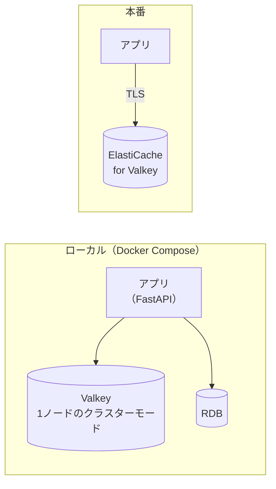

# 10. ローカル環境とテスト

> 前提: [08. FastAPI からの利用](08-fastapi.md)

## 要点

- ローカルでは、Docker Compose で Valkey のコンテナを1つ動かすのが基本です。**コンテナ1つのまま、本番と同じクラスターモードで動かします**（1ノードのクラスターモード）。シャードが1つでも `CROSSSLOT` エラーは出るので、クラスターモードの制約をローカルで再現できます。
- それでも本番（ElastiCache）とは、TLS・認証・使えるコマンドなどが違います。リダイレクトのような複数ノードでしか起きない動きも、ローカルでは起きません。
- テストでは、Valkey の動きに依存する部分は**実際のコンテナ**で確かめます。モック（fakeredis など）は、Valkey の動きに依存しない部分のテストに限ります。
- テストのたびにデータを消す処理が、間違って本番や共有の環境に向かないよう、接続先を確認する仕組みを入れます。

## ローカル環境の構成



| 環境 | Valkey の構成 | 目的 |
|---|---|---|
| ローカル | **1ノードのクラスターモード**のコンテナ | 日々の開発。コンテナ1つで起動が速く、クラスターモードの制約も再現できる |
| 検証環境 | ElastiCache（本番と同じ構成） | TLS・認証・ElastiCache 固有の制約を含めた確認 |

Valkey の公式のコンテナイメージは、Docker Hub で公開されています。**本番の ElastiCache と同じバージョン（9.1）のイメージ**を使います。

| イメージ | 内容 | 使う場面 |
|---|---|---|
| `valkey/valkey` | Valkey 本体だけ | JSON と検索を使わない場合 |
| `valkey/valkey-bundle` | 本体に、valkey-json・valkey-search などのモジュールを読み込んだもの | JSON や検索を使う場合（07 章） |

JSON や検索を使うなら、`valkey/valkey-bundle:9.1` を使います。
ただし、イメージに含まれるモジュールのバージョンは、ElastiCache に組み込まれているものと同じとは限りません。調査の時点では、`9.1.5` のイメージに含まれるのは valkey-search 1.2.1、valkey-json 1.0.3 です（Docker Hub の説明による）。ElastiCache 側のモジュールのバージョンは、調査の時点では確かめられていません。新しいオプションを使うときは、検証環境（ElastiCache）でも動作を確かめてください（07 章「ElastiCache での制約」）。

### ローカルもクラスターモードで動かす

本番の ElastiCache Serverless は、常にクラスターモードです。ローカルも、**コンテナ1つのまま、クラスターモードで動かします**（1ノードのクラスターモード）。
クラスターモードでは、シャードが1つでも、キーが別々のハッシュスロットにあれば `CROSSSLOT` エラーになります（06 章）。そのため、ノードを何台も並べなくても、本番と同じ制約をローカルで再現できます。クライアントも、本番と同じ `RedisCluster` を使えます（08 章）。

設定は2つです。

| 設定 | 内容 |
|---|---|
| クラスターモードで起動する | `--cluster-enabled yes` を指定する |
| 全スロットを割り当てる | 起動後に1回、`CLUSTER ADDSLOTSRANGE 0 16383` で、すべてのハッシュスロットをこのノードに割り当てる。割り当てるまでは、コマンドを受け付けない |

Docker Compose の設定例です。

> **この設定例は、動作を確かめていません。** 使う前に、手元で動かして確かめてください。

```yaml
services:
  valkey:
    image: valkey/valkey-bundle:9.1
    # 異常終了させたあと、自動で再起動する（「障害時の振る舞いを確かめる」の節）
    restart: unless-stopped
    environment:
      # --cluster-enabled: クラスターモードで起動する
      # --cluster-announce-ip: ホストで動かすアプリから接続するため、自分のアドレスを 127.0.0.1 として知らせる
      # --save "": ディスクに保存しない。再起動したら必ず空になる
      # --enable-debug-command: 障害をまねる DEBUG コマンドを使えるようにする（ローカル専用）
      VALKEY_EXTRA_FLAGS: >-
        --cluster-enabled yes
        --cluster-announce-ip 127.0.0.1
        --save ""
        --enable-debug-command yes
    ports:
      - "6379:6379"

  valkey-init:
    image: valkey/valkey-bundle:9.1
    depends_on:
      - valkey
    # 起動後に1回、全スロットを割り当てる。
    # 割り当て済み（コンテナの再起動後など）のときはエラーになるが、無視してよい
    entrypoint:
      - sh
      - -c
      - >-
        until valkey-cli -h valkey ping; do sleep 1; done;
        valkey-cli -h valkey CLUSTER ADDSLOTSRANGE 0 16383 || true
```

| 気をつける点 | 内容 |
|---|---|
| 接続先のアドレス | クラスターモードのクライアントは、ノードが知らせるアドレスに接続し直す。何も指定しないと、ノードはコンテナの内部の IP を知らせるので、ホストのアプリからは接続できない。上の例では `--cluster-announce-ip 127.0.0.1` で回避している。アプリも Docker Compose の中で動かす場合は、この指定を外す |
| モジュール | `valkey/valkey-bundle` は、`VALKEY_EXTRA_FLAGS` で渡した設定を、モジュールを読み込む設定に追加する。`command` で `valkey-server` の起動の仕方を上書きすると、モジュールが読み込まれなくなるおそれがある |
| 本番がクラスターモード無効の場合 | 本番がクラスターモード無効のノードベースなら、ローカルもクラスターモードを無効にして、`Redis` のクライアントを使う。本番に合わせることが目的 |

## 本番との違い

| 項目 | ローカル（1ノードのクラスターモード） | 本番（ElastiCache） | 違いで起きること |
|---|---|---|---|
| クラスターモード | 有効（シャードは1つ） | Serverless は常に有効 | `CROSSSLOT` エラーやパイプラインの既定の動きは同じ。リダイレクトやノードをまたぐ処理は、ローカルでは起きない |
| クライアントのクラス | `RedisCluster` | `RedisCluster` | 同じ |
| TLS | なし | Serverless は必須 | 証明書の検証の失敗や、接続の確立にかかる時間が本番だけで起きる |
| 認証 | なし | あり | 権限（ACL）の不足によるエラーが本番だけで起きる（15 章） |
| 使えるコマンド | すべて | `CONFIG`、`KEYS` などが使えない（Serverless はさらに多い） | ローカルで動いた調査用のスクリプトが、本番では動かない（17 章） |
| メモリの上限とエビクション | 設定しなければ上限なし | 上限あり。エビクションの設定がある | メモリが満杯になったときの動きを、ローカルでは確かめられない（11 章） |
| 通信の遅延 | ほぼない | AZ 内で数百マイクロ秒、AZ をまたぐとそれ以上 | パイプラインを使わない処理の遅さに、本番で初めて気づく（06 章） |
| モジュール | `valkey/valkey` には入っていない。`valkey/valkey-bundle` には入っている | JSON・検索が使える（検索は 9.0 以降） | 基本のイメージでは、JSON や検索のコマンドが「unknown command」になる。モジュールのバージョンが本番と違うことがある |

違いを小さくするために、次のことを行います。

| やること | 内容 |
|---|---|
| クライアントを作る処理を1つにする | 08 章の `create_valkey_client` のように、設定値だけでクラスとオプションを切り替える。ローカル専用の作り方をしない |
| メモリの上限とエビクションの設定を本番に合わせる | ローカルのコンテナにも、本番と同じエビクションの設定（11 章）を指定する |
| ローカルもクラスターモードで動かす | 1ノードのクラスターモードで動かし、本番と同じ `RedisCluster` を使う（「ローカルもクラスターモードで動かす」の節） |
| 使えないコマンドを使わない | 本番で使えないコマンド（`KEYS` など）を、アプリやバッチのコードで使っていないかを、レビューや静的なチェックで確認する |

> **注意: クラスターモード無効のローカルで試し、本番で初めて CROSSSLOT エラーが出る**
>
> - **何が起きるか**: ローカルとテストでは動いていたトランザクションや `MGET` が、本番で `CROSSSLOT` エラーになる。
> - **なぜ起きるか**: クラスターモード無効の Valkey は、ハッシュスロットを確かめない。クラスターモードでしか、この制約は表に出ない。ノードが1つかどうかは関係ない。
> - **どう防ぐか**: ローカルとテストの Valkey を、1ノードのクラスターモードで動かす。複数のキーを扱う処理は、05 章のハッシュタグの方針どおりになっているかをレビューで確認する。

## テストの方針

### 何で確かめるか

| テストの対象 | 例 | 確かめ方 |
|---|---|---|
| Valkey に依存しない処理 | キー名の組み立て、値の変換（03 章の `to_hash` / `from_hash`）、API のレスポンスの組み立て | 普通の単体テスト。Valkey は不要 |
| Valkey を使う処理の流れ | エンドポイントが、正しいキーを読み、結果を返すか | モック、または実際のコンテナ |
| Valkey の動きに依存する処理 | パイプライン、トランザクション、Lua スクリプト、有効期限、`SCAN`、入れ替え（09 章）、クラスターでの制約 | **実際のコンテナ** |
| 障害時の振る舞い | Valkey が応答しないときのタイムアウト、リトライ、API の応答（08 章） | 実際のコンテナを止める・遅延させる |

### モックと実際のコンテナ

| 観点 | モック（fakeredis など） | 実際のコンテナ |
|---|---|---|
| 速さ | 速い | コンテナの起動の分だけ遅い |
| 準備 | Python のライブラリだけ | Docker が必要 |
| Valkey と同じ動きか | **同じとは限らない。** 一部のコマンドやオプションがない、エラーの出方が違う、など | 同じ（バージョンをそろえれば） |
| Valkey 独自のコマンド・モジュール | 使えないことが多い | 使える（イメージによる） |
| クラスターモード | 確かめられない | 確かめられる（クラスターのコンテナを使えば） |

モックは、Redis の動きをまねて作られたものです。Valkey と同じ動きをする保証はありません。**モックでテストが通っても、Valkey で動くとは限らない**ことを前提に、Valkey の動きに依存する処理は、実際のコンテナで確かめます。

### テストの書き方

テストのためのクライアントは、テストの仕組み（pytest の fixture）で作り、テストごとにデータを空にします。

```python
import os
from collections.abc import AsyncIterator

import pytest
import pytest_asyncio
from redis.asyncio import RedisCluster


@pytest_asyncio.fixture
async def valkey() -> AsyncIterator[RedisCluster]:
    host = os.environ.get("TEST_VALKEY_HOST", "localhost")
    # 間違って共有の環境のデータを消さないよう、接続先を確かめる
    if host not in ("localhost", "valkey-test"):
        pytest.fail(f"refusing to flush non-test Valkey: {host}")
    client = RedisCluster(host=host, port=6379, protocol=2, decode_responses=True)
    await client.flushdb()  # RedisCluster は、すべてのプライマリに送る
    try:
        yield client
    finally:
        await client.aclose()


async def test_product_roundtrip(valkey: RedisCluster) -> None:
    product = Product(id=1001, name="ノートPC", price=128000)
    await valkey.hset("product:1001", mapping=to_hash(product))
    assert from_hash(1001, await valkey.hgetall("product:1001")) == product
```

| 注意点 | 内容 |
|---|---|
| クライアントとイベントループ | 非同期のクライアントは、作ったときのイベントループに結びつく。テストごとにイベントループが変わる設定では、クライアントもテストごとに作る（上の例のように、fixture の範囲をテスト単位にする） |
| データの初期化 | テストの前にデータを空にし、テストどうしが影響し合わないようにする |
| 並列実行 | テストを並列で実行する場合、同じ Valkey を共有すると、データの初期化が互いに干渉する。ワーカーごとに別のコンテナを使う（`RedisCluster` では DB 番号で分けられない。08 章） |
| クラスターモードでの初期化 | `FLUSHDB` は、すべてのプライマリに送る必要がある。redis-py の `RedisCluster` の `flushdb()` は、自動ですべてのプライマリに送る（09 章） |

> **注意: テストのデータの初期化が、別の環境のデータを消す**
>
> - **何が起きるか**: 環境変数の設定を間違えたまま結合テストを実行し、検証環境や本番の Valkey のデータが `FLUSHDB` で全部消える。
> - **なぜ起きるか**: テストのコードは、どこにつながっていても同じように `FLUSHDB` を実行する。
> - **どう防ぐか**: テストのコードで、接続先がテスト用であることを確かめてから初期化する（上の例）。本番の Valkey では、`FLUSHDB` / `FLUSHALL` を権限（ACL）で実行できないようにする（15 章）。

### 障害時の振る舞いを確かめる

08 章で決めた「Valkey が使えないときの振る舞い」が、そのとおりに動くかを確かめます。
障害は、実際に壊さなくても、コマンドでまねられます。

**ローカルで確かめる**

| まねたい障害 | 方法 | 確かめられること |
|---|---|---|
| Valkey が応答しない | `CLIENT PAUSE 5000 ALL`（5 秒間、すべてのクライアントのコマンドを止める） | タイムアウトが効くか。API が決めた時間内に、エラー（または代わりの応答）を返すか |
| 重いコマンドで、メインスレッドが止まる | `DEBUG SLEEP 5`（5 秒間、メインスレッドを止める） | 同上 |
| 接続が切れる | `CLIENT KILL TYPE normal`（通常のクライアントの接続を、すべて切る） | 再接続とリトライで回復するか |
| Valkey が止まる | コンテナを止める（`docker compose stop valkey`） | 接続できないときの振る舞い |
| Valkey が異常終了し、**空の状態で**再起動する | `DEBUG SEGFAULT`（プロセスをその場で異常終了させる）。上の設定例では、コンテナが自動で再起動する | 再接続して回復するか。データが空のときに API が何を返すか（全部の商品が 404 にならないか。08 章）。データの作り直し（09 章）が始まるか |

- `DEBUG` のコマンドは、既定では使えません。上の設定例のように、ローカルだけ `--enable-debug-command yes` を指定します。ElastiCache では使えません。
- `DEBUG SEGFAULT` で空の状態になるのは、ディスクに保存しない設定（上の設定例の `--save ""`）にしている場合です。保存した内容が残っていると、それを読み込んで再起動します。
- ネットワークの遅延そのもの（応答が少しずつ遅い状態）を再現したい場合は、通信を遅延させる仕組み（Toxiproxy など）を、アプリと Valkey の間に入れます。

**検証環境で確かめる**

| まねたい障害 | 方法 | 確かめられること |
|---|---|---|
| フェイルオーバー | ElastiCache の `TestFailover` で、指定したシャードのフェイルオーバーを起こす（18 章） | リトライで回復するか。回復までに何秒かかるか |

```console
$ aws elasticache test-failover --replication-group-id <クラスター> --node-group-id <シャード>
```

`TestFailover` を使えるのは、ノードベースで、マルチ AZ が有効で、シャードごとにレプリカが1つ以上ある構成です。24 時間で 15 シャードまで実行できます。
ElastiCache Serverless で使えるかは、調査の時点では確かめられていません（AWS の資料は、ノードベースのクラスターだけを対象にしています）。

これらは毎回の CI で動かすには重いので、定期的に、または関係する設定を変えたときに実行します。

## まとめ

- ローカルは Docker Compose のコンテナ1つで、本番と同じクラスターモードで動かします（1ノードのクラスターモード）。それでも、TLS、認証、使えるコマンド、メモリの上限などは本番と違います。
- クライアントを作る処理を1つにし、エビクションの設定を本番に合わせ、ローカルもクラスターモードで動かして、違いを小さくします。
- Valkey の動きに依存する処理は、実際のコンテナで確かめます。モックで通っても、Valkey で動くとは限りません。
- テストのデータの初期化は、接続先がテスト用であることを確かめてから行います。
- 障害時の振る舞い（タイムアウト、リトライ、代わりの応答）も、コンテナを止めたり遅延させたりして確かめます。
