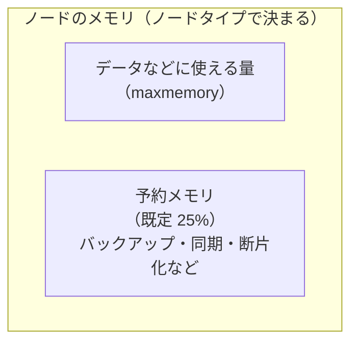
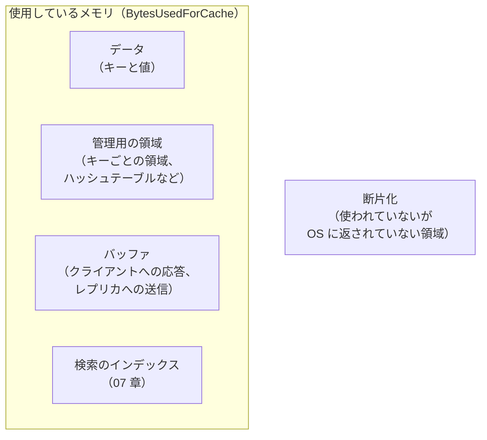

# 11. メモリ管理とエビクション

> 前提: [03. データ型 (1)](03-string-and-hash.md)（エンコーディングとビッグキー）、[09. データの投入・入れ替え・削除](09-loading-swapping-deleting.md)

## 要点

- Valkey が使えるメモリには上限（**maxmemory**）があります。ElastiCache のノードベースでは、ノードタイプのメモリから、バックアップなどのための**予約メモリ（既定で 25%）**を引いた量がデータに使えます。
- 上限に達したときの動きは、**エビクション**（eviction。キーを自動で消すこと）の**ポリシー**で決まります。キャッシュとして使うなら古いキーを消してよいですが、この資料の想定する使い方（作り直せる読み取り用のデータストア）では、**データが黙って消えるより、書き込みが失敗するほうが安全**です。
- ElastiCache の既定のポリシーは `volatile-lru`（有効期限の付いたキーだけを消す）です。有効期限を付けないデータは消されず、上限に達すると書き込みがエラーになります。
- メモリの使用量は、データそのものより大きくなります。管理用の領域、バッファ、**断片化**、検索のインデックス、**入れ替え中の2世代分**を見込んで見積もります。
- キーを消しても、断片化によってメモリの使用量が減らないことがあります。

## メモリの上限

### ノードベース

| 項目 | 内容 |
|---|---|
| maxmemory | ノードタイプごとに決まっていて、変えられない |
| 予約メモリ（reserved memory。パラメータは `reserved-memory-percent`） | 既定で 25%。バックアップやレプリカとの同期のときのコピーオンライト、レプリカへの送信用のバッファ、断片化のために空けておく量 |
| 予約メモリの変更 | **減らさない。** AWS のドキュメントでも、減らすとアップグレードなどの際にデータを失うおそれがあるとされている。小さいノード（small）では 30%、最小のノード（micro）では 50% に増やすことが勧められている |

### Serverless

| 項目 | 内容 |
|---|---|
| キャッシュ全体の上限 | 最大 5,000 GiB。自分で上限（使用量の上限）を設定することもできる |
| ハッシュスロットごとの上限 | **1つのハッシュスロットあたり 32 GiB** |
| 上限に達したとき | ノードベースと同じく、エビクションのポリシー（既定は `volatile-lru`）に従う。消せるキーがなければ、書き込みが OOM エラーになる |

Serverless でも、ハッシュスロットごとの上限があることに注意します。ハッシュタグ（05 章）で1つのハッシュスロットにデータを集めすぎると、キャッシュ全体には余裕があっても、そのスロットだけが上限に達します。

## エビクションのポリシー

### ポリシーの種類

| ポリシー | 上限に達したときの動き |
|---|---|
| `noeviction` | キーを消さない。メモリを増やす書き込みは OOM エラーになる |
| `volatile-lru` | **有効期限の付いたキー**のうち、最近使われていないものから消す。消せるキーがなければ OOM エラー |
| `volatile-lfu` | 有効期限の付いたキーのうち、使われる頻度の低いものから消す |
| `volatile-ttl` | 有効期限の付いたキーのうち、残りの期限が短いものから消す |
| `volatile-random` | 有効期限の付いたキーから、ランダムに消す |
| `allkeys-lru` | **すべてのキー**のうち、最近使われていないものから消す |
| `allkeys-lfu` | すべてのキーのうち、使われる頻度の低いものから消す |
| `allkeys-random` | すべてのキーから、ランダムに消す |

ElastiCache の既定は `volatile-lru` です。ノードベースでは、パラメータグループで変えられます。

> **注意: 既定値は、構築するときにパラメータグループで確かめる**
>
> Serverless と以前のバージョンの既定が `volatile-lru` であることは AWS のドキュメントで確認できますが、Valkey 9 系の既定のパラメータグループの値は、調査の時点ではドキュメントに直接書かれていませんでした。構築するときに、実際のパラメータグループの `maxmemory-policy` を確かめ、意図した値を明示的に設定します（14 章）。

### 使い方によって、選ぶポリシーが違う

| 使い方 | 上限に達したときに望ましい動き | ポリシーの例 |
|---|---|---|
| キャッシュ（なければ元のデータから読み直せばよい） | 古いキーを消して、新しいキーを入れる | `allkeys-lru`、`allkeys-lfu` |
| 作り直せる読み取り用のデータストア（この資料の想定） | **データを消さずに、書き込みを失敗させて気づく** | `noeviction`、または有効期限のないデータだけの `volatile-lru` |

この資料の想定する使い方では、API はキーがあることを前提に読みます。キーが消されると、API は「商品が存在しない」と誤って応答します（08 章「キーがない」ことの扱い）。
キャッシュなら、キーがなければ RDB から読み直すだけですが、この使い方ではそうなりません。

そのため、**データが黙って消える `allkeys-*` は使いません。** 書き込みが失敗すれば、バッチがエラーで止まり、気づくことができます。

> **注意: エビクションで、データが黙って消える**
>
> - **何が起きるか**: データ量が増えてメモリの上限に達し、一部の商品のキーが消される。API はその商品について 404 を返すが、エラーにはならないので、しばらく誰も気づかない。
> - **なぜ起きるか**: `allkeys-*` のポリシーでは、上限に達するとすべてのキーが消される対象になる。キャッシュ向けの設定を、そのまま使っている。
> - **どう防ぐか・どう気づくか**: `noeviction` か、有効期限のないデータだけの `volatile-lru` にする。`Evictions` のメトリクスが 0 より大きくなったら、アラームを出す（16 章）。

> **注意: 有効期限の付いた少数のキーだけが消される**
>
> - **何が起きるか**: メモリが上限に近づいたとき、バッチのロック（09 章）や、一時的に使うキーなど、有効期限の付いたキーだけが消される。ロックが消えて、バッチが二重に動き出す。
> - **なぜ起きるか**: `volatile-*` のポリシーでは、有効期限の付いたキーが優先して消される。データの大部分に有効期限がないと、消される対象が少数のキーに集中する。
> - **どう防ぐか**: メモリの使用率に余裕を持たせ、上限に近づく前にアラームで気づく（16 章）。ロックのように消えては困るキーがあるなら、`noeviction` を選ぶ。

### 上限に達したときの影響の範囲

`noeviction`（または消せるキーがない `volatile-*`）で上限に達した場合、エラーになるのは**メモリを増やす書き込み**です。

| 操作 | 上限に達したとき |
|---|---|
| 読み取り（`GET`、`HGETALL`、`ZRANGE` など） | 成功する |
| メモリを増やす書き込み（`SET`、`HSET`、`ZADD` など） | OOM エラー |
| 削除（`DEL`、`UNLINK`） | 成功する |

つまり、API の読み取りは続けられますが、バッチの書き込み（全件の作り直しや差分の同期）が止まります。09 章のバージョン付きのキーの方式なら、作り直しが失敗してもポインタは古い世代を指したままなので、API は古いデータを返し続けます。

## メモリの使用量の内訳

| 内訳 | 内容 | 増える原因 |
|---|---|---|
| データ | キーと値そのもの | データ量の増加。値の大きさ |
| 管理用の領域 | キーごとの管理用の領域、データ型の内部の構造 | キーの数の増加。エンコーディングの切り替わり（03 章・04 章） |
| バッファ | クライアントへの応答を一時的にためる領域、レプリカへ送る変更をためる領域 | 大きな応答（`HGETALL` のビッグキーなど）。大きなパイプライン（06 章）。レプリカとの同期 |
| 検索のインデックス | valkey-search のインデックス | インデックスの数、フィールドの数、データの件数 |
| 断片化 | 解放されたが、OS に返されていない細切れの領域 | 大きさの違うキーの作成と削除の繰り返し（入れ替えなど） |

## メモリの見積もり

05 章の「キーの数とサイズの見積もり」に、運用で必要な分を上乗せします。

| 項目 | 見積もり方 |
|---|---|
| ① データ（1世代分） | 05 章の方法で、実際のデータを入れて測る（管理用の領域を含む） |
| ② 入れ替え中の2世代分 | 09 章のバージョン付きのキーの方式では、ロードの間、① がもう1世代分必要 |
| ③ 検索のインデックス | 使う場合は、実際のデータでインデックスを作って測る（07 章） |
| ④ バッファと断片化の余裕 | 通常の運用で ① の 1〜2 割程度を目安に、実際の値（`MemoryFragmentationRatio` など）を見て調整する |
| ⑤ データの増加 | 次の見直しまでの増加の見込み |
| 合計 | ①×2 ＋ ③ ＋ ④ ＋ ⑤ が、maxmemory（ノードベース）や使用量の上限（Serverless）に収まるようにする |

> **注意: 入れ替えの方式の2世代分を見落とす**
>
> ふだんのメモリの使用率が 50% を少し超えているだけでも、バージョン付きのキーの方式で全件を作り直すと、ロードの途中で上限に達します。ふだんの使用率ではなく、**ロード中の最大の使用率**で見積もり、監視します。

## バックアップと同期のときのメモリ

スナップショットの作成（12 章）や、レプリカとの全体の同期（13 章）では、Valkey はプロセスを複製（fork）して、その時点のデータを書き出します。

| 項目 | 内容 |
|---|---|
| コピーオンライト（copy-on-write） | 書き出しの間に変更されたデータは、元のプロセス側で別にコピーされる。変更が多いと、メモリの使用量が**最大で2倍近く**になる |
| ElastiCache の対策 | 予約メモリ（25%）で、この増加分を受け止める。空きメモリ（`FreeableMemory`）が足りないときは、メモリをあまり使わない方式（forkless）に自動で切り替える |
| forkless の方式の注意 | メモリは節約できるが、クライアントへの応答が遅くなることがある（特に大きなキーがあるとき） |
| 実行中かどうか | `SaveInProgress` のメトリクスが 1 になる |

バックアップの時間帯と、全件ロードの時間帯を重ねないようにします。書き込みが多い時間帯にバックアップを取ると、コピーオンライトでメモリが大きく増えます。

## 断片化

### 断片化（fragmentation）とは

キーを作ったり消したりを繰り返すと、解放されたメモリが細切れになり、新しいデータを入れられないまま残ります。OS から見ると、Valkey はその分のメモリを使い続けています。

| 指標 | 内容 | 目安 |
|---|---|---|
| `MemoryFragmentationRatio` | OS から見たメモリの使用量 ÷ Valkey が使っているメモリ | 1.0 より大きいのが正常。大きいほど断片化が進んでいる。1.0 を下回るのは、スワップが起きているおそれがある |
| `AllocatorFragmentationRatio` / `AllocatorFragmentationBytes` | 断片化のうち、自動の断片化の解消（activedefrag）で減らせる部分 | 大きければ、断片化の解消が効く |

### 断片化を解消する

ElastiCache には、動作中に断片化を少しずつ解消する機能（`activedefrag` パラメータ、既定は無効）があります。また AWS のドキュメントでは、Valkey 7.0 以降では、必要に応じて AWS が自動で断片化の解消を行うことがあるとされています。

| 方法 | 内容 | 注意点 |
|---|---|---|
| `activedefrag` を有効にする（ノードベース） | バックグラウンドで、データを詰め直す | CPU を使う。全件ロードの直後などに断片化が大きくなるなら検討する |
| 全件を作り直す | 新しい世代を作り、古い世代を消す | 作り直し自体が断片化の原因にもなる |
| ノードを置き換える | フェイルオーバーなどで、新しいノードにデータを移す | 影響が大きいので、最後の手段 |

この資料の想定する使い方では、全件の入れ替えのたびに大量のキーを作って消すため、断片化が進みやすくなります。`MemoryFragmentationRatio` を監視し（16 章）、入れ替えの前後でどう変わるかを見ておきます。

## ビッグキーを見つける

03 章のビッグキーは、メモリの偏りや全体の停止の原因になります。

| 方法 | 内容 | 使える構成 |
|---|---|---|
| `valkey-cli --bigkeys` | `SCAN` でキーをたどり、型ごとに要素の数が最も多いキーを報告する | ノードベース（負荷がかかるので、レプリカやアクセスの少ない時間帯に実行する） |
| `valkey-cli --memkeys` | `SCAN` と `MEMORY USAGE` で、メモリの使用量が多いキーを報告する | ノードベース（Serverless では `MEMORY` が使えない） |
| 設計で防ぐ | キー設計書（05 章）で、要素の数とサイズの上限を決め、バッチで書き込む前に確かめる | すべて |

Serverless では調査用のコマンドの多くが使えないので、**設計とバッチの段階で防ぐ**ことが特に大切です（17 章）。

## 見るべきメトリクス

| メトリクス | 内容 | 構成 |
|---|---|---|
| `DatabaseMemoryUsagePercentage` | maxmemory に対する使用率 | ノードベース |
| `BytesUsedForCache` | 使用しているメモリの量 | ノードベース・Serverless |
| `UsedMemoryDataset` | データ（キーと値）が使っているメモリの見積もり | ノードベース |
| `Evictions` | エビクションで消されたキーの数 | ノードベース・Serverless |
| `FreeableMemory` | ホストの空きメモリ | ノードベース |
| `SwapUsage` | スワップの使用量。増えていると、性能が大きく落ちる | ノードベース |
| `MemoryFragmentationRatio` | 断片化の割合 | ノードベース |

しきい値とアラームの設計は 16 章で説明します。

## まとめ

- ノードベースの maxmemory はノードタイプで決まり、予約メモリ（既定 25%）を引いた量がデータに使えます。予約メモリは減らしません。Serverless には、ハッシュスロットごとに 32 GiB の上限があります。
- この資料の想定する使い方では、データが黙って消える `allkeys-*` は使わず、`noeviction` か、有効期限のないデータだけの `volatile-lru` にします。上限に達すると書き込みが失敗し、気づくことができます。
- 有効期限の付いた少数のキー（ロックなど）だけが消されることがあります。上限に近づく前にアラームで気づくようにします。
- メモリは、データのほかに、管理用の領域、バッファ、検索のインデックス、断片化、入れ替え中の2世代分を見込んで見積もります。
- バックアップや同期では、コピーオンライトでメモリが増えます。バックアップと全件ロードの時間帯を重ねません。
- 断片化は、入れ替えのたびに進みやすくなります。`MemoryFragmentationRatio` を監視し、必要なら断片化の解消を使います。
- ビッグキーは、ノードベースでは `valkey-cli` で見つけられます。Serverless では、設計とバッチの段階で防ぎます。
