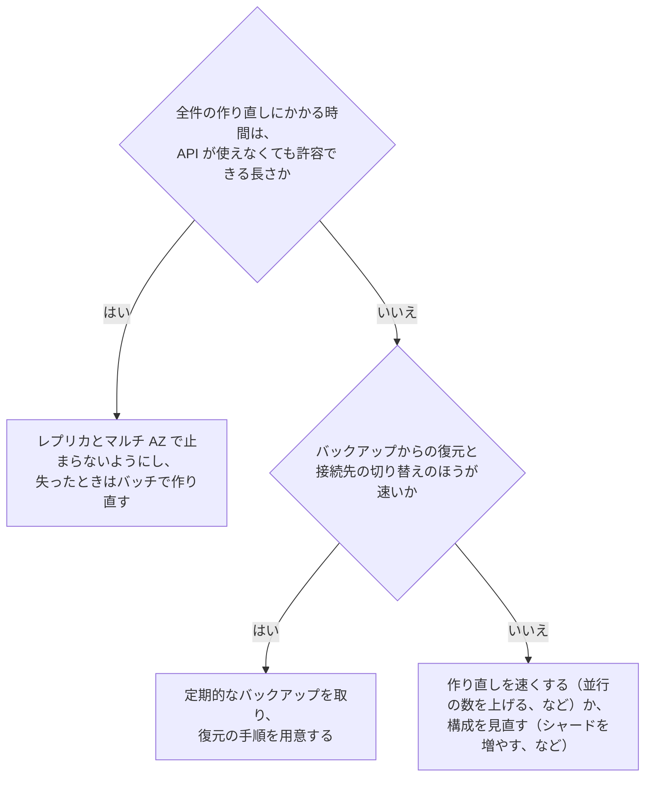

# 12. 永続化・バックアップ・復旧

> 前提: [09. データの投入・入れ替え・削除](09-loading-swapping-deleting.md)、[11. メモリ管理とエビクション](11-memory.md)

## 要点

- 書き込みが成功しても、データがディスクや別のノードに残っているとは限りません（01 章「RDB の感覚が通用しない点」の 4）。**どんなときにデータが失われるか**を知っておくことが出発点です。
- ElastiCache のバックアップは S3 に保存されます。ただし、**復元は新しいクラスター（キャッシュ）として作られ、接続先が変わります。** 再起動したノードに、自動でデータが戻るわけではありません。
- Valkey 9.0 以降のノードベースには、応答を返した書き込みを失わないための**耐久性の機能**（マルチ AZ のトランザクションログ）があります。ただし、書き込みが遅くなり、費用も増えます。
- RDB から作り直せる構成では、多くの場合、**レプリカとマルチ AZ で止まらないようにし、失ったときはバッチで作り直す**のが基本です。作り直しにかかる時間を測り、それが許容できるかで、バックアップや耐久性の機能の要否を決めます。

## データが失われる場面

| 場面 | 何が起きるか |
|---|---|
| レプリカのないノードが故障する | そのノードのデータはすべて失われる（バックアップから復元するか、作り直すまで空） |
| **利用者がプライマリを再起動する** | **レプリカがあっても、自動のフェイルオーバーは起きない。プライマリは空の状態で戻り、レプリカのデータも消える**（18 章） |
| レプリカのないノードが置き換えられる（メンテナンス） | 新しいノードにデータを移す間、そのノードは使えない。データはできるだけ引き継がれるが、保証はない（18 章） |
| レプリカのあるプライマリが故障する（フェイルオーバー） | レプリカがプライマリに昇格する。レプリケーションは非同期なので、**直前の書き込みの一部が失われる**ことがある（13 章） |
| AZ の障害 | その AZ のノードが使えなくなる。マルチ AZ で別の AZ にレプリカがあれば、フェイルオーバーする |
| 人による誤操作 | 誤ったバッチや `FLUSHALL` でデータを消す。レプリカにも同じ操作が伝わるので、レプリカでは防げない |
| エビクション | メモリの上限で、キーが消される（11 章） |

ElastiCache Serverless は、データを自動で複数の AZ に複製します。ただし、複製は非同期で行われます。

> **RDB で言うと**
>
> RDB のコミットは、トランザクションログをディスクに書いてから成功を返します。Valkey は、メモリに書いた時点で成功を返します。ディスクへの書き出しや、ほかのノードへの複製は、その後で行われます。

## 永続化の仕組み

OSS の Valkey には、メモリのデータをディスクに残す仕組みが2つあります。

| 仕組み | 内容 | ElastiCache では |
|---|---|---|
| RDB スナップショット | ある時点のデータ全体を、ファイルに書き出す。最後に書き出した後の変更は失われる | バックアップとして使われる（S3 に保存）。再起動時の自動の読み込みには使われない |
| AOF（追記型のログ） | 書き込みのたびに、操作をファイルに追記する | **Valkey では使えない** |

> **注意: 「RDB スナップショット」と「RDB」**
>
> Valkey のスナップショットのファイル形式も「RDB」と呼ばれます（Redis Database の略）。リレーショナルデータベースの RDB とは関係ありません。この資料では、スナップショットのファイルの意味で使うときは「RDB スナップショット」と書きます。

ElastiCache で、データを失わないための手段は次の3つです。

| 手段 | 守れるもの | 守れないもの |
|---|---|---|
| レプリカとマルチ AZ | ノードや AZ の障害で、サービスが止まること（データの大部分） | フェイルオーバーの直前の書き込み。誤操作 |
| バックアップ | 誤操作や、クラスター全体の喪失に対して、ある時点のデータ | バックアップ以降の変更 |
| 耐久性の機能（9.0 以降） | フェイルオーバーで、応答を返した書き込みが失われること（同期の場合） | 誤操作 |

## ElastiCache のバックアップ

### 取り方

| 種類 | 内容 |
|---|---|
| 自動バックアップ | 1日1回、指定した時間帯（バックアップウィンドウ）に取る。保持期間は最大 35 日。0 にすると無効 |
| 手動バックアップ | 任意のときに取る。期限はなく、キャッシュを削除しても残る |
| 削除時の最終バックアップ | クラスターを削除するときに取れる |

| 項目 | ノードベース | Serverless |
|---|---|---|
| アプリへの影響 | ある。予約メモリが足りないと性能に影響する（11 章）。**レプリカから取ることが勧められている** | AWS のドキュメントでは、影響はないとされている |
| 単位 | クラスター単位（クラスターモードでは、シャード単位では取れない） | キャッシュ単位 |
| 手動バックアップの回数の上限 | 1ノードあたり 24 時間で 20 回 | 1キャッシュあたり 24 時間で 24 回 |
| 保存先 | S3 | S3 |

バックアップを取っている間は、11 章のコピーオンライトでメモリの使用量が増えます。全件ロード（09 章）の時間帯と重ねないようにします。

### 復元

| 項目 | 内容 |
|---|---|
| 復元先 | **新しいクラスター（キャッシュ）として作られる**。既存のクラスターにデータを戻すことはできない |
| 接続先 | 新しいクラスターなので、エンドポイントが変わる。アプリの接続先の設定を切り替える必要がある |
| 復元できるファイル | ElastiCache のバックアップ、または S3 に置いた RDB スナップショットのファイル |
| 復元にかかる時間 | データ量によって変わる。実際に試して測る |
| S3 への書き出し | バックアップを、自分の S3 のバケットに書き出せる（別のリージョンへの保管や、ほかの環境での利用） |

> **注意: 復元すると、接続先が変わる**
>
> - **何が起きるか**: 障害の後でバックアップから復元したが、アプリの接続先の切り替えに手間取り、復旧が遅れる。
> - **なぜ起きるか**: 復元は新しいクラスターとして作られ、エンドポイントが変わる。アプリの設定、シークレット、セキュリティグループなどの切り替えが必要になる。
> - **どう防ぐか**: 接続先を設定値（環境変数やパラメータストア）で切り替えられるようにしておく。復元から切り替えまでの手順書を作り、実際に試しておく。

> **注意: 復元を一度も試していない**
>
> バックアップが取れていても、復元に何時間かかるか、復元したデータで API が正しく動くかは、試してみないと分かりません。定期的に、検証環境でバックアップからの復元を試し、かかった時間を記録します。

## 耐久性の機能（Valkey 9.0 以降）

ノードベースの Valkey 9.0 以降では、書き込みを複数の AZ にまたがるトランザクションログに記録する、**耐久性の機能**を使えます。

| 書き込みの方式 | 応答を返すタイミング | フェイルオーバーで失われうるデータ | 書き込みの遅さ |
|---|---|---|---|
| 同期 | ログが2つ以上の AZ に記録されてから | 応答を返した書き込みは失われない | 数ミリ秒程度に増える |
| 非同期 | ログへの記録を待たずに | 最大 10 秒分 | ほとんど増えない |

| 項目 | 内容 |
|---|---|
| 使える構成 | ノードベースのみ（Serverless では使えない） |
| 条件 | マルチ AZ が有効で、シャードごとに1つ以上のレプリカがあること |
| 費用 | 同期の書き込みでは、ノードの料金に 18% が上乗せされる。非同期では追加の料金なし |
| 既定値 | 指定しないと無効になる場合があるので、使うときは明示して有効にする |
| 検索との組み合わせ | 耐久性の機能を有効にすると、検索のインデックスがあるキーへの書き込みが抑えられることがある（07 章） |

この機能は、Valkey を正本のデータの置き場所として使う場合に向いています。
この資料の想定する構成（正本は RDB にあり、作り直せる）では、多くの場合は不要です。失われたデータは、RDB から作り直せるからです。

## 作り直せる構成での考え方

作り直せる構成では、データを失ったときの選択肢が増えます。どれを使うかは、**作り直しにかかる時間**と、その間に API がどうなるかで決まります。

| 復旧の方法 | 復旧にかかる時間 | 復旧後のデータ | 費用・手間 |
|---|---|---|---|
| レプリカへのフェイルオーバー | 自動。AWS のドキュメントでは、昇格は通常数秒とされている。アプリが回復するまでの時間は、検証環境で測る | フェイルオーバーの直前まで（一部欠けることがある） | レプリカの分のノードの費用 |
| バッチで全件を作り直す | 全件ロードの時間（09 章） | 最新（RDB の今の内容） | バッチがあれば追加の手間はない |
| バックアップから復元する | 復元の時間＋接続先の切り替え | バックアップの時点（その後の変更は差分の同期で反映） | バックアップの保存の費用。切り替えの手順 |
| 耐久性の機能 | フェイルオーバーと同じ | 応答を返した書き込みはすべて残る（同期の場合） | ノードの料金の 18% 増（同期）。書き込みが遅くなる |

どの場合も、次のことは共通です。

| やること | 理由 |
|---|---|
| レプリカとマルチ AZ を使う（ノードベースの場合） | ノード1台の故障で、全件の作り直しが必要になる事態を避ける |
| 全件の作り直しにかかる時間を、定期的に測る | データの増加とともに延びるため（09 章） |
| 作り直しの間の API の振る舞いを決めておく | ポインタがない、データが空、などのときに何を返すか（08 章・09 章） |
| 誤操作への備えを決めておく | レプリカでは防げない。作り直しで足りるか、バックアップが必要か |

> **注意: 再起動やメンテナンスで、データが空になる**
>
> - **何が起きるか**: ノードの再起動やメンテナンスによる置き換えの後、データが空になる。API がすべての商品について「存在しない」と応答する。
> - **なぜ起きるか**: ElastiCache は、再起動したノードに、バックアップから自動でデータを戻さない。特に、**利用者がプライマリを再起動した場合は、レプリカがあってもフェイルオーバーは起きず、レプリカのデータも消える。** レプリカのない構成では、故障や置き換えでもデータを引き継ぐ先がない。
> - **どう防ぐか・どう気づくか**: 本番ではレプリカとマルチ AZ を使い、プライマリを手動で再起動しない（18 章）。データが空になったことを検知して（ポインタのキーがない、キーの数が急に減った、など）、作り直しのバッチを自動で動かすか、アラームを出す（16 章）。

## まとめ

- Valkey は、メモリに書いた時点で成功を返します。ノードの故障、フェイルオーバー、誤操作、エビクションで、データが失われることがあります。
- ElastiCache の Valkey では AOF は使えません。バックアップ（自動・手動）は S3 に保存され、復元は新しいクラスターとして作られて接続先が変わります。
- ノードベースのバックアップはアプリに影響することがあるので、レプリカから取り、全件ロードの時間帯と重ねません。
- Valkey 9.0 以降のノードベースには耐久性の機能があります。同期の書き込みなら応答を返した書き込みを失いませんが、遅くなり、費用も増えます。作り直せる構成では多くの場合は不要です。
- 作り直せる構成では、レプリカとマルチ AZ で止まらないようにし、失ったときはバッチで作り直すのが基本です。作り直しにかかる時間を定期的に測り、許容できなければバックアップからの復元を用意します。
- 復元の手順は、実際に試しておきます。
