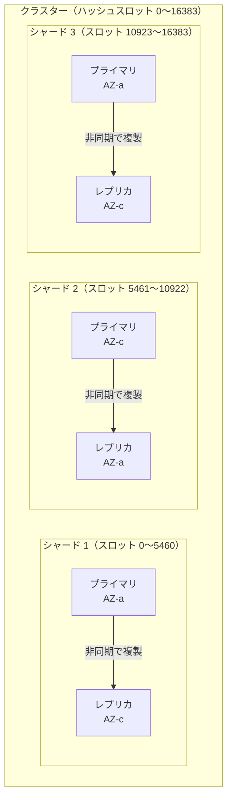
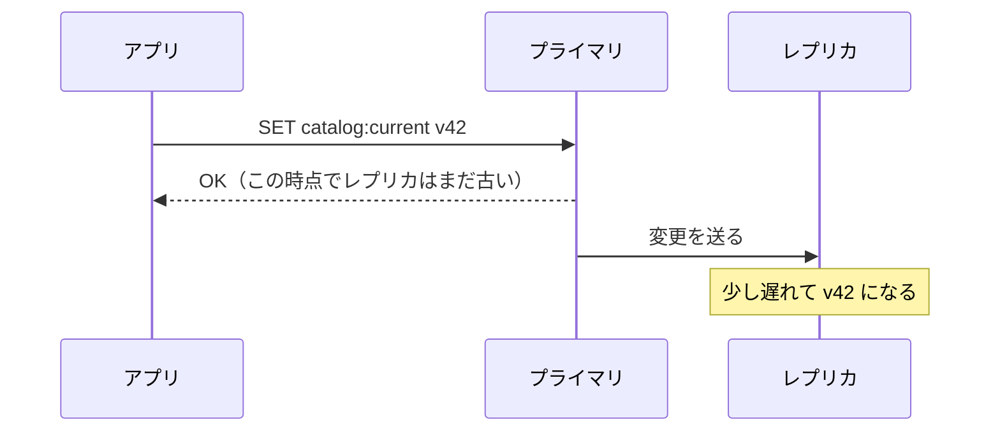
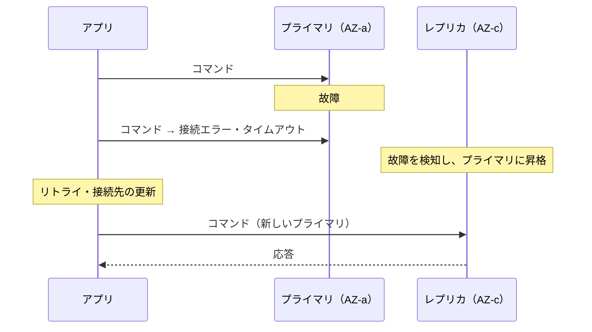

# 13. レプリケーションとクラスター

> 前提: [05. データモデリングとキー設計](05-data-modeling.md)（特に「クラスターを前提にしたキー設計」の節）

## 要点

- **レプリケーション**は、プライマリのデータをレプリカに複製する仕組みです。複製は**非同期**なので、レプリカのデータは少し遅れます。レプリカから読むと、古いデータが見えることがあります。
- プライマリが故障すると、レプリカがプライマリに昇格します（**フェイルオーバー**）。その間の数秒〜数十秒、書き込みや読み取りが失敗し、直前の書き込みが失われることがあります。
- **クラスター**は、データを複数のシャードに分けて持つ仕組みです。キー名から計算した**ハッシュスロット**（16,384 個）で、どのシャードに置くかが決まります。
- クラスターでは、複数のキーをまとめて扱う操作に制約があり、特定のシャードやキーへの偏りにも注意が必要です。
- ElastiCache Serverless では、レプリケーションとシャーディングは自動で管理されます。それでも、非同期の複製、ハッシュスロットの制約、偏りの問題はなくなりません。

## 全体像



| 仕組み | 目的 | ElastiCache での構成 |
|---|---|---|
| レプリケーション | 可用性（故障しても止まらない）、読み取りの分散 | ノードベース: シャードごとに最大 5 つのレプリカ。Serverless: 自動で複数の AZ に複製 |
| クラスター（シャーディング） | 1台に収まらないデータ量と処理量を扱う | ノードベース: クラスターモードを有効にして、シャードの数を指定する。Serverless: 常にクラスターモードで、自動で拡大・縮小 |

## レプリケーション

### 非同期の複製

プライマリは、書き込みを処理して**クライアントに応答を返した後で**、その変更をレプリカに送ります。



| 性質 | 影響 |
|---|---|
| レプリカは少し遅れる | レプリカから読むと、プライマリに書いた直後の値が見えないことがある。遅れはふだんミリ秒の単位だが、負荷が高いときや同期の途中では大きくなる |
| 応答はレプリカへの到着を待たない | プライマリが故障すると、レプリカに届いていなかった書き込みは失われる（12 章） |
| レプリカとの同期が切れると、全体を同期し直すことがある | レプリカが長く切れていた場合などは、データ全体を送り直す。データ量が多いほど時間がかかり、プライマリのメモリと CPU を使う（11 章） |

遅れの大きさは、`ReplicationLag` のメトリクス（ノードベース）で確認できます（16 章）。

### レプリカから読む

レプリカから読むと、プライマリの負荷を減らし、読み取りの処理能力を増やせます。ただし、古いデータが見えることを許容できる読み取りに限ります。

| 構成 | レプリカから読む方法 |
|---|---|
| ノードベース（クラスターモード無効） | リーダーエンドポイントに接続する、読み取り専用のクライアントを別に作る |
| ノードベース（クラスターモード有効） | `RedisCluster` の `load_balancing_strategy` で、レプリカから読む方式を指定する |
| Serverless | 読み取り用のポート（6380）に、`READONLY` を送った接続で読む。できるだけ同じ AZ のノードから読まれ、低い遅延になる。セキュリティグループで 6379 と 6380 の両方を許可する必要がある。redis-py での具体的な設定は、使う場合に確認する |

Serverless では、レプリカから読むと、1つのハッシュスロットで処理できる量の上限も上がります（ECPU が毎秒 3 万から 9 万に）。ホットキー（05 章）への対策としても使えます。

> **注意: ポインタを切り替えた直後に、レプリカから古い世代を読む**
>
> - **何が起きるか**: 09 章の方式でポインタを `v42` に切り替え、古い世代 `v41` を消した。その直後、レプリカから読んだ API が、まだ `v41` を指しているポインタを読み、消えた `v41` のキーを読んで 404 になる。
> - **なぜ起きるか**: レプリカへの複製は非同期なので、ポインタの切り替えもキーの削除も、レプリカには遅れて届く。届く順番によっては、古いポインタと、消えたキーの組み合わせが見える。
> - **どう防ぐか**: 古い世代の削除の前に、レプリケーションの遅れより十分に長い猶予を置く（09 章の猶予と同じ考え方）。ポインタはプライマリから読む。

> **注意: 書いた直後に、レプリカから読む**
>
> 同じ処理の中で、プライマリに書いた値をすぐにレプリカから読むと、書く前の値が返ることがあります。書いた値をすぐに読む必要がある処理は、プライマリから読みます。

## フェイルオーバー

プライマリが故障すると、ElastiCache はレプリカの1つをプライマリに昇格させます（マルチ AZ と自動フェイルオーバーが有効な場合）。



| 段階 | アプリから見えること |
|---|---|
| 故障から検知まで | コマンドがタイムアウトする、接続が切れる |
| 昇格の間 | 書き込みが失敗する。読み取りも失敗することがある |
| 昇格の後 | 新しいプライマリに接続し直せば、使えるようになる |
| 全体の時間 | 数秒〜数十秒程度が目安。検証環境で、フェイルオーバーを実際に起こして測る（ElastiCache には、フェイルオーバーを試す機能がある） |

| 構成 | 接続先の切り替え |
|---|---|
| `RedisCluster`（Serverless、クラスターモード有効） | クライアントがシャードの構成を取り直し、新しいプライマリに送る（08 章のリトライ） |
| `Redis`（クラスターモード無効） | プライマリエンドポイントの DNS が新しいプライマリを指すように変わる。クライアントは、接続し直したときに新しいプライマリにつながる |

> **注意: 降格した元のプライマリに、つながったまま書き込む**
>
> - **何が起きるか**: フェイルオーバーの後、書き込みが「読み取り専用のレプリカには書き込めない」というエラー（`READONLY`）になり続ける。
> - **なぜ起きるか**: クラスターモード無効の構成で、元のプライマリが復旧してレプリカとして戻ったとき、アプリが古い接続を使い続けている。接続し直さない限り、DNS の変更は反映されない。
> - **どう防ぐか・どう気づくか**: `READONLY` のエラーを、接続し直すべきエラーとして扱う（接続を捨てて作り直す）。フェイルオーバーを検証環境で起こし、アプリが回復するかを確かめる（10 章）。

## クラスター

### ハッシュスロット

クラスターは、16,384 個のハッシュスロットを、シャードに割り当てます。キーがどのハッシュスロットに入るかは、キー名から計算されます。

```text
ハッシュスロット = CRC16(キー名) mod 16384
```

| 項目 | 内容 |
|---|---|
| 計算に使う部分 | キー名の全体。ただし `{` と `}` で囲んだ部分（ハッシュタグ）があれば、その部分だけ（05 章） |
| シャードへの割り当て | ハッシュスロットの範囲ごとに、担当するシャードが決まる。シャードを増減すると、ハッシュスロットが移動する |
| キーの名前とシャードの関係 | プレフィックスとは関係なく、ばらばらに散らばる（02 章「データの階層」） |

```console
> CLUSTER KEYSLOT product:1001
(integer) 181
> CLUSTER KEYSLOT {category:10}:products:by_price
(integer) 6884
> CLUSTER KEYSLOT tmp:{category:10}:products:by_price
(integer) 6884
```

ハッシュタグの部分が同じなので、最後の2つのキーは同じハッシュスロットに入ります。

### クライアントが振り分けを担う

Valkey のクラスターには、サーバー側でリクエストを担当のシャードに振り分ける仕組み（プロキシ）がありません。
クライアントは各シャードのノードに直接つなぎ、**どのノードに送るかをクライアント自身が決めます。** 担当でないノードに送ると、Valkey はコマンドを転送せず、「担当はあちらのノード」という応答（リダイレクト）を返すだけです。

そのため、クラスターにつなぐには、次のことができる**クラスター対応のクライアント**（redis-py の `RedisCluster` など、08 章）が必要です。

| クライアントがやること | 内容 |
|---|---|
| 対応表を持つ | どのハッシュスロットをどのノードが担当しているかを取得して持つ |
| 送り先を決める | キーからハッシュスロットを計算し、担当のノードに直接送る |
| リダイレクトに従う | リダイレクトが返ったら、指示されたノードに送り直す（下の表） |
| 構成の変化に追従する | フェイルオーバーやシャードの増減の後で、対応表を取り直す |
| ノードごとに接続を持つ | シャードの数だけ、接続（コネクションプール）を持つ |

単一ノード用のクライアント（`Redis`）は、これらを行いません。クラスターにつなぐと、担当でないキーへのコマンドがエラーになります。

| 構成 | 補足 |
|---|---|
| ElastiCache Serverless | エンドポイントは1つで、AWS 側で振り分けている。ただし、クラスターの通信方式で応答する（仮想的な1シャードとして見える）ため、クラスター対応のクライアントを使う必要がある。複数のキーの操作の制約（後述）も同じように残る |
| ノードベース（クラスターモード無効） | シャードが1つなので、リダイレクトは起きない。単一ノード用のクライアントで足りる |

### リダイレクト（MOVED と ASK）

クライアントは対応表をもとにコマンドを送ります。対応表が古いと、Valkey はリダイレクトを返します。

| 応答 | 意味 | クライアントの動き |
|---|---|---|
| `MOVED <スロット> <ノード>` | そのハッシュスロットは、別のノードの担当になった | 対応表を更新し、正しいノードに送り直す |
| `ASK <スロット> <ノード>` | そのハッシュスロットは移動の途中で、このキーは移動先にある | その1回だけ移動先に送る（対応表は更新しない） |

redis-py の `RedisCluster` は、どちらも自動で処理します（08 章）。リダイレクトが多いと、その分だけ応答が遅れます。

### 複数のキーの操作の制約

05 章・06 章で説明したとおり、次の操作は、すべてのキーが同じハッシュスロットにないと `CROSSSLOT` エラーになります。

| 操作 | 例 |
|---|---|
| 複数のキーを扱うコマンド | `MGET`、`MSET`、`SINTER`、`ZINTER`、`RENAME` |
| トランザクション | `MULTI` 〜 `EXEC` |
| Lua スクリプト | `EVAL` の `KEYS` |

### 偏り

| 偏りの種類 | 原因 | 影響 | 対処 |
|---|---|---|---|
| データ量の偏り | ビッグキー（03 章）、ハッシュタグの付けすぎ（05 章） | 特定のシャードのメモリだけが上限に近づく。Serverless では、ハッシュスロットごとの上限（32 GiB）に達する | ビッグキーを分ける。ハッシュタグは小さな集まりにだけ付ける |
| アクセスの偏り | ホットキー（05 章） | 特定のシャードの CPU だけが高くなる。シャードを増やしても解消しない | アプリのメモリに短時間持つ。レプリカから読む。同じ内容を複数のキーに持つ |

ノードベースでは、シャードごとのメトリクス（メモリの使用率、CPU の使用率）を比べると、偏りに気づけます（16 章）。

### シャードの増減（リシャーディング）

| 構成 | 方法 | 影響 |
|---|---|---|
| ノードベース（クラスターモード有効） | シャードを追加・削除する（オンラインでできる） | ハッシュスロットの移動の間、CPU とネットワークの負荷が増える。リダイレクトが増え、応答が遅れることがある |
| Serverless | 自動 | 負荷の増加は自動で吸収されるが、急激な増加には追いつくまでに時間がかかることがある |

Valkey 9.0 では、ハッシュスロットをまとめて不可分に移す仕組み（アトミックなスロット移行）が入り、移動中のリダイレクトやビッグキーでの停止が起きにくくなりました。ただし、移すデータの量に応じて時間と負荷がかかることは変わりません。

> **注意: ビッグキーが、シャードの増減を遅くする**
>
> 1つのキーは、1つのハッシュスロットとして、まとめて移動します。ビッグキーがあると、その移動に時間がかかり、移動中の負荷も大きくなります。ビッグキーを作らないことは、メモリや性能だけでなく、シャードの増減のためにも大切です（03 章）。

## まとめ

- レプリケーションは非同期です。レプリカから読むと古いデータが見えることがあり、フェイルオーバーでは直前の書き込みが失われることがあります。
- レプリカから読むのは、古いデータを許容できる読み取りに限ります。ポインタのように切り替えに関わるキーは、プライマリから読みます。
- フェイルオーバーの間、数秒〜数十秒、コマンドが失敗します。リトライで回復できるようにし、検証環境で実際に試します。クラスターモード無効の構成では、降格した元のプライマリへの古い接続に注意します。
- クラスターは、キー名から計算したハッシュスロットで、データをシャードに分けます。クライアントはリダイレクトを自動で処理します。
- 複数のキーの操作には同じハッシュスロットの制約があります。データ量とアクセスの偏りに注意し、シャードごとのメトリクスで確認します。
- シャードの増減の間は負荷が増えます。ビッグキーは、増減の時間と負荷も大きくします。
