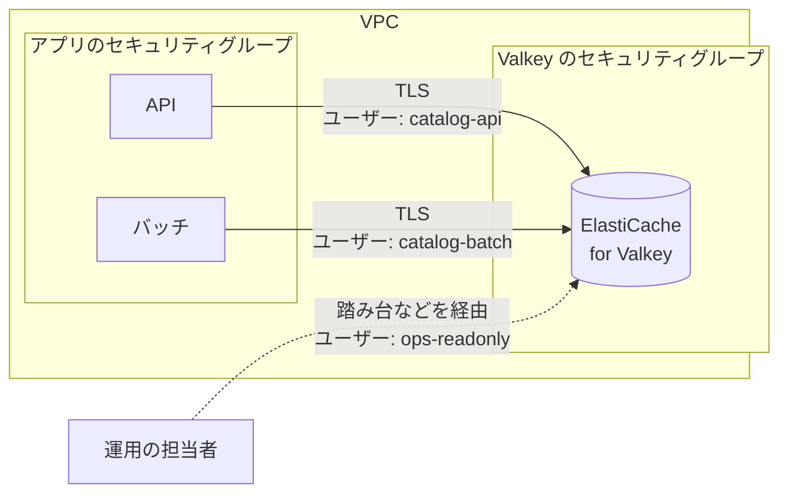

# 15. セキュリティ

> 前提: [14. ElastiCache の構成選定](14-elasticache-design.md)

## 要点

- ElastiCache は VPC の中に置き、**セキュリティグループで、アプリからの接続だけを許可**します。
- **転送時の暗号化（TLS）と保存時の暗号化**を有効にします。Serverless では常に有効です。暗号化は、作った後で変えにくい設定です。
- 認証は、**ユーザーとユーザーグループ（RBAC）**で行います。ユーザーごとにパスワードか **IAM 認証**を選び、使えるコマンドとキーを**アクセス文字列（ACL）**で制限します。
- アプリ、バッチ、運用の担当者で、ユーザーを分けます。特に、`FLUSHALL` や `KEYS` などの危険なコマンドは、アプリとバッチから使えないようにします。
- ElastiCache では、`ACL SETUSER` などのコマンドでユーザーを管理できません。ユーザーの作成や変更は、ElastiCache の API（CDK）で行います。

## 全体像



| 層 | 守るもの | 手段 |
|---|---|---|
| ネットワーク | 接続できる相手を限る | VPC、セキュリティグループ |
| 通信 | 通信の盗み見・改ざん | TLS |
| 保存 | ディスク（バックアップを含む）上のデータ | 保存時の暗号化（KMS） |
| 認証 | 誰が接続しているか | ユーザーとパスワード、または IAM 認証 |
| 認可 | 何をしてよいか | アクセス文字列（使えるコマンドとキー） |

## ネットワーク

ElastiCache に固有の点だけを挙げます。

| 項目 | 内容 |
|---|---|
| 置き場所 | プライベートサブネットに置く |
| セキュリティグループ | Valkey のポート（6379）への接続を、アプリとバッチのセキュリティグループからだけ許可する |
| Serverless のレプリカからの読み取り | 読み取り用のポート（6380）も許可する（13 章） |
| Serverless の公開エンドポイント | Valkey 9.0 以降の Serverless では、インターネットから接続できるエンドポイントも作れる（IAM 認証と TLS 1.3 が必須）。この資料の想定する使い方では使わない |

## 暗号化

| 種類 | Serverless | ノードベース |
|---|---|---|
| 転送時の暗号化（TLS） | 常に有効 | 作るときに有効にする（14 章の CDK の例の `transit_encryption_enabled`） |
| 保存時の暗号化 | 常に有効 | 作るときに有効にする（`at_rest_encryption_enabled`）。KMS のキーを指定できる |

TLS を有効にすると、クライアントも TLS で接続する必要があります（08 章の `ssl=True`）。

> **注意: TLS の接続の確立は重い**
>
> TLS の接続の確立には、コマンドの処理よりはるかに時間と CPU がかかります。接続を使い回さず、リクエストごとに接続し直すと、Valkey とアプリの両方の CPU を大きく使います。クライアントは1つ作って使い回します（08 章）。

## 認証

### 認証の方式

| 方式 | 内容 | 使える構成 |
|---|---|---|
| AUTH トークン | クラスター全体で1つのパスワード | ノードベース。ユーザーを分けられないので、この資料ではおすすめしない |
| ユーザーとユーザーグループ（RBAC）＋パスワード | ユーザーごとにパスワードと権限を持つ | Serverless、ノードベース |
| ユーザーとユーザーグループ（RBAC）＋ IAM 認証 | パスワードの代わりに、IAM の権限から作る短期のトークンで認証する | Serverless、ノードベース |

ユーザーをユーザーグループにまとめ、ユーザーグループをキャッシュ（クラスター）に関連づけます。

### IAM 認証

IAM 認証では、パスワードを管理する必要がなく、アクセスを IAM のポリシーで制御できます。ただし、次の制約があります。

| 制約 | 内容 |
|---|---|
| トークンの有効期限 | **15 分。** 新しい接続を作るときには、有効なトークンが必要 |
| 接続の寿命 | IAM 認証の接続は、**12 時間で自動的に切断される。** 切断の前に新しいトークンで認証し直せば延長できる |
| TLS | 必須 |
| ユーザー | IAM 認証のユーザーは、ユーザー名とユーザー ID を同じにする必要がある |

redis-py で IAM 認証を使うには、接続のたびにトークンを作る仕組み（クレデンシャルプロバイダ）を組み込みます。トークンは、AWS の SDK の署名の機能で作ります。

> **注意: IAM 認証の接続が、12 時間で切れる**
>
> - **何が起きるか**: 長く動いているアプリで、12 時間ごとにまとまった接続エラーが起きる。
> - **なぜ起きるか**: IAM 認証の接続は、12 時間で ElastiCache に切断される。切断された後、古いトークンで接続し直そうとすると、トークンの期限（15 分）が切れていて失敗する。
> - **どう防ぐか**: 接続を作るたびに新しいトークンを作るように、クライアントを設定する。接続が切れたときにリトライで回復できるようにする（08 章）。導入の前に、12 時間を超えて動かす試験をする。

### パスワードの管理

| 項目 | 内容 |
|---|---|
| 保管 | パスワードは AWS Secrets Manager に保管し、アプリは起動時に読む。コードや設定ファイルに書かない |
| パスワードの数 | 1ユーザーに2つまで設定できる |
| 変更（ローテーション） | 2つ設定できることを使い、①新しいパスワードを追加する → ②アプリを新しいパスワードに切り替える → ③古いパスワードを削除する、の順で行う。Secrets Manager による自動のローテーションもある |
| パスワードなし | Valkey では、パスワードなしのユーザーは使えない |

## 認可（アクセス文字列）

ユーザーごとに、**アクセス文字列**で、使えるコマンドとキーを制限します。

```text
on ~catalog:* +@read -@dangerous
```

| 部分 | 意味 |
|---|---|
| `on` | ユーザーを有効にする（`off` なら無効。`on` を書かないと無効になる） |
| `~catalog:*` | `catalog:` で始まるキーだけを操作できる |
| `+@read` | 読み取りのコマンドの分類を許可する |
| `-@dangerous` | 危険なコマンドの分類（`FLUSHALL`、`KEYS`、`CONFIG` など）を禁止する |
| `+get`、`-flushall` | コマンドを個別に許可・禁止する |

主なコマンドの分類は次のとおりです。

| 分類 | 内容 |
|---|---|
| `@read` | 読み取りのコマンド |
| `@write` | 書き込みのコマンド |
| `@dangerous` | 誤って使うと危険なコマンド（全削除、全キーの列挙、設定の変更など） |
| `@admin` | 管理用のコマンド |
| `@json` | JSON のコマンド（07 章） |
| `@search` | 検索のコマンド（07 章） |
| `@all` | すべてのコマンド |

Valkey 9.1 からは、使える DB 番号もアクセス文字列で制限できます（`db=0` など）。

### ユーザーの分け方の例

| ユーザー | 用途 | アクセス文字列の例 |
|---|---|---|
| `catalog-api` | API（読み取りだけ） | `on ~catalog:* +@read -@dangerous` |
| `catalog-batch` | バッチ（書き込みと削除） | `on ~catalog:* ~lock:catalog:* +@read +@write -@dangerous` |
| `ops-readonly` | 運用の担当者の調査 | `on ~* +@read -@dangerous +info` |
| `default` | 既定のユーザー | 無効にする（後述） |

キーのパターンは、キーの命名規則（02 章）と合わせて決めます。プレフィックスをそろえておくと、`~catalog:*` のように、まとめて制限できます。

> **注意: アクセス文字列で `-@dangerous` にすると、必要なコマンドまで禁止される**
>
> `@dangerous` には、`KEYS` や `FLUSHALL` のほかにも、運用で使うコマンドが含まれます。たとえば `INFO` も `@dangerous` に含まれるので、調査用のユーザーで使うなら個別に許可します（上の例の `+info`）。どのコマンドがどの分類に入るかは、`ACL CAT dangerous` などで確かめられます。本番の前に、各ユーザーで実際の処理が動くことを検証環境で確かめます。

### default ユーザー

ElastiCache は、`default` という名前のユーザーを自動で用意しています。このユーザーは、すべてのコマンドを使える設定になっていることがあります。

| 項目 | 内容 |
|---|---|
| Valkey のユーザーグループ | AWS のドキュメントでは、Valkey のユーザーグループをクラスターに関連づけると、`default` ユーザーは自動で無効になるとされている |
| CDK の `CfnUserGroup` | CDK のドキュメントでは、`default` という名前のユーザーを含める必要があるとされている |
| 対処 | 上の2つの記述が食い違っているため、構築するときに確かめる。含める必要がある場合は、`default` という名前で、無効（`off -@all`）のユーザーを自分で作って含める |

## CDK での設定例

```python
from aws_cdk import aws_elasticache as elasticache

api_user = elasticache.CfnUser(
    self,
    "CatalogApiUser",
    user_id="catalog-api",
    user_name="catalog-api",
    engine="valkey",
    access_string="on ~catalog:* +@read -@dangerous",
    passwords=[api_password],  # Secrets Manager から渡す
)

user_group = elasticache.CfnUserGroup(
    self,
    "CatalogUserGroup",
    user_group_id="catalog-users",
    engine="valkey",
    user_ids=[api_user.user_id, batch_user.user_id, ops_user.user_id],
)
# 14 章の CfnServerlessCache の user_group_id、
# または CfnReplicationGroup の user_group_ids に指定する
```

| 注意点 | 内容 |
|---|---|
| パスワードの渡し方 | パスワードは、CDK のコードに直接書かない。Secrets Manager のシークレットから渡す |
| ユーザーの管理の場所 | ElastiCache では `ACL SETUSER` などのコマンドは使えない。ユーザーの追加・変更は、すべて CDK（ElastiCache の API）で行う |

> **注意: 本番の誤操作を、権限で防いでいない**
>
> - **何が起きるか**: 運用の担当者が、検証環境のつもりで本番に `FLUSHALL` を実行し、すべてのデータが消える。調査のつもりの `KEYS` で、本番が数秒止まる。
> - **なぜ起きるか**: 全員が、すべてのコマンドを使えるユーザーで接続している。
> - **どう防ぐか**: 用途ごとにユーザーを分け、危険なコマンドは、アプリ・バッチ・調査用のユーザーから禁止する。全削除が必要な作業は、手順書と承認を経て、専用のユーザーで行う。

## まとめ

- VPC のプライベートサブネットに置き、セキュリティグループでアプリとバッチからの接続だけを許可します。
- 転送時と保存時の暗号化を有効にします。作った後で変えにくいので、最初に決めます。
- 認証は、ユーザーとユーザーグループ（RBAC）で行い、パスワードか IAM 認証を使います。IAM 認証では、トークンの有効期限（15 分）と接続の寿命（12 時間）に対応します。パスワードは Secrets Manager で管理し、2つ設定できることを使ってローテーションします。
- アクセス文字列で、ユーザーごとに使えるコマンドとキーを制限します。アプリ・バッチ・運用でユーザーを分け、危険なコマンドを禁止します。
- `default` ユーザーは無効にします。ユーザーの管理は、コマンドではなく CDK で行います。
