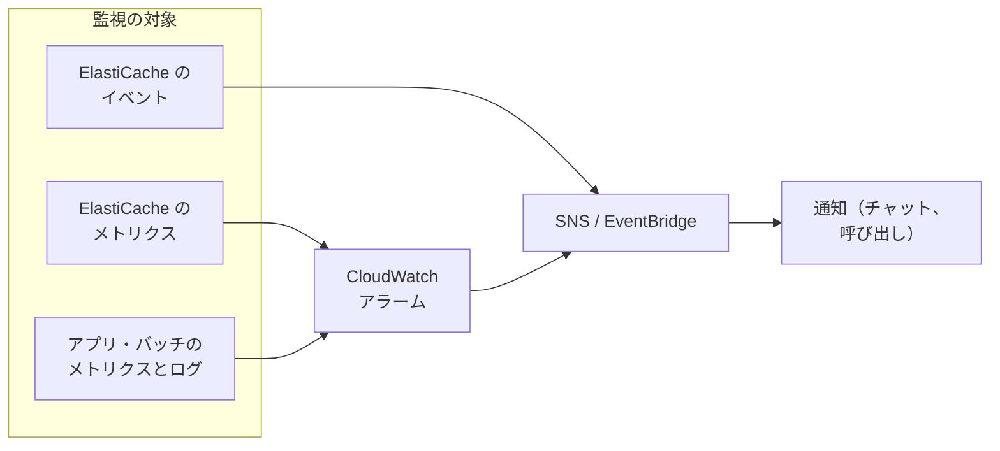

# 16. 監視

> 前提: [11. メモリ管理とエビクション](11-memory.md)、[14. ElastiCache の構成選定](14-elasticache-design.md)

## 要点

- 監視は3つの層で行います。**ElastiCache のメトリクス**（CloudWatch）、**ElastiCache のイベント**（フェイルオーバーなど）、**アプリとバッチのメトリクス**です。
- CPU は、ホスト全体の `CPUUtilization` ではなく、コマンドを実行するスレッドの使用率 **`EngineCPUUtilization`** を見ます（vCPU が 4 つ以上のノード）。
- この資料の想定する使い方で特に大切なのは、**メモリの使用率（入れ替え中の2世代分を見込む）**、**エビクションが 0 であること**、**データが最新であること（最後の作り直しからの時間）**です。
- メトリクスは、**平均だけでなく最大値**を、**クラスター全体だけでなくノード（シャード）ごと**に見ます。平均やクラスター全体の値では、一時的な高負荷や特定のシャードの偏りが隠れます。
- Serverless とノードベースでは、使えるメトリクスが違います。

## 監視の全体像



| 層 | 分かること | 例 |
|---|---|---|
| ElastiCache のメトリクス | Valkey の資源の使い方と状態 | CPU、メモリ、接続の数、エビクション、レプリケーションの遅れ |
| ElastiCache のイベント | 構成の変化 | フェイルオーバー、ノードの置き換え、スナップショットの失敗 |
| アプリ・バッチのメトリクス | 利用者から見た状態と、データの鮮度 | API から見た Valkey の応答時間とエラー、作り直しの成否と所要時間 |

ElastiCache のメトリクスだけでは、「API が正しいデータを返しているか」は分かりません。アプリとバッチのメトリクスも必ず取ります。

## ElastiCache のメトリクス（ノードベース）

ノードベースのメトリクスは、ノードごとに記録されます（ディメンションは `CacheClusterId`。値はノードの ID）。

| 観点 | メトリクス | 見方 |
|---|---|---|
| CPU | `EngineCPUUtilization` | コマンドを実行するスレッドの使用率。**vCPU が 4 つ以上のノードでは、これを見る** |
| CPU | `CPUUtilization` | ホスト全体の使用率。vCPU が 2 つ以下のノードでは、こちらを見る |
| メモリ | `DatabaseMemoryUsagePercentage` | maxmemory に対するメモリの使用率（11 章） |
| メモリ | `Evictions` | エビクションで消されたキーの数。この資料の想定する使い方では、0 であるべき |
| メモリ | `FreeableMemory`、`SwapUsage` | ホストの空きメモリとスワップ。スワップが増えると性能が大きく落ちる |
| メモリ | `MemoryFragmentationRatio` | 断片化の割合（11 章） |
| 接続 | `CurrConnections`、`NewConnections` | 接続の数と、新しい接続の数（08 章） |
| 接続 | `RejectedConnections` | 上限などで断られた接続の数 |
| 遅延 | `SuccessfulReadRequestLatency`、`SuccessfulWriteRequestLatency` | 読み書きの応答にかかった時間（Valkey の中での時間） |
| 遅延 | `GetTypeCmdsLatency`、`SetTypeCmdsLatency` など | 種類ごとのコマンドの実行時間 |
| レプリケーション | `ReplicationLag` | レプリカの遅れ（レプリカのノードで記録される） |
| ネットワーク | `NetworkBandwidthInAllowanceExceeded`、`NetworkBandwidthOutAllowanceExceeded` | ノードタイプの帯域の上限を超えて、パケットが待たされた・捨てられた数。0 より大きければ帯域が足りない |
| 負荷の制御 | `TrafficManagementActive` | 1 なら、ノードの性能が足りず、ElastiCache が受け付けるコマンドを抑えている |
| バックアップ | `SaveInProgress` | スナップショットの作成中は 1（11 章・12 章） |
| 権限 | `AuthenticationFailures`、`CommandAuthorizationFailures`、`KeyAuthorizationFailures` | 認証の失敗、権限のないコマンド・キーへのアクセス（15 章） |

> **注意: CPUUtilization を見て、余裕があると判断する**
>
> - **何が起きるか**: `CPUUtilization` は 25% なのに、Valkey の応答が遅い。
> - **なぜ起きるか**: コマンドの実行は1本のスレッドで行われる（01 章）。vCPU が 4 つのノードで、そのスレッドが使い切っていても、ホスト全体の使用率は 25% 程度にしかならない。
> - **どう防ぐか**: vCPU が 4 つ以上のノードでは、`EngineCPUUtilization` でアラームを設定する。

## ElastiCache のメトリクス（Serverless）

Serverless のメトリクスは、キャッシュごとに記録されます（ディメンションは `clusterId`。値はキャッシュの名前）。

| 観点 | メトリクス | 見方 |
|---|---|---|
| データ量 | `BytesUsedForCache` | 使用しているデータの量（検索のインデックスを含む）。使用量の上限（14 章）と比べる |
| 処理量 | `ElastiCacheProcessingUnits` | 消費した ECPU。費用と、ECPU の上限（14 章）に関わる |
| 遅延 | `SuccessfulReadRequestLatency`、`SuccessfulWriteRequestLatency` | 読み書きの応答にかかった時間 |
| 制限 | `ThrottledCmds` | 負荷の増え方に拡張が追いつかず、抑えられたリクエストの数。0 より大きければ、アプリにエラーや遅延が出ている |
| メモリ | `Evictions` | エビクションで消されたキーの数 |
| 接続 | `CurrConnections`、`NewConnections` | 接続の数と、新しい接続の数 |
| キーの数 | `CurrItems` | キーの数。急に減ったら、データが消えた可能性がある |
| 権限 | `AuthenticationFailures` など | ノードベースと同じ |

Serverless には CPU やノードごとのメトリクスがありません。ハッシュスロットごとの上限（32 GiB）に近づいたことは、メトリクスではなく、**イベント**（`Cache limit approaching`）で通知されます。

## アラームの設計

### しきい値の考え方

AWS のドキュメントで示されている具体的な数値は、ごく一部です（下の表で「AWS の指針」と書いたもの）。それ以外は、この資料の想定する使い方に合わせた**目安**です。実際の値は、検証環境での負荷試験と、運用を始めてからの実績で調整します。

| メトリクス | しきい値の考え方 | 出どころ |
|---|---|---|
| `CPUUtilization`（vCPU が 2 つ以下） | 90% ÷ vCPU の数（2 vCPU なら 45%） | AWS の指針 |
| `EngineCPUUtilization` | 最も負荷の高い時間帯（全件ロード中を含む）でも余裕が残る値。例: 70〜80% | 目安 |
| `DatabaseMemoryUsagePercentage` | **入れ替え中の2世代分が収まる値**。ふだんの使用率がこれを超えたら、次の入れ替えでメモリが足りなくなる（下の計算） | 目安 |
| `Evictions` | 0 より大きい | この資料の方針（11 章） |
| `FreeableMemory` / `SwapUsage` | 空きメモリが約 100 MB を下回る、またはスワップが空きメモリより大きい | AWS の指針 |
| `ThrottledCmds`（Serverless） | 0 より大きい状態が続く | 目安 |
| `TrafficManagementActive`（ノードベース） | 1 が続く | AWS の指針（続くならスケールアップ・アウト） |
| `NetworkBandwidth…AllowanceExceeded` | 0 より大きい状態が続く | 目安 |
| `ReplicationLag` | ふだんより明らかに大きい状態が続く。例: 数秒以上 | 目安 |
| `CurrConnections` | 想定する最大の接続の数（08 章の見積もり）を超える | 目安 |
| `SuccessfulReadRequestLatency` | API の応答時間の目標から逆算した値 | 目安 |

```text
メモリの使用率のしきい値の例（09 章のバージョン付きのキーの方式）:
  入れ替え中は「ふだんのデータ量 × 2」に、余裕（11 章）を足した量が必要。
  余裕を 10% とすると: ふだんの使用率 × 2 + 10% ≦ 100%
  → ふだんの使用率のしきい値 ≒ 45%
```

> **注意: 入れ替えの方式を考えずに、メモリのしきい値を 80% にする**
>
> 一般的なキャッシュでは、メモリの使用率のしきい値を 80% 前後にすることが多くあります。しかし、バージョン付きのキーの方式では、ふだんの使用率が 50% を超えた時点で、次の入れ替えでメモリが足りなくなります。一般的な値をそのまま使わず、入れ替えの方式から逆算します（11 章）。

### 統計とディメンション

| 観点 | 注意点 |
|---|---|
| 統計 | 平均（Average）だけでは、一時的な高負荷が隠れる。CPU と遅延は最大値（Maximum）やパーセンタイル（p99 など）でも見る |
| ディメンション | ノードベースでは、ノードごとにアラームを設定する。クラスター全体の平均では、特定のシャードの偏り（13 章）が隠れる |
| 期間と回数 | 1回だけの瞬間的な値でアラームを出すと、誤報が多くなる。「5 分のうち 3 回」のように、続いたときに出す |

> **注意: クラスター全体の平均だけを見る**
>
> - **何が起きるか**: クラスター全体の CPU の使用率は 30% なのに、1つのシャードだけが 100% で、そのシャードのキーへのアクセスが遅れている。
> - **なぜ起きるか**: ホットキーやハッシュタグの付けすぎで、負荷が1つのシャードに集中している（05 章・13 章）。平均すると、ほかのシャードの低い値に埋もれる。
> - **どう防ぐか**: アラームはノードごとに設定する。ダッシュボードで、シャードごとの値を並べて比べられるようにする。

## ElastiCache のイベント

構成の変化は、メトリクスではなくイベントで通知されます。

| 構成 | 受け取り方 | 主なイベント |
|---|---|---|
| ノードベース | SNS の通知 | `ElastiCache:FailoverComplete`（フェイルオーバーの完了）、`ElastiCache:CacheNodeReplaceStarted` / `…Complete`（ノードの置き換え）、`ElastiCache:NodeReplacementScheduled`（置き換えの予定）、`ElastiCache:SnapshotFailed`（スナップショットの失敗）、`ElastiCache:ServiceUpdateAvailableForNode`（サービスの更新、18 章） |
| Serverless | イベント（EventBridge など） | `Cache limit approaching`（ハッシュスロットごとの上限に近づいた）、スナップショットの作成の失敗 |

フェイルオーバーやノードの置き換えの通知を受けたら、アプリにエラーが出ていないか、データが失われていないか（12 章）を確認します。

## アプリとバッチのメトリクス

ElastiCache のメトリクスでは分からないことを、アプリとバッチで記録します。

| 対象 | メトリクス | 理由 |
|---|---|---|
| API | Valkey へのコマンドの応答時間（p99 など） | 通信を含めた、アプリから見た遅さ。ElastiCache のメトリクスには通信の時間が含まれない |
| API | Valkey のエラーの数（接続エラー、タイムアウト、`OOM` など） | 障害の検知。リトライの回数も記録する |
| API | 参照先が見つからなかった件数（05 章） | 本体と索引のずれ、データの欠け |
| バッチ | 作り直しの成否、所要時間、書き込んだキーの数 | 作り直しの時間が延びていないか（09 章・12 章）。件数が急に減っていないか |
| データの鮮度 | 最後に作り直しに成功してからの時間 | **バッチが止まっていても、API は古いデータを返し続けるため、気づきにくい** |
| データの有無 | ポインタのキー（09 章）があるか | データが空になったことの検知（12 章） |

> **注意: バッチが止まっていることに気づかない**
>
> - **何が起きるか**: 作り直しのバッチが何日も失敗し続けていたが、API は古いデータを正常に返していたため、誰も気づかなかった。
> - **なぜ起きるか**: バージョン付きのキーの方式では、作り直しに失敗してもポインタは古い世代を指したままなので、API にはエラーが出ない（11 章）。ElastiCache のメトリクスにも異常は出ない。
> - **どう防ぐか**: 「最後に作り直しに成功してからの時間」をメトリクスとして記録し、決めた時間を超えたらアラームを出す。

## CDK でのアラームの例

```python
from aws_cdk import Duration
from aws_cdk import aws_cloudwatch as cloudwatch
from aws_cdk import aws_cloudwatch_actions as cw_actions

for node_id in node_ids:  # 例: "catalog-0001-001"（ノードごとに設定する）
    engine_cpu = cloudwatch.Metric(
        namespace="AWS/ElastiCache",
        metric_name="EngineCPUUtilization",
        dimensions_map={"CacheClusterId": node_id},
        statistic="Maximum",
        period=Duration.minutes(1),
    )
    alarm = engine_cpu.create_alarm(
        self,
        f"EngineCpuHigh-{node_id}",
        threshold=80,
        evaluation_periods=5,
        datapoints_to_alarm=3,  # 5 分のうち 3 回
        alarm_description=f"Valkey engine CPU high on {node_id}",
    )
    alarm.add_alarm_action(cw_actions.SnsAction(alert_topic))
```

| 注意点 | 内容 |
|---|---|
| ノードの ID | ノードベースのノードの ID は、クラスターの構成（シャードとレプリカの数）から決まる。シャードを増やしたら、アラームも追加する |
| Serverless | ディメンションは `{"clusterId": キャッシュの名前}` |
| 数が多いアラーム | 同じ設定をノードごとに作るので、関数にまとめる |

## まとめ

- ElastiCache のメトリクス、イベント、アプリとバッチのメトリクスの3つの層で監視します。
- CPU は `EngineCPUUtilization`（vCPU が 4 つ以上のノード）で見ます。Serverless では `ThrottledCmds`、`BytesUsedForCache`、`ElastiCacheProcessingUnits` を見ます。
- メモリのしきい値は、入れ替えの方式（2世代分）から逆算します。エビクションは 0 であるべきです。
- 平均だけでなく最大値を、クラスター全体だけでなくノードごとに見ます。
- フェイルオーバーやノードの置き換えは、イベントで受け取ります。Serverless のハッシュスロットの上限も、イベントで通知されます。
- データの鮮度（最後に作り直しに成功してからの時間）を記録し、バッチが止まったことに気づけるようにします。
