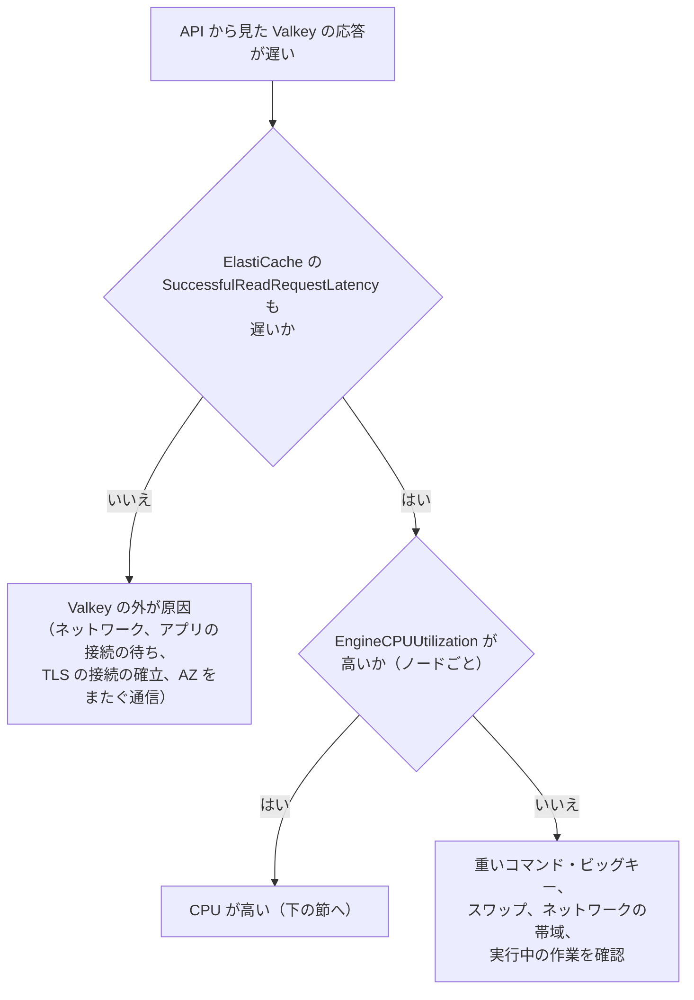

# 17. トラブルシューティング

> 前提: [14. ElastiCache の構成選定](14-elasticache-design.md)、[15. セキュリティ](15-security.md)、[16. 監視](16-monitoring.md)

## 要点

- 障害が起きてから調べ方を考えるのでは遅すぎます。**調査の手段（経路・ユーザー・使ってよいコマンド）を、事前に用意しておきます。**
- 日常の状態の確認は、手作業のコマンドを使わずに、ダッシュボードや状態確認のエンドポイントで見られるようにします。手作業の調査は、障害時の詳しい調査に限ります。
- 症状（遅い、メモリが足りない、接続できない、CPU が高い、データがおかしい）ごとに、**見る順番**を決めておきます。
- ElastiCache Serverless では、`SLOWLOG` や `MEMORY USAGE` など、調査用のコマンドの多くが使えません。メトリクスとアプリのログで調べる前提で準備します。
- **調査のための操作が、新しい障害を起こさないように**します。本番で `KEYS` や `MONITOR` は使いません。

## 調査の手段を事前に用意する

### 2段構え

| 段 | 用途 | 仕組み |
|---|---|---|
| ① 日常の状態の確認 | ポインタが指す世代、最後に作り直してからの時間、キーの数、エラーの数 | **手作業のコマンドを使わない。** ダッシュボード（16 章）や、社内向けの状態確認のエンドポイントで返す |
| ② 障害時の詳しい調査 | ビッグキーの特定、遅いコマンドの確認、クラスターの状態の確認 | 決められた経路から、読み取り専用の調査用ユーザーで `valkey-cli` を使う |

①で状態が見えていれば、多くの場合、②の手作業は不要になります。手作業は、それ自体が誤操作のきっかけになるので、少ないほど安全です。

### 障害時の調査の経路

ElastiCache は VPC の中にあるので、手元から直接は接続できません。次のような経路を、事前に用意しておきます。

| 経路 | 内容 |
|---|---|
| Systems Manager のセッションマネージャー | VPC の中の踏み台（EC2 など）を経由して、ポートフォワードで接続する。接続の記録が残る |
| アプリのコンテナへの接続 | アプリと同じネットワークから接続する（`valkey-cli` をイメージに含めておく必要がある） |

| 準備すること | 内容 |
|---|---|
| 調査用のユーザー | 読み取り専用で、危険なコマンドを禁止したユーザー（15 章の `ops-readonly`） |
| 手順書 | 接続の手順、使ってよいコマンド、使ってはいけないコマンド、症状ごとの調べ方（この章） |
| 練習 | 検証環境で、手順書どおりに接続して調べられるかを、定期的に試す |
| 記録 | 誰がいつ接続して何をしたかを残す |

### 調査に使うコマンド

| コマンド | 分かること | 負荷 | ノードベース | Serverless |
|---|---|---|---|---|
| `INFO [セクション]` | サーバーの状態（メモリ、接続、統計、レプリケーション、コマンドごとの統計など） | 軽い | 使える | 使える |
| `CLUSTER INFO` / `CLUSTER SHARDS` | クラスターの状態とシャードの構成 | 軽い | 使える | 使える（仮想的な1シャードとして見える） |
| `DBSIZE` | キーの数 | 軽い | 使える | 使える |
| `TYPE` / `TTL` / `HLEN` / `ZCARD` / `SCARD` / `STRLEN` | 1つのキーの型、期限、要素の数、大きさ | 軽い（O(1)） | 使える | 使える |
| `SLOWLOG GET [件数]` | 実行に時間がかかったコマンドの記録 | 軽い | 使える | **使えない** |
| `COMMANDLOG GET [件数] slow` など | 遅いコマンド、大きなリクエスト、大きな応答の記録（Valkey 8.1 以降） | 軽い | 使える | **使えない** |
| `LATENCY LATEST` | 遅延が発生したイベントの記録 | 軽い | 使える | **使えない** |
| `MEMORY USAGE key` | 1つのキーのメモリの使用量 | 軽い〜中程度 | 使える | **使えない** |
| `MEMORY STATS` | メモリの使用量の内訳 | 軽い | 使える | **使えない** |
| `CLIENT LIST` | 接続しているクライアントの一覧 | 接続が多いと中程度 | 使える | **使えない** |
| `OBJECT ENCODING key` | キーのエンコーディング（03 章） | 軽い | 使える | **使えない** |
| `valkey-cli --bigkeys` / `--memkeys` | 大きなキーの一覧（11 章） | **重い**（全キーを `SCAN` する） | レプリカで、アクセスの少ない時間帯に | `--memkeys` は使えない |

| 使ってはいけないコマンド | 理由 |
|---|---|
| `KEYS` | 全体を止める（02 章）。Serverless では使えない |
| `MONITOR` | すべてのコマンドを流し続けるため、負荷が大きい。Serverless では使えない |
| `HGETALL` / `SMEMBERS` / `ZRANGE 0 -1` などをビッグキーに | 全体を止める（03 章）。要素の数を先に `HLEN` などで確かめる |
| `FLUSHDB` / `FLUSHALL` / `DEL` などの書き込み | 調査では使わない。調査用のユーザーで禁止しておく（15 章） |

## 症状ごとの調べ方

### 応答が遅い

| 確認すること | 見るもの |
|---|---|
| Valkey の中が遅いのか、外が遅いのか | アプリで記録した応答時間（16 章）と、`SuccessfulReadRequestLatency` の比較 |
| 遅いコマンドがあるか | `SLOWLOG GET`、`COMMANDLOG GET`（ノードベース）。種類ごとのコマンドの遅延のメトリクス（`HashBasedCmdsLatency` など） |
| 大きな応答を返していないか | `COMMANDLOG GET … large-reply`（ノードベース）。アプリのログで、応答の大きさを記録しておく |
| 実行中の作業がないか | 全件ロード（09 章）、スナップショットの作成（`SaveInProgress`）、シャードの増減（13 章）、メンテナンス（18 章） |
| スワップが起きていないか | `SwapUsage`、`FreeableMemory` |
| ネットワークの帯域が足りているか | `NetworkBandwidth…AllowanceExceeded` |
| 性能の上限に達していないか | `TrafficManagementActive`（ノードベース）、`ThrottledCmds`（Serverless） |

### メモリが足りない

| 確認すること | 見るもの |
|---|---|
| 何が増えたのか | `DatabaseMemoryUsagePercentage` / `BytesUsedForCache` の推移と、`CurrItems`（キーの数）の推移を比べる。キーの数が変わらずにメモリが増えたなら、値が大きくなったか、バッファや断片化 |
| 古い世代が残っていないか | ポインタが指す世代以外の世代のキーが残っていないか（09 章）。`SCAN` で `catalog:v41:*` などを、少しずつ数える |
| 断片化 | `MemoryFragmentationRatio`、`AllocatorFragmentationRatio`（11 章） |
| バッファ | `INFO memory` / `INFO clients` で、クライアントへの応答のバッファの量。大きな応答や、遅いクライアントが原因のことがある |
| ビッグキー | `valkey-cli --bigkeys`（ノードベース、レプリカで） |
| エビクションが起きていないか | `Evictions`（11 章） |

### 接続できない・接続のエラーが多い

| 確認すること | 見るもの |
|---|---|
| アプリ側のプールの上限 | アプリのログの `MaxConnectionsError` など（08 章） |
| 接続の数 | `CurrConnections`、`NewConnections`、`RejectedConnections` |
| 接続を作り直しすぎていないか | `NewConnections` が多いなら、リクエストごとにクライアントを作っている可能性（08 章） |
| 認証 | `AuthenticationFailures`。IAM 認証なら `IamAuthenticationExpirations`（12 時間の寿命、15 章） |
| フェイルオーバー | ElastiCache のイベント（`FailoverComplete` など）。アプリのエラーの時刻と比べる（13 章） |
| ネットワーク | セキュリティグループ、ポート（Serverless のレプリカからの読み取りは 6380）、TLS の設定 |

### CPU が高い

| 状況 | 考えられる原因 | 確認すること |
|---|---|---|
| `EngineCPUUtilization` が高い | 重いコマンド（O(N)） | `INFO commandstats` の `usec_per_call`（1回あたりの時間）が大きいコマンド。`SLOWLOG` |
| `EngineCPUUtilization` が高い | 小さなコマンドが非常に多い | `INFO commandstats` の `calls`。パイプラインを使っていない処理がないか（06 章） |
| 特定のシャードだけ高い | ホットキー、ハッシュタグの偏り | ノードごとのメトリクスの比較（13 章・16 章） |
| `CPUUtilization` は高いが `EngineCPUUtilization` は低い | 通信の処理、TLS の接続の確立、バックアップ | `NewConnections`、`SaveInProgress` |

### データがおかしい（古い・欠けている）

| 確認すること | 見るもの |
|---|---|
| 作り直しが成功しているか | 最後に作り直しに成功してからの時間（16 章）。バッチのログ |
| ポインタが正しい世代を指しているか | ポインタのキー（09 章） |
| データが空になっていないか | `CurrItems` の急な減少、ポインタのキーの有無。フェイルオーバーやノードの置き換えのイベント（12 章） |
| 本体と索引がずれていないか | 参照先が見つからなかった件数（05 章）。特定の ID について、本体と索引の両方を確かめる |
| レプリカから古いデータを読んでいないか | レプリカから読む設定かどうか、`ReplicationLag`（13 章） |
| エビクションで消えていないか | `Evictions`（11 章） |

## Serverless での調べ方

Serverless では、調査用のコマンドの多くが使えません。代わりの手段を、事前に用意しておきます。

| 知りたいこと | ノードベースの手段 | Serverless での代わり |
|---|---|---|
| 遅いコマンド | `SLOWLOG`、`COMMANDLOG` | アプリで、コマンドごとの応答時間とキーのパターンを記録する |
| どの種類のコマンドが多いか | `INFO commandstats` | 種類ごとのコマンドの数と ECPU のメトリクス（`HashBasedCmds`、`HashBasedCmdsECPUs` など） |
| 大きなキー | `MEMORY USAGE`、`--memkeys` | キー設計書の上限をバッチで確かめる（05 章・11 章）。アプリで、応答の大きさを記録する |
| 接続しているクライアント | `CLIENT LIST` | アプリ側で、接続の数を記録する |
| 詳しい再現 | — | 同じデータを、ノードベースの検証環境に入れて再現する |

## 調査で新しい障害を起こさない

> **注意: 調査のつもりの操作で、本番を止める**
>
> - **何が起きるか**: 遅さの原因を調べるために `KEYS *` や `MONITOR` を実行したり、ビッグキーに `HGETALL` を実行したりして、本番がさらに遅くなる、または止まる。
> - **なぜ起きるか**: 調査用のコマンドにも、重いものがある。障害の最中は負荷が高いことが多く、影響がさらに大きくなる。
> - **どう防ぐか**: 使ってよいコマンドを手順書に書いておき、それ以外は使わない。危険なコマンドは、調査用のユーザーで禁止しておく（15 章）。要素の数を `HLEN` などで先に確かめてから読む。重い調査（`--bigkeys` など）は、レプリカで行う。

> **注意: 別の環境に接続したまま調べる**
>
> 本番のつもりで検証環境を調べて「問題なし」と判断したり、検証環境のつもりで本番に操作したりすることがあります。接続したら、まず `INFO server` や接続先のホスト名で、どの環境かを確かめます。

> **注意: 障害の最中に、設定を変える**
>
> 原因が分からないまま、パラメータの変更やノードの再起動を行うと、再起動でデータが失われたり（12 章）、原因の手がかりが消えたりします。設定の変更や再起動は、影響を確かめてから行います。

## まとめ

- 調査の手段（経路、読み取り専用のユーザー、使ってよいコマンド、手順書）は、事前に用意し、検証環境で練習しておきます。
- 日常の状態は、ダッシュボードや状態確認のエンドポイントで見られるようにし、手作業の調査は障害時に限ります。
- 症状ごとに、見る順番を決めておきます。「Valkey の中が遅いのか、外が遅いのか」から切り分けます。
- Serverless では調査用のコマンドの多くが使えないので、アプリのログ、種類ごとのコマンドのメトリクス、ノードベースの検証環境での再現で補います。
- 調査のための操作で新しい障害を起こさないよう、重いコマンドや書き込みは使わず、接続先の環境を必ず確かめます。
