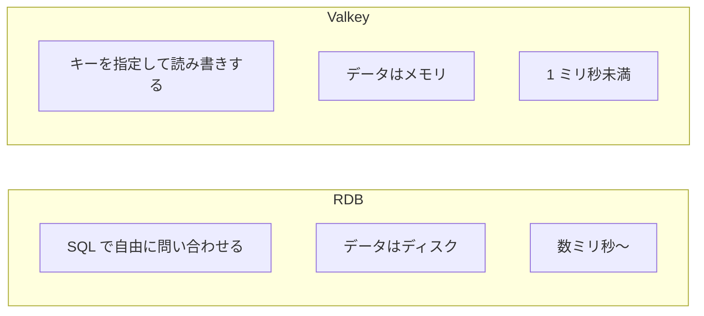
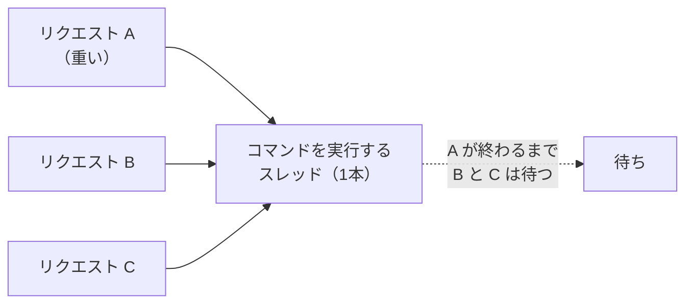
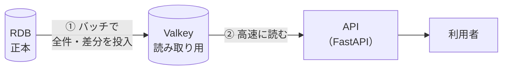
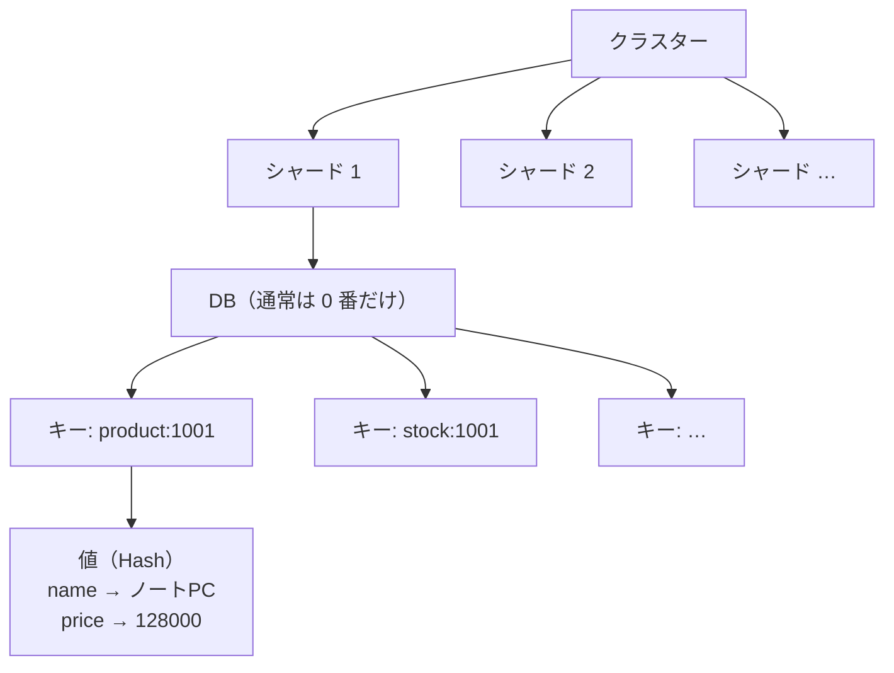
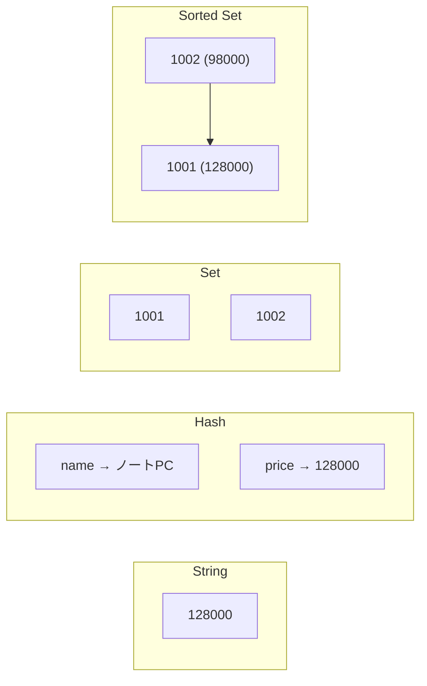
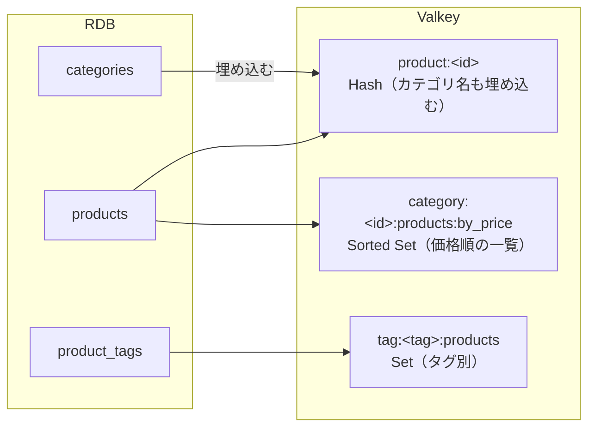
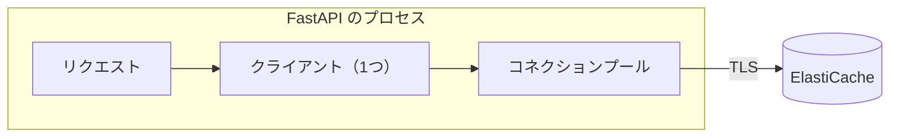
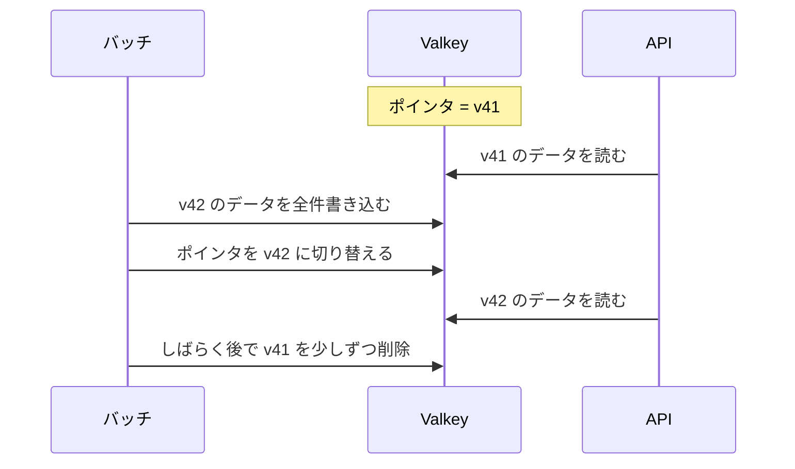
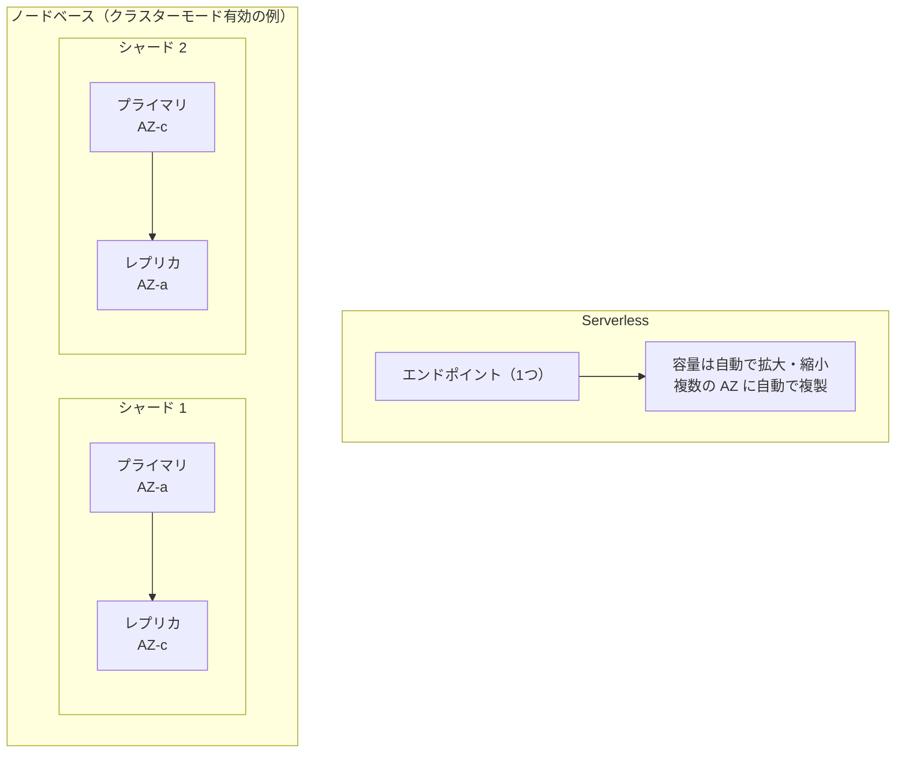
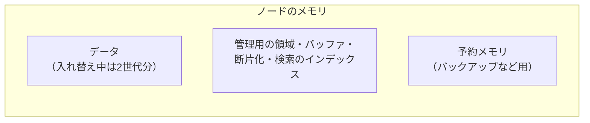

# 概要編

> 詳細編のダイジェストです。図を中心に、全体像をつかむためのものです。
> **30 分で読む場合は ★ の節だけ**、1 時間で読む場合は全体を読んでください。詳しくは、各節の末尾のリンク先（詳細編）を参照してください。

## ★ Valkey とは

Valkey は、データを**メモリ上**に置く**キーバリューストア**です。キー（名前）を指定して値を読み書きし、1回の操作が1ミリ秒未満で終わります。

- 自由な検索や、厳密な耐久性はありません。「**どう読むかが決まっているデータを、とにかく速く返す**」ための道具です。
- この資料では、正本を RDB に置き、そこからバッチで作り直せるデータを Valkey に載せて、API から高速に読む使い方を想定しています。
- Redis から分かれて生まれたソフトウェアで、Redis と互換性があります。この資料の対象は Valkey 9.1 です。
- コマンドは**1本のスレッドで1つずつ**実行されます。1つの重いコマンドが、ほかのすべてのリクエストを待たせます。

→ 詳しくは [01. Valkey とは](01-what-is-valkey.md)

## ★ RDB の感覚が通用しない点

RDB では当たり前のことの多くが、Valkey にはありません。設計・実装の前に知っておく必要があります。

| RDB での感覚 | Valkey の実際 |
|---|---|
| 列の型や制約で、データが守られる | 型の強制も制約もない。値はすべて文字列 |
| JOIN で結合でき、参照の整合性が守られる | JOIN も参照の整合性もない |
| 1つのクエリの結果は、一貫した状態 | 複数のキーを読むと、更新の途中の状態が見えることがある |
| コミットすれば、データは失われない | 書き込みが成功しても、故障で失われることがある |
| `SELECT … WHERE` で中身を調べられる | 条件を指定して調べる手段がほとんどない |
| ディスクが少なくなっても、すぐには止まらない | メモリが上限に達すると、書き込みが失敗するか、データが消される |
| 「空」と「存在しない」は区別できる | 要素が 0 個になったキーは消える |
| ALTER TABLE で構造を変えられる | データの形を変えるには、書き直すしかない |
| データベースやスキーマで、置き場所と影響範囲を分けられる | 階層も分離もない |
| 値がないことを NULL で表せる | NULL はない。フィールドを消して表す |

→ 詳しくは [01. Valkey とは](01-what-is-valkey.md) の「RDB の感覚が通用しない点」

## ★ データの層の構造

### システム全体の層

- データの正本は RDB です。Valkey のデータは、RDB からいつでも作り直せます。
- API は Valkey から読みます。Valkey に書き込むのは、基本的にバッチだけです。

### Valkey の中の層

| RDB | Valkey | 違い |
|---|---|---|
| パーティション | シャード | キー名から**自動で**振り分けられる |
| データベース | DB 番号 | 名前空間の区切りにすぎない。通常は 0 番だけを使う |
| スキーマ / テーブル | **ない** | キーは、階層のない1つの空間に並ぶ。キー名の `:` は見た目の区切りにすぎない |
| 行 | キー | |
| 列 | Hash のフィールドなど | |

→ 詳しくは [02. 基本操作とキー](02-basics-and-keys.md) の「データの階層」

## ★ データ型

値には「型」があり、型ごとに専用の操作があります。

| 型 | 中身 | 主な使い方（この資料の題材） |
|---|---|---|
| String | 1つの値 | JSON にしたオブジェクト、カウンター |
| Hash | フィールドと値の組（RDB の1行に近い） | 商品の詳細 |
| Set | 重複のない集合 | タグが付いた商品の ID |
| Sorted Set | スコアの順に並んだ集合 | 価格順の商品一覧、ページング |
| List / Stream | 入れた順の並び / 追記のログ | この資料の使い方では限定的 |

このほか、JSON の文書をそのまま扱う機能（valkey-json）と、条件を組み合わせて検索する機能（valkey-search）もあります。

→ 詳しくは [03. String と Hash](03-string-and-hash.md)、[04. Set・Sorted Set・List・Stream](04-set-zset-list-stream.md)、[07. JSON と検索](07-json-and-search.md)

## ★ 主な用語

| 用語 | 意味 |
|---|---|
| キー | 値を取り出すための名前 |
| シャード | データの一部を受け持つ単位。クラスターは複数のシャードでデータを分けて持つ |
| ハッシュスロット | キー名から計算される番号（0〜16383）。どのシャードに置くかを決める |
| プライマリ / レプリカ | 書き込みを受け付けるノード / その複製を持つノード |
| フェイルオーバー | プライマリが故障したときに、レプリカをプライマリに昇格させること |
| エビクション | メモリの上限に達したときに、キーを自動で消すこと |
| パイプライン | 複数のコマンドをまとめて送り、通信の往復を減らすこと |
| ビッグキー | 要素が多すぎる、または値が大きすぎるキー。全体を止める原因になる |
| ホットキー | アクセスが集中するキー。1つのシャードの限界を超えやすい |
| ElastiCache Serverless / ノードベース | 容量の管理が不要な構成 / ノードの種類と数を自分で決める構成 |

→ ほかの用語は [付録 D. 用語集](appendix-d-glossary.md)

## データの持ち方

Valkey の設計は、**API がどう読むか**から始めます。RDB のように、正規化してからクエリを考える順番ではありません。

- 読み方ごとに、1〜数回のコマンドで応答できるキーと型を決めます。**設計にない読み方は、後からはできません。**
- JOIN がないので、関連するデータはあらかじめ埋め込む（非正規化）か、ID で参照して別に読みます。
- 「カテゴリ別の一覧」のような索引（二次インデックス）は、自分で作り、自分で更新します。
- スキーマがないので、キーの一覧（キー設計書）を作って、スキーマの代わりにします。

→ 詳しくは [05. データモデリングとキー設計](05-data-modeling.md)

## アプリからの使い方

- クライアント（redis-py）は、アプリの起動時に1つ作って使い回します。
- 接続先がクラスターなら、**クラスター対応のクライアント**を使います。Valkey のクラスターは、送り先のシャードをクライアントが決める仕組みだからです。
- タイムアウトとリトライは必ず設定します。既定のままだと、Valkey の障害で1つのリクエストが1分前後待たされます。
- 複数のコマンドは、パイプラインでまとめて送ります。不可分にしたいときはトランザクションか Lua スクリプトを使いますが、**ロールバックはありません**。

→ 詳しくは [06. 複数コマンドの扱い](06-multi-command.md)、[08. FastAPI からの利用](08-fastapi.md)、[10. ローカル環境とテスト](10-local-and-testing.md)

## データの投入・入れ替え・削除

全件を入れ替えるときは、**新しいデータ一式を別のキーに作ってから、読む先を一度に切り替えます。**

- 上書きしていく方法では、更新の途中の状態が API から見えてしまいます。
- 入れ替えの間は、**2世代分のメモリ**が必要です。
- 書き込みはパイプラインでまとめて送り、削除は `UNLINK` で少しずつ行います。
- 差分の同期を使う場合も、定期的な全件の作り直しと組み合わせて、ずれを解消します。

→ 詳しくは [09. データの投入・入れ替え・削除](09-loading-swapping-deleting.md)

## ★ AWS での構成

ElastiCache for Valkey には、2つの構成があります。

| 観点 | Serverless | ノードベース |
|---|---|---|
| 容量の管理 | 不要 | ノードの種類と数を自分で決める |
| 設定の変更 | できない | できる |
| 調査用のコマンド | 多くが使えない | ほぼ使える |
| 課金 | データ量＋リクエストの量（ECPU） | ノードの時間（長期の契約で割引） |
| 向いている場面 | トラフィックが読めない。まず始めたい。運用の手間を減らしたい | トラフィックが安定している。細かく制御・調査したい |

- どちらの構成でも、データはシャードに分けて持ち、レプリカに複製します。複製は**非同期**なので、故障したときに直前の書き込みが失われることがあります。
- 構成は AWS CDK で定義します。暗号化など、作った後で変えにくい設定は最初に決めます。

→ 詳しくは [13. レプリケーションとクラスター](13-replication-and-cluster.md)、[14. ElastiCache の構成選定](14-elasticache-design.md)、[15. セキュリティ](15-security.md)

## メモリと永続化

- メモリの使用量は、データそのものより大きくなります。実際のデータで測って見積もります。
- メモリの上限に達したときに、**データが黙って消える設定（キャッシュ向けの設定）は使いません**。書き込みが失敗して気づけるほうが安全です。
- バックアップは取れますが、復元すると新しいクラスターになり、接続先が変わります。
- **本番のプライマリを手動で再起動すると、レプリカがあってもデータが消えます。**
- この資料の使い方では、故障に備えてレプリカを置き、データを失ったときはバッチで作り直すのが基本です。

→ 詳しくは [11. メモリ管理とエビクション](11-memory.md)、[12. 永続化・バックアップ・復旧](12-persistence-and-backup.md)

## 運用

| 領域 | 要点 | 詳しく |
|---|---|---|
| 監視 | CPU は、コマンドを実行するスレッドの使用率（`EngineCPUUtilization`）で見る。メモリのしきい値は、入れ替えの2世代分から逆算する。バッチが止まっていないか（データの鮮度）も監視する | [16 章](16-monitoring.md) |
| 調査 | 調査の経路・読み取り専用のユーザー・手順書を、事前に用意する。調査のための操作で本番を止めない | [17 章](17-troubleshooting.md) |
| セキュリティ | 用途ごとにユーザーを分け、危険なコマンド（全削除など）を禁止する | [15 章](15-security.md) |
| メンテナンス | 週1回のメンテナンスウィンドウを、アクセスの少ない時間帯に設定する。バージョンアップは元に戻せないので、検証環境で先に試す | [18 章](18-upgrade-and-maintenance.md) |

## よくある落とし穴

障害や不具合の多くは、次の2つから来ています。

1. **RDB の感覚のまま使うこと**（「RDB の感覚が通用しない点」の節）
2. **1本のスレッドでコマンドを実行する仕組み**（重いコマンドが全体を止める）

影響が大きい（データが消える、全体が止まる、気づけないまま続く）パターンは、主に次の領域にあります。

| 領域 | 例 |
|---|---|
| 重いコマンド | 本番での `KEYS`、ビッグキーの作成と一括の読み取り、長い Lua スクリプト、大量の `DEL` |
| データの消失・誤り | プライマリの手動の再起動、キャッシュ向けのエビクションの設定、上書きでの全件の入れ替え、本体と索引のずれ |
| 容量 | 入れ替えの2世代分を見込まない見積もり、平均のリクエストの量でのサイジング、ホットキー |
| アプリの作り | リクエストごとのクライアントの作成、既定値のままのタイムアウト、ヘルスチェックへの Valkey の状態の組み込み |
| 運用 | 作り直しのバッチの成否を監視しない、全員が全権限のユーザー、検証なしのバージョンアップ |

→ 影響が大きいパターンの一覧は [19. アンチパターン・障害パターン集](19-antipatterns.md) の「影響が大きいもの」
